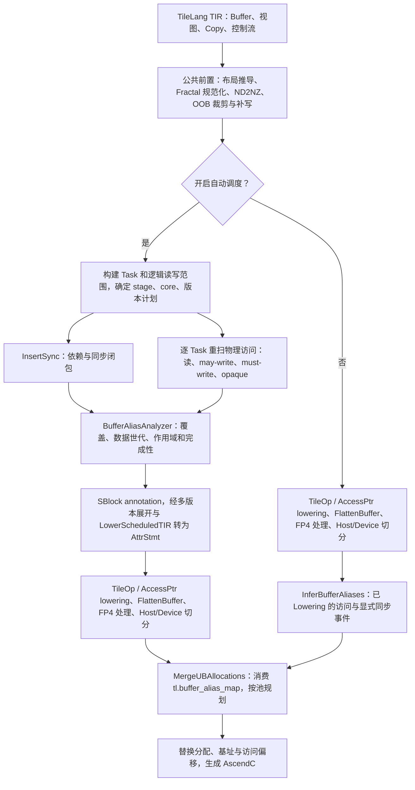
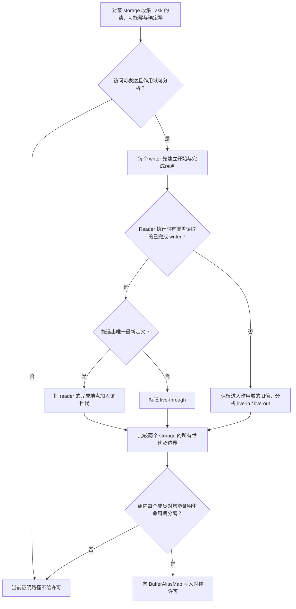

# TileLang AscendC Buffer 访问范围分析与复用决策

| 项目 | 内容 |
| --- | --- |
| 所属特性 | 7.5 物理存储规划、容量与复用 |
| 主线 | **7.5.02 Buffer 实际读写范围分析**、**7.5.03 Buffer 复用条件与生命周期检查** |
| 下游接口 | **7.5.04 片上 Buffer 合并分配与 AIV 私有 UB 地址规划**，本文追踪到许可消费、偏移与 IR 改写 |
| 源码基线 | `test_memory`，`74a53f4c89c462cb7370e1cd69977631aefc09d4`，范围为 AscendC（`target="ascend"`） |
| 规格与证据 | 沿用项目主表和规格补充表的编号、定义和测试映射。本文结论来自该基线源码及现有测试断言，测试结果待用户运行录入。 [主表](../../memory_management_layout_features.csv) · [规格补充表 406–457 行](../../memory_management_layout_features.specs.csv#L406) |

## 1. 功能与设计动机

7.5.02 为片上访问建立可供分析的范围。读和可能写范围用于保留潜在访问，确定写入范围用于证明某次读取所需的位置已经被新定义覆盖。7.5.03 利用覆盖、控制条件与完成顺序建立生命周期，判断两个独立存储是否可以共用地址。7.5.04 接收逐对许可，在同一物理池内选择共址组并为访问加上分配偏移。共址以后，两份逻辑数据仍有各自的定义与使用，某一时刻可继续被使用的数据必须保有其物理内容。

单靠源码位置难以满足要求。一个 GM→UB DMA 已经发射时，同一条 PIPE 上后续 DMA 仍可能覆盖上一条操作正在使用的存储。即使看到覆盖整个逻辑矩形的写描述，也可能有 mask、stride 间隙、条件分支、循环提前退出，或者只是通过指针声明了可写范围。相反，有些物理写会补齐到 DMA 行边界，从而真正覆盖逻辑请求以外的元素。复用分析因此同时回答两个问题：**旧值还要保留多久**，以及 **旧访问何时完成**。

设置 `tl.disable_shared_memory_reuse=True` 后，生产流水仍生成分配所需的契约，自动路径仍安排同步，普通同池分配走独立区间规划。最终可以看到一个合并的字节 Buffer，原逻辑 Buffer 各用不同区间。AIV0/AIV1 私有 UB 即使关闭生命周期复用也可以使用相同数字偏移，因为地址空间独立。容量收益应比较同一物理池的最终 arena 大小，arena 指承载多份逻辑分配的一块连续存储。 [开关读取](../../tilelang/ascend/pipeline.py#L53) · [同步与空契约](../../src/ascend/transform/insert_sync.cc#L899) · [分池规划](../../src/ascend/transform/merge_ub_allocations.cc#L610)

| 相邻特性 | 本文使用的接口 |
| --- | --- |
| 7.1.04 带 stride 的 Buffer、指针重建与零拷贝视图 | 视图可共用 `Buffer.data`，生命周期以同一物理存储归集，覆盖仍须在可比较的视图坐标中证明。 |
| 7.2 布局表达、推导与地址映射、7.4 访问合法化与初始化 | 使用已经规范化的布局和搬运语义。GM↔UB 的常规 Copy 与 GM→L1 的裁剪、补写分别按各自语义分析，早期 `VerifyBufferInit` 独立执行。 |
| 7.5.01 自动多缓冲的片上容量预算 | 自动调度先使用尺寸和版本数约束预算，晚期物理分配才体现生命周期复用的收益。 |
| 7.5.05 片上 Buffer 固定地址与容量检查 | 带指定地址的池走预留区间和容量检查，绕过生命周期共址分组。 |
| 7.6 多版本存储管理 | 版本所有者、槽数、逻辑迭代时钟和计数器模式是生命周期分析的输入，多版本物理展开由其他 Pass 负责。 |

## 2. 编译流水与数据契约



生产入口默认开启自动调度。前端阶段的 `LegalizeSimdMerging` 将保留未激活 lane 的目的操作显式化为读改写，`InsertNd2Nz` 把相关 UB→L1 搬运改写成 scatter 和 post-copy，`AscendInsertOOBPadding` 在调度前裁剪 DMA 尾块并把 GM→L1 padding 暴露为语义填充。分析看到的是这些 Pass 处理后的访问。自动路径在 `PrepareMultiBuffer → ResolveCore → InsertSync → MaterializeMultiBuffer → LowerScheduledTIR` 中先判决后展开。手工路径在 `SplitHostDevice` 后、合并前运行 `InferBufferAliases`。 `MergeUBAllocations` 之后的 flag 重写与 thread sync 是后续环节。 [排程前规范化](../../tilelang/ascend/pipeline.py#L73) · [自动调度段](../../tilelang/ascend/pipeline.py#L113) · [访问展平与合并](../../tilelang/ascend/pipeline.py#L141)

| 数据 | 表达与生产者 | 消费点 |
| --- | --- | --- |
| 逻辑依赖输入 | `TaskNode.read_regions/write_regions`、上下文约束、core/stage、L0 pitch，由 scheduled TIR 解码时调用 `AnalyzeTaskAccesses(kLogical)` 取得。 | `AnalyzeDependencies` 为调度和同步建立可能冲突。 |
| 物理覆盖输入 | `PhysicalTaskAccesses` 逐 Task 重扫，包含读、可能写、确定写、裸 Var 与 opaque；`StorageAccessInfo` 按 `data` Var 聚合，内层 region 保留原 Buffer 对象。 | `BuildGenerations` 和组级生命周期比较。 |
| 同步证明输入 | `SyncInsertionSite` 区分 task 开始/结束、core、PIPE、作用域与 epoch domain（迭代时钟域），`DepClosure` 与 `IterationOrder` 回答完成先后与最小迭代距离。 | `BufferAliasAnalysisContext`。 |
| 手工同步输入 | `LinearEvent` 记录 storage、执行 PIPE/core、同步 ID、For/If 标记，经实例化建成可达图。 | `BufferReuseAnalysis` 对整块分配比较所有访问事件。 |
| 复用输出 | `BufferAliasMap = Map<Var, Array<Var>>`，无自边、对称。它表示两个独立 storage **可以**共址，缺边按冲突处理，边不传递。 | `BufferAliasContractExtractor` 取出许可，allocator 在池内选组。 |
| 物理结果 | `MemoryPlan` 的 `byte_offsets[data]` 与 `total_size`，结合 `tl.aiv_storage_map` 和固定地址契约。 | `SharedMemoryRewriter` 改写平坦访问。 |

证据入口见 [Task 访问收集](../../src/ascend/transform/auto_schedule/scheduled_tir.cc#L296)、[逻辑模式](../../src/ascend/transform/auto_schedule/task_analysis.h#L401)、[物理重扫](../../src/ascend/transform/auto_schedule/buffer_alias_analysis.h#L94)、[完成查询接口](../../src/ascend/transform/auto_schedule/buffer_alias_analysis.h#L64)、[手工事件](../../src/ascend/transform/infer_buffer_aliases.cc#L93)、[许可契约](../../src/ascend/transform/buffer_alias.h#L43) 和 [MemoryPlan](../../src/ascend/transform/merge_ub_common.h#L52)。

## 3. L3 7.5.02 Buffer 实际读写范围分析

### 3.1 逻辑访问、可能冲突与物理覆盖

`BufferRegion` 由 Buffer 对象和各轴半开区间 `[min, min + extent)` 组成。普通 Load/Store、带访问类型的 `tl.region`、Copy 和部分专用 intrinsic 提供范围输入。分析器展开可见的 let 绑定，把 Task 内循环变量映射到 `IntSet`，用 `RelaxAccessIndex` 求起始与终点的包络。可能读写分别按同一 Buffer 对象逐轴取并集，区间包络可以包含空洞。无界集合的 `CoverRange` 可回落到视图维度范围。 [区间收集](../../src/ascend/transform/auto_schedule/memory_detector.h#L231) · [放宽索引与循环域](../../src/ascend/transform/auto_schedule/memory_detector.h#L631) · [tl.region 解码](../../src/ascend/transform/auto_schedule/memory_detector.h#L1201)

- **逻辑依赖链。** `AnalyzeTaskAccesses` 生成 Task 区域。`AnalyzeDependencies` 比较写→读（RAW）、读→写（WAR）、写→写（WAW），结合 stage、迭代偏移和约束。`RegionsMayConflict` 默认以 storage identity 区分分配。同 storage 的不同 Buffer 视图保守地判可能冲突，同视图可尝试证明任一轴不相交。L0 操作 pitch、版本归属以及冲突提示还有专门分支。`InsertSync` 消费这些依赖，产生可由后续复用判决使用的完成路径。 [依赖区域比较](../../src/ascend/transform/auto_schedule/dependency_analysis.cc#L119) · [依赖枚举](../../src/ascend/transform/auto_schedule/dependency_analysis.cc#L397) · [同步依赖入口](../../src/ascend/transform/insert_sync.cc#L1350)
- **物理覆盖链。** `AnalyzePhysicalTaskAccesses` 新建 `kPhysical` detector，重扫当前 Task、外层 guard 表达式，必要时独立扫描循环最小值、范围和步长。它从 TIR 的 Buffer、stride、操作描述和专用规则提取 footprint（访问所涉及的位置集合或保守包络）。这里 `BufferRegion` 仍可用原 Buffer 的坐标表达，判决期间没有统一的 byte-interval 图。Opaque 通过独立集合携带，能阻止同 Task 中的结构化访问掩盖未知访问。 [物理收集](../../src/ascend/transform/auto_schedule/buffer_alias_analysis.h#L103) · [按 storage 归集和标记 opaque](../../src/ascend/transform/auto_schedule/buffer_alias_analysis.h#L322)

例如 in-place 累加读取旧目的值。`reduce(clear=False)` 在物理模式显式追加目的 read；该 Task 的自身写入无法证明其自身输入已经被写新。这会延长旧世代，即使语法里目的参数被编码为 `w`。 [reduce 物理读改写](../../src/ascend/transform/auto_schedule/memory_detector.h#L1298) · [跨 Task 写定义条件](../../src/ascend/transform/auto_schedule/buffer_alias_analysis.h#L1045)

### 3.2 何时能证明确定写入

**May-write** 回答哪里可能被改动。**Must-write** 回答 Task 执行时哪里一定被写到，可据此结束相关旧值的活跃期。物理模式下，`UpdateWrite` 始终累积 may-write，仅在无内部条件、写必执行且 `IsDenseWriteRegion` 成功时单独收集 must-write。内部 `IfThenElse`、`While` 中的写没有这项保证；Store predicate 需要能证明为真的标量；含 `loop_break` 的 Task 清掉整份 must-write 结果。 [确定写入口与证明](../../src/ascend/transform/auto_schedule/memory_detector.h#L304) · [条件与 predicate](../../src/ascend/transform/auto_schedule/memory_detector.h#L659) · [提前退出](../../src/ascend/transform/auto_schedule/memory_detector.h#L172)

`IsDenseWriteRegion` 的核心是证明迭代空间确实填满包络。首先要求各轴有界，排除非单位步长和不能证明非空的循环，循环域也不能依赖活跃迭代变量。为每个 write extent 添加一个偏移迭代器，令实际坐标为 `min + offset`。然后对全部坐标调用 `DetectIterMap(..., Surjective)`，检查无 padding predicate、逐轴能化成单个单位比例（允许 ±1）的 split 或单点，且求得的精确端点与放宽后的包络一致。最后一步防止把运行时索引的多个可能取值当作一次写入的全部位置。

| 示例 | 包络与覆盖结论 |
| --- | --- |
| `for i in range(4): a[i] = v` | `[0,4)` 可被证明密集覆盖，可结束该范围内的旧值。 |
| `a[2*i]`，`i∈[0,4)` | 包络为 `[0,7)`，只写 0、2、4、6。旧位置 1 仍可能被读。 |
| `a[i,i]` | 两轴包络均为 `[0,4)`，实际写点只在对角线上。 |
| `a[index[0] % 8] = v` | 即使索引可能落在 `[0,8)`，一次执行只写一个位置。覆盖判断还要处理后续读取时 `index[0]` 可能已经改变。 |

覆盖读取时，`DenseRegionsCover` 只接受与读 **同一个 Buffer 对象**的确定写区域，读和每段写各自对可变 Load 建独立快照。文本相同的 `index[0]` 可能来自不同的动态值。区域先尝试包含消去，或在其余轴完全相同、唯一不同轴重叠或相邻时合并；反复合并后需要有矩形能逐轴包含读范围。同一个 Task 的 `[0,4)` 和 `[4,8)` 可合成 `[0,8)`；`[0,4)` 加 `[5,8)` 不能通过这项覆盖。候选 writer 按 Task 枚举，两个不同 Task 各填一半时，目前没有跨 Task 联合定义证明。 [密集合并与快照](../../src/ascend/transform/auto_schedule/buffer_alias_analysis.h#L193) · [逐轴包含条件](../../src/ascend/transform/auto_schedule/ir_structure.h#L113) · [writer 候选粒度](../../src/ascend/transform/auto_schedule/buffer_alias_analysis.h#L890)

### 3.3 Padding、stride 与特殊布局

`ExpandPaddedCopyWriteRegion` 针对 `data_select != 0` 的 GM→UB Copy。先规范化单位轴并 coalesce 源、目标 stride 布局（合并可连成一行的相邻维），沿用 `PlanMTECopy` 的物理行选择原则。检查元素 bit 宽相同、两侧元素总数可证相等、coalesce 后各为一或二维且二维行边界可比较。选用具有二维模式的一侧提供的行长（两侧都是一维时用目标行长）。要求正、常量、按字节表达且满足打包限制的行长。用 `row_bits = row_elems × bits_per_element`，按 256 bits（32 B）向上取整。扩展只能沿末轴 stride=1、逻辑末轴范围 extent 与 DMA 行长相同的视图精确表达；否则标记 storage opaque。若可证补齐超出目标视图末轴，也标 opaque。分析阶段仍允许继续建同步关系，访问是否合法由相应 lowering 和校验决定。 [DMA 行补齐实现](../../src/ascend/transform/auto_schedule/memory_detector.h#L490) · [DMA lowering 几何](../../src/ascend/op/ascend_mte_plan.h#L359)

同一套“先恢复操作语义，再决定是否可用于覆盖”的策略有几处分支。

- **GM→L1。** 使用真实源几何校验目的区域。要求最后两维匹配（考虑 transpose）、更高维 extent 为 1；不满足时保留 may-write，撤销该 Copy 新产生的 must-write。前置 OOB Pass 发出的独立填充仍作为自己的操作分析。 [Copy 物理特化](../../src/ascend/transform/auto_schedule/memory_detector.h#L1171)
- **L0 compact/pitch。** 部分 L0 读写只知道所选 plane，末两轴保留宽泛的 may-access 并标 opaque。Copy 的 L0 特殊分支单独处理各操作数，compact L0 源可使该 L0 storage 退出复用，接收数据的 UB 仍可有可证明的写覆盖。 [L0 may-access](../../src/ascend/transform/auto_schedule/memory_detector.h#L468) · [按操作数判断 compact](../../src/ascend/transform/auto_schedule/memory_detector.h#L1126) · [对应回归](../../testing/ascend/auto_schedule/test_access_footprints.py#L896)
- **ND2NZ。** `VisitNd2NzCall` 按行列、重复次数、pitch 与对齐方式核对真实搬运跨度。`VisitPhysicalPointer` 需要指针声明范围覆盖该跨度，并包含应有的读写 mask。`nd2nz_logical_regions` 可为 NZ 列切片提供从物理块回到视图矩形的依据，防止把含行间隙的物理 span 当成连续 row-major 逻辑区间。相关指针写仍作 may-write。 [描述与跨度核对](../../src/ascend/transform/auto_schedule/memory_detector.h#L774) · [NZ 区域及 ND2NZ 分派](../../src/ascend/transform/auto_schedule/memory_detector.h#L813)

### 3.4 指针与同源视图

`tl.access_ptr(BufferLoad, extent, rw_mask)` 的 extent 描述从起点起的一段连续物理元素。对隐式连续的多维视图，`PointerRegion` 尝试从内轴向外轴传播进位。跨行时，读的矩形包络覆盖该内轴，进位若超出最外逻辑轴则回落到整视图、同时标 opaque。物理模式对显式 stride 多元素访问保守，即使逻辑模式能证明是 dense；单元素还有独立可表达分支。指针写来自访问契约，可能受 predication 或 intrinsic 寻址影响，因此只作为 may-write。 [指针区域恢复](../../src/ascend/transform/auto_schedule/memory_detector.h#L930) · [读写掩码](../../src/ascend/transform/auto_schedule/memory_detector.h#L1351)

裸 storage Var、`address_of`、已经 Lowering 的 `tvm_access_ptr` 在这套物理 detector 中无法由当前表达恢复可靠范围。把 pointer 放入 handle、经不透明返回值传播，以及 gather/scatter 等有额外索引的调用，也会触发保守处理。读写访问中若 shape、stride 或 elem_offset 本身读取可变存储，detector 会记录元数据的读取并标记视图的 storage opaque。隐式读元数据同样影响其自身生命周期。 [动态布局元数据](../../src/ascend/transform/auto_schedule/memory_detector.h#L231) · [间接 SIMD 访存](../../src/ascend/transform/auto_schedule/memory_detector.h#L1094) · [指针逃逸](../../src/ascend/transform/auto_schedule/memory_detector.h#L1325)

当前实现允许 Buffer 的访问坐标包含稳定符号。稳定符号与动态存储 Load 的区别在于跨 Task 是否还能证明同一个值。可证明的同视图区间允许建立覆盖；不能恢复 byte footprint 的场景退回保守的 liveness 结论。持有同一 `data` 的多个视图天然共享一份 storage；`tl.buffer_alias_map` 则连接两个独立 storage。两种关系在测试与诊断里应分别确认。 [storage 归集](../../src/ascend/transform/auto_schedule/buffer_alias_analysis.h#L344) · [同视图过滤](../../src/ascend/transform/auto_schedule/buffer_alias_analysis.h#L249)

## 4. L3 7.5.03 Buffer 复用条件与生命周期检查

### 4.1 自动调度路径的完成证明

`InsertKernelSync` 解码 Task 树与 core/stage，读取多缓冲计划，建立 L0 数据与 SF 的 storage 组。 `SyncAnalyzer::Analyze` 先构建站点和世代通道，再对控制作用域递归建立依赖闭包，最后才运行 `BufferAliasAnalyzer::Collect/Analyze`。完成查询根据 storage 的时钟域解析 Task 首尾端点，每个参与的 core 都有端点。对于跨 core 的数据使用，只看到其中一个访问完成不足以释放池内地址。 [组、时钟域与契约产生](../../src/ascend/transform/insert_sync.cc#L3255) · [同步分析顺序](../../src/ascend/transform/insert_sync.cc#L899) · [解析端点](../../src/ascend/transform/insert_sync.cc#L964)

同迭代的查询接受含严格完成边的可达路径，也接受在同 core、同 PIPE 且属于 S、V、M 时由实现承认的隐式完成顺序。MTE、FIX 等仅靠发射序无法满足。严格路径可通过真实 set/wait 等同步，再与其前后的弱顺序组合。必要时还会匹配物理站点并证明相应 active guard 的蕴含关系。跨迭代查询使用兼容的时钟域，要求作用域匹配、排除 counter domain 和依赖当前迭代变量的 active guard；能证明时以最小迭代距离回答。负距离查询失败。 [隐式 PIPE 列表](../../src/ascend/transform/insert_sync.cc#L783) · [完成查询及 guard](../../src/ascend/transform/insert_sync.cc#L1020) · [构造跨迭代顺序](../../src/ascend/transform/insert_sync.cc#L1580)

### 4.2 从访问关联到数据世代

这里的数据世代指一次 Task 写出的值以及由该值服务的读取。每个有 may-write 的 Task 先产生一段世代，起点是该 writer 的开始端点，初始终点是 writer 的完成端点。即使该写无法保证覆盖下游读取，它本身仍可能修改存储。对同迭代的每个 reader，`BuildGenerations` 只接受同时满足以下条件的 writer。 [世代初始化](../../src/ascend/transform/auto_schedule/buffer_alias_analysis.h#L899) · [reader 归因](../../src/ascend/transform/auto_schedule/buffer_alias_analysis.h#L1033)

```cpp
// src/ascend/transform/auto_schedule/buffer_alias_analysis.h:1050
if (!ProveGuardImplication(conditions[reader_index].conditions,
                           conditions[access_index].conditions,
                           analysis_scope))
  continue;
if (writer.task != reader.task && covers(writer, reader) &&
    AllHappenBefore(writer_ends[writer_index], read_begins, 0,
                    happens_before)) {
  candidates.push_back({writer_index, 0});
  continue;
}
```

1. **Reader guard 蕴含 writer guard。** 例如 reader 在 `p && q` 下执行，writer 在 `p` 下执行，reader 执行时 writer 有机会定义它。把两个 guard 对换，就存在 reader 执行而 writer 跳过的路径。内部条件可能已在 7.5.02 被过滤，外部调度 guard 在此独立求证。分析使用算术分析器和限额下的 Z3。 [guard 证明](../../src/ascend/transform/auto_schedule/buffer_alias_analysis.h#L767)
2. **确定写覆盖该 reader 的每个读区域。** 整个读取由一个可证明的 writer Task 定义。同 Task 的读改写需要进入该 Task 时仍能访问旧值。
3. **Writer 的所有完成端点先于 reader 的所有开始端点。** 后续用 reader 的完成端点延长世代，DMA 发射后、完成前仍占用存储。

多个候选存在时，要求有唯一的最新定义，其开始在其他所有候选完成之后。候选不可排序或无法唯一选择，直接标记 `live_through`。没有候选意味着读取依赖进入作用域前可用的值。循环中这种值可能被下一次迭代用到，按跨整个作用域保留处理；根作用域若能证明后续稳定且完成有序的覆盖，可以保留一个截止于最后相关读完成的 live-in 前缀。对循环之后仍读取的值，则检查循环是否必执行、不会提前退出、且有 guard 和覆盖可靠的内部写，必要时形成 live-out 后缀或 live-through。只读的预装载存储也须纳入。 [最新定义与未归因读取](../../src/ascend/transform/auto_schedule/buffer_alias_analysis.h#L1091) · [作用域边界](../../src/ascend/transform/auto_schedule/buffer_alias_analysis.h#L1135)



### 4.3 迭代时钟、嵌套作用域与 SF

- **跨迭代读的归因。** `(site, offset)` 代表相对世代迭代的事件。普通、显式 ring、隐式版本维有不同的周期来源。跨迭代候选先证明读与 must-write 区域在周期位移后不变，并检查 guard、绑定和地址参数的迭代稳定性。用完成路径取得距离下界，再按版本同余类取不小于下界的最近候选，将 writer 区域按循环步长平移后重做覆盖。隐式版本槽只看同一槽对应的余数 0。若 reader 读取的是距离 `d` 的旧世代，就把其完成端点记入该旧世代的 `+d`。 [周期来源](../../src/ascend/transform/insert_sync.cc#L1001) · [周期证明与候选](../../src/ascend/transform/auto_schedule/buffer_alias_analysis.h#L956)
- **周期性复用判据。** `CanSeparatePeriodicLifetimes` 为方向 A→B 求最小平移量 `forward`，为 B→A 求 `reverse`。对每对端点，要求平移量至少为 `end.offset - begin.offset + 最小完成距离`，取最大值。存在切点 `q`，使 A(k) 完成后才能开始 B(k+q)，且 B(k+q−1) 已在 A(k) 开始前完成，等价于两方向都有下界且 `forward + reverse <= 1`。例如一轮内完成 A 再执行 B，B 完成以后才开始下一轮 A，可得到 0+1，允许共址。若 B 在本轮已启动但 A 还活跃，最早可证的相互结束→开始都需延迟一轮，1+1 无法通过。比较覆盖整块环形分配的所有世代组合。 [公式与端点检查](../../src/ascend/transform/auto_schedule/buffer_lifetime_analysis.h#L138) · [guard 与周期比较](../../src/ascend/transform/auto_schedule/buffer_lifetime_analysis.h#L252)
- **分支互斥。** 非周期作用域中能证明两个世代的 guards 互斥时，可以跳过该对时间比较。周期场景还要求 guard 不随迭代变动，因为两种分支可以在相邻世代同时占用存储。同一迭代中 `i % 2 == 0` 和其否定互斥，仍可能出现偶数轮的 DMA 未完成、奇数轮已发射。 [互斥判据](../../src/ascend/transform/auto_schedule/buffer_lifetime_analysis.h#L253)
- **嵌套作用域。** 自底向上缓存每个子 scope 的 `LifetimeSummary`。可证单次执行的子循环可直接映射端点。其他子循环需要把整体入口、出口及有限前缀、后缀提升到父级，证明循环非空且正步长，保持 guard，避免把内部跨迭代偏移当成外层偏移。同一子循环的两个总结由子级比较；复合兄弟循环仅在能分组件证明时继续。父级若见 `live_through`、缺少边界端点或迭代边界上两者重叠，则拒绝对应证明。 [单次判断](../../src/ascend/transform/auto_schedule/buffer_alias_analysis.h#L293) · [自底向上与边界比较](../../src/ascend/transform/auto_schedule/buffer_alias_analysis.h#L436) · [摘要提升和组合](../../src/ascend/transform/auto_schedule/buffer_alias_analysis.h#L1251)
- **计数器与绑定 SF。** `write_counter` 由完成写推进，可能跳过某些常规迭代。当前实现只在根作用域建整分配生命周期，要求非 opaque 且每个 writer 的 must-write 覆盖各 reader；随后以全部访问开始和完成端点比较。L0 数据地址和绑定 SF 要作为组比较，组间所有成员对都要有可比较且相容的生命周期，任一缺失或 SF 仍活跃均会阻断该对许可。SS 被排除于自动路径的生命周期复用。 [整分配分支](../../src/ascend/transform/auto_schedule/buffer_alias_analysis.h#L500) · [组兼容检查](../../src/ascend/transform/auto_schedule/buffer_alias_analysis.h#L462) · [SF 绑定入口](../../src/ascend/transform/insert_sync.cc#L3255)

### 4.4 关闭自动调度时的手工同步路径

`InferBufferAliases` 接收 Lowering 之后的模块，以池为单位收集分配。 `SyncAwareLinearizer` 将 Load/Store、裸 Var 与 `tvm_access_ptr` 转为存储访问事件，识别 `ascend_set_flag/wait_flag`、pipe barrier 和 cross-core flag，同时记录 For/If 等控制标记。它使用操作及操作数的 PIPE 归属，例如复合 GEMM 的输入和结果可能在不同 PIPE 上。 `tvm_access_ptr` 按 `rw_mask` 判访问类型，未知或零 mask 按读保留。 **事件结构记录 storage 和访问类型，在这条路径上没有区域覆盖或世代切分。** [线性化及 PIPE 分派](../../src/ascend/transform/infer_buffer_aliases.cc#L145) · [指针与显式同步](../../src/ascend/transform/infer_buffer_aliases.cc#L314) · [操作数 PIPE 表](../../src/ascend/transform/ascend_pipe.h#L335)

1. 连续访问事件在相同 core/PIPE 内按 storage 合并，遇到同步和控制标记切段。 `BuildLoopUnrollPlan` 选择实例化的迭代，包含带 `enable_offset` 的阶段 guard、周期与头尾样本。该模型对多迭代循环保留 loop ID，并在最终比较中阻止两个共同驻留于该循环的 storage 共址。 [合并与循环建模](../../src/ascend/transform/infer_buffer_aliases.cc#L467) · [选取迭代实例](../../src/ascend/transform/infer_buffer_aliases.cc#L750) · [继承 loop ID](../../src/ascend/transform/infer_buffer_aliases.cc#L1091)
2. 构建 happens-before（一定先于）图。同一迭代、同 core、同 PIPE 内连接前方 acquire 到访问、访问到后方 release，并连接同步节点。代码有意省略直接访问→访问边。set/wait 按可求值的 ID 等键匹配，孤立 wait 缺少 release 来源。cross-core 按 mode、ID 和两侧事件位置配对，且接入图时使用各端点自己的 PIPE。`PIPE_ALL` 覆盖当前核各 PIPE，局部 barrier 只覆盖本 PIPE。循环实例间还存在同 core 的结构边。最后求传递闭包。 [建图](../../src/ascend/transform/infer_buffer_aliases.cc#L1224) · [连接 release/acquire](../../src/ascend/transform/infer_buffer_aliases.cc#L1317) · [flag 匹配](../../src/ascend/transform/infer_buffer_aliases.cc#L1430) · [barrier](../../src/ascend/transform/infer_buffer_aliases.cc#L1604)
3. `BufferReuseAnalysis` 检查两个 storage 的全访问点笛卡尔积，要求所有 A 的访问都可达所有 B 的访问，或反过来，且只能有一个方向成立。没有访问点、共享多迭代 loop ID、任一对不可达、或者存在双向环路，都不会产生许可。 `InferBufferAliases` 封装为同一种 `AttrStmt`，供分配端消费。 [整分配比较](../../src/ascend/transform/infer_buffer_aliases.cc#L1814) · [按池产出契约](../../src/ascend/transform/infer_buffer_aliases.cc#L1929) · [Pass 封装](../../src/ascend/transform/infer_buffer_aliases.cc#L2022)

手工协议的覆盖以代码和用例为准。例如 intra-core bucket 内当前实现取 `pending_sets.front()`，即消耗排在队首的尚未配对 set；讨论多个 outstanding set 时应查看代码分支与实机协议，附近注释中的 “most recent” 需要单独确认。`IfThenElse` 访问器生成分支标记并遍历两侧，循环计划只对可识别的 guard 筛选事件，通用分支支配及条件表达式中的存储读值得单独取证。未知 PIPE 退出常规 program-order 接线，特定 barrier 还有自己的连边规则。`get_buf/rls_buf` 没有按显式 set/wait 协议建模。 [If 线性化](../../src/ascend/transform/infer_buffer_aliases.cc#L192) · [迭代模型](../../src/ascend/transform/infer_buffer_aliases.cc#L750) · [匹配实现](../../src/ascend/transform/infer_buffer_aliases.cc#L1586) · [未知 PIPE 与 mutex 说明](../../src/ascend/transform/infer_buffer_aliases.cc#L1317)

## 5. 7.5.04 下游接口与最终 IR

### 5.1 许可如何变成偏移

自动路径的 `InsertSync` 把 map 写入 scheduled-TIR metadata，编码到 kernel 根 SBlock annotation。`MaterializeMultiBuffer` 展开版本维及索引，保留用于关联 storage 的 `data` 身份。`LowerScheduledTIR` 将契约搬到 `AttrStmt`，同时携带 AIV storage、固定地址信息。`AscendLowerTileOp` 遇到 storage remap 时通过 `RemapBufferAliasMap` 转移关系，合并到同一新身份的原 storage 只有跨组成员全相容时才能保留许可。IR 展平后，`BufferAliasContractExtractor` 读出并剥离属性；缺少契约时跳过普通合并规划，存在空契约时仍可合并独立区间。 [编码](../../src/ascend/transform/auto_schedule/scheduled_tir.cc#L432) · [多版本 Buffer 创建](../../src/ascend/transform/materialize_multi_buffer.cc#L99) · [属性转换](../../src/ascend/transform/lower_scheduled_tir.cc#L761) · [LowerTileOp 重映射](../../src/ascend/transform/lower_tile_op.cc#L1318) · [重映射判据](../../src/ascend/transform/buffer_alias.h#L111) · [契约消费](../../src/ascend/transform/merge_ub_allocations.cc#L520)

普通 `BuildAliasMemoryPlan` 取展平后实际分配的元素数与 dtype bit 宽，转成字节。常量大小的分配构建冲突图，两个 storage 缺少许可就有冲突边。贪心算法先选与最多已分组冲突组相邻的候选，再按冲突度、大小、对齐和稳定顺序判优。遍历所有可加入的组及新组，试排得到当前最小 arena。一个共址组要求所有成员逐对相容，共用起点，大小和对齐分别取组内最大值。实际排序先看对齐，再看大小和稳定索引。因此 A↔B、A↔C 同时成立但 B↔C 缺边时，A 最多与其中一个同组。常量组排完后，动态大小分配对齐追加，当前 planner 不将其放进生命周期共址组。 [组选择](../../src/ascend/transform/merge_ub_allocations.cc#L120) · [构建冲突图](../../src/ascend/transform/merge_ub_allocations.cc#L247) · [布局与动态分配](../../src/ascend/transform/merge_ub_allocations.cc#L269)

标准流水的 UB 对齐参数为 32 B，SS 也取 32 B，L1/L0A/L0B 为 512 B，L0C 为 1024 B。公共 UB 使用对齐后的前缀，两 AIV 分别从前缀结束处安排各自私有区，总大小是 `prefix + max(private0, private1)`。SS 普通路径顺序且分离，固定地址池走固定区间规划。普通同 scope 在只有一份分配时通常无需合并，指定地址要求规划时仍可触发。 [默认对齐](../../tilelang/ascend/pipeline.py#L20) · [scope 对齐](../../src/ascend/transform/merge_ub_common.h#L78) · [AIV/固定地址分支](../../src/ascend/transform/merge_ub_allocations.cc#L610) · [SS 与单分配分支](../../src/ascend/transform/merge_ub_common.h#L422)

### 5.2 重写规则

- `SharedMemoryRewriter` 在所管理的 launch `thread_extent` 内插入 `AllocBuffer(uint8, [total_size])`，移除原分配，用同一个 arena data 替换各原 view 的 data。
- Load/Store 按原 view dtype 换算偏移。每元素 `elem_bits` 位时，换算单位为 `floor(byte_offset × 8 / elem_bits)`，新下标是原展平下标加上这个基址偏移。
- `tvm_access_ptr(dtype, data, offset, extent, rw)` 使用新 data，额外加上按该 ptr dtype 换算的分配偏移，保留 extent/mask。裸 storage Var 通过读写型 access pointer 重写。AscendC codegen 采用相应存储域的地址空间限定符，并以地址空间零地址为基址，编译后的访问地址体现已规划的偏移。

实现见 [新字节 Buffer](../../src/ascend/transform/merge_ub_common.h#L240)、[原分配与 Load/Store 重写](../../src/ascend/transform/merge_ub_common.h#L299)、[指针偏移](../../src/ascend/transform/merge_ub_common.h#L359) 和 [AscendC 分配 codegen](../../src/ascend/codegen/codegen_ascend.cc#L3119)。

## 6. 用真实测试追踪访问、判决与 IR

本节区分测试的真实输入、测试断言和源码推导。「结构」列只列出可核对的节点和关系。本次没有采集 Pass dump，具体节点名、同步 ID 和读写表达式以运行时打印为准。

### 6.1 主例：固定完成路径，改变 Padding 的物理位置

`test_padded_copy_coverage_uses_physical_rows` 在两块 512 元素的 FP32 UB 存储上构造对照。下面是测试输入的核心片段，省去函数签名与 launch。 [主例输入](../../testing/ascend/auto_schedule/test_access_footprints.py#L843)

```python
allocation = T.alloc_shared((512,), "float32")
b = T.alloc_shared((512,), "float32")
view = T.StridedTensor((32,), (stride,), "float32", data=allocation.data, scope="shared.dyn")
with T.Stage(0):
    view[31] = 100.0
    b[31 * stride] = 200.0
    T.ascend_set_copy_pad_value(b[31 * stride], dtype="float32")
    with T.Task():
        for i in T.serial(30):
            b[i] = 1.0
    T.copy(b[:30], A)
    T.copy(A, view[:30], data_select=True)
    out[0] = view[0] + view[31]
```

设逻辑 read 为位置 0 与 31，同一分配内的物理元素以 FP32 元素为单位。两种参数都依靠中间 GM scratch `A` 的写→读依赖建立 MTE3→MTE2 的完成路径，因此可独立观察覆盖变化。

| 观测量 | `stride=1` | `stride=16` |
| --- | --- | --- |
| DMA 几何（源码推导） | 1 行 × 30 元素，120 B 补至 128 B，写 `[0,32)`。 | 30 个单元素行，行起点 `16j`，每行写 `[16j,16j+8)`，`j=0…29`。 |
| `view[31]` 的物理位置 | 31，包含在补写范围。 | 496，最后一行的起点为 464，补写至 472（不含）。 |
| 覆盖与活跃性（源码推导） | Copy 写覆盖末次读，读归到新定义；初始 `view[31]` 无需跨越 b 的阶段保值。 | Copy 补写落在视图元素之间，末轴扩张无法表达，storage 标记 opaque；而且原值确实在最终仍要读。若两者共址，`b[496]` 会破坏该旧值。 |
| `InsertSync` 静态测试断言 | 存在 `("b", "view")` 许可。 | 该许可缺失。 |
| 对应 NPU 测试断言 | 输出 201.0，即 1.0 + 补写值 200.0。 | 输出 101.0，即 1.0 + 初始旧值 100.0。 |

NPU 对照还对 `disable_reuse` 取 True/False，各执行十次，预期值一致。该测试只断言数值。静态 fixture 用 `schedule(..., through="ResolveCore", auto_schedule=False)` 固定 Task 的源码顺序和缺省 stage，**随后显式调用 `InsertSync`**。这里的 helper 参数跳过求解器，并不会把用例切换为生产环境的 `InferBufferAliases` 路径。 [静态断言](../../testing/ascend/auto_schedule/test_access_footprints.py#L864) · [helper](../../testing/ascend/auto_schedule/_reuse_utils.py#L34) · [helper 调度策略](../../testing/ascend/_ir.py#L83) · [设备断言](../../testing/ascend/language/test_tilelang_ascend_buffer_reuse.py#L43)

### 6.2 手工路径对照：固定访问，增删完成边

`test_dma_read_requires_a_completion_edge_before_reuse` 直接构造 Lowering 后形态的 TIR。输入含两个 `shared.dyn`、各 `64 × float32` 的 `AllocBuffer`。操作顺序依次为 `_load(gm,a)`、成对 `MTE2_MTE3`、`_store(a,gm)`、可变的 release 序列、`_load(gm,b)`、成对 `MTE2_MTE3`、`_store(b,gm)`。两次 load 都在 MTE2 以写掩码访问各自 UB，store 在 MTE3 读取对应 UB。

| 中间 release 序列 | 从 A 的 MTE3 read 到 B 的 MTE2 write | Pass 后许可断言 |
| --- | --- | --- |
| 无 | 两条 PIPE 缺少连接。 | 无 |
| 只有 `wait MTE3_MTE2, 0` | wait 在 B 的 PIPE 上提供 acquire，无 A 的配对 release。 | 无 |
| `set MTE3_MTE2, 0` → `wait MTE3_MTE2, 0` | `read(a) → set → wait → write(b)`。 | 有 |
| `pipe_barrier("PIPE_ALL")` | 通过同核全 PIPE fence 连接。 | 有 |

这个 fixture 到 `InferBufferAliases` 即结束。Pass 前是分开的分配及低阶调用，Pass 后外层新增 `AttrStmt(attr_key="tl.buffer_alias_map")`，断言实际是在 `contract[a.data]` 中检查 `b.data`。它提供了完成边的正反例，偏移结果由下面的集成测试和 planner UT 取证。 [原始低阶调用和断言](../../testing/ascend/transform/test_ascend_buffer_aliases.py#L11)

### 6.3 全链路：对比契约载体与最终分配

`test_alias_contract_lifetime` 使用 `_make_cyclic_scalar_program()`。真实输入是两个 `8 × int32` UB 分配和一个 8 次的单 stage 循环，每轮依序写 A、读 A 到输出、写 B、读 B 到输出。相同 helper 的 `interleave=True` 先写 B 再读 A，构成生命周期重叠的反例。 [输入程序](../../testing/ascend/auto_schedule/_reuse_utils.py#L9) · [交错覆盖用例](../../testing/ascend/auto_schedule/test_access_footprints.py#L960)

| 阶段 | 可核对的 IR 结构 | 证据 |
| --- | --- | --- |
| 最初 TIR、调度前 | 独立的 `AllocBuffer` 或 block alloc，保有各自 `data` 的访问。 | fixture 输入及前置 Pass。 |
| `ResolveCore` 后 | Task 的 core、stage、版本计划已可供 `InsertSync` 使用，原分配身份仍可追踪。 | 流水源码。 |
| `InsertSync` 后 | kernel 根 `SBlock.annotations["tl.buffer_alias_map"]`。 | 集成断言验证属性存在；静态用例分别验证具体许可。 |
| `LowerScheduledTIR` 后 | 根块内部可找到 `AttrStmt(attr_key="tl.buffer_alias_map")`。 | 集成断言验证载体迁移。 |
| `MergeUBAllocations` 前 | 已展平的 Load/Store 与 `tvm_access_ptr`，仍可由 data Var 找到原分配。 | 源码约定；需打印实际模块。 |
| `MergeUBAllocations` 后 | alias 属性已被消费。若 A/B 共组，两个视图改持同一 arena data，且两者从相同字节偏移开始；否则下标加上各自区间的基址。 | 集成断言验证属性消失；下标规则来自 rewriter。 |

`test_fixed_versions_allow_ub_reuse_above_raw_capacity` 进一步断言最终物理大小。两个 `32768 × int32` 分配都固定为 1 个版本，循环内依次写、读 `a[i*4096]`，再写、读 `b[i*4096]`。断言 `MergeUBAllocations` 后只有一个 `uint8[131072]` 的 UB 分配，原始总量为 262144 B。该断言呈现整块分配共址的收益，访问分析无需证明两个写填满 32768 个元素，只需证明读取位置的来源及世代不会重叠。此处的容量证据限于该用例的最终分配大小。 [契约迁移测试](../../testing/ascend/auto_schedule/test_reuse_integration.py#L11) · [arena 大小测试](../../testing/ascend/auto_schedule/test_reuse_integration.py#L33)

### 6.4 获取实际 IR

以下脚本从仓库根目录运行，用现有 cyclic fixture 捕获真实生产流水的若干边界。分别保存开启、关闭复用的输出，先对比 map 中的 data Var，再比较 arena 大小及 Load/Store、pointer 下标。 `enable_device_compile=False` 用于收集 Lowering 结果，仍需要编入 Ascend 后端。捕获 hook 与现有集成测试一致，并增加了合并前快照。

```bash
python - <<'PY'
import tilelang
from tilelang import tvm
from testing.ascend.auto_schedule._reuse_utils import _make_cyclic_scalar_program

wanted = {"tl.InsertSync", "tl.LowerScheduledTIR", "tl.MergeUBAllocations"}

@tvm.ir.instrument.pass_instrument
class CapturePassIR:
    def run_before_pass(self, mod, info):
        if info.name == "tl.MergeUBAllocations":
            print(f"\n--- before {info.name} ---\n{mod.script()}")

    def run_after_pass(self, mod, info):
        if info.name in wanted:
            print(f"\n--- after {info.name} ---\n{mod.script()}")

for disable_reuse in (False, True):
    print(f"\n--- disable_reuse={disable_reuse} ---")
    with tvm.transform.PassContext(
        opt_level=3,
        config={"tl.disable_shared_memory_reuse": disable_reuse},
        instruments=[CapturePassIR()],
    ):
        tilelang.lower(_make_cyclic_scalar_program(), target="ascend", enable_device_compile=False)
PY
```

Padding fixture 将 `main` 定义在测试函数内部。可以对具体参数用 `python -m pytest -q --trace 'testing/ascend/auto_schedule/test_access_footprints.py::test_padded_copy_coverage_uses_physical_rows[1]'` 停在测试开头，在 PDB 中执行 `until 868` 后，使用 `p __import__("testing.ascend._ir", fromlist=["schedule"]).schedule(main, through="InsertSync", auto_schedule=False).script()` 取该静态 fixture 的 IR。对 `[16]` 重复即可。将 `through` 改为 `"ResolveCore"` 可看判决前的 Task 结构。手工路径类似，在 [fixture 的第 51 行](../../testing/ascend/transform/test_ascend_buffer_aliases.py#L51) 前后打印 `before.script()` 和 `after.script()`。逐 Task 的物理 `must_writes` 是 C++ 临时分析数据，Pass dump 不包含该列表，需在带符号的编译器中于 `AnalyzePhysicalTaskAccesses` 返回或 `BuildGenerations` 入参处查看。

## 7. 规则、约束与商用边界

| 场景 | 当前实现分类与判断 | 需要的验收证据 |
| --- | --- | --- |
| 同视图定长密集写，guard 与完成顺序均成立 | **有实现路径。** 写可能只覆盖部分 Buffer，足以定义当前 reader 的区域时可以结束对应旧值。 | 对照读在写内与超出写区两个变体，结合完成边看许可。 |
| 补齐、非连续 stride | **有条件支持。** 可恢复精确行布局时扩展 must-write，补齐无法映射到视图区域或可证超出时排除 storage。 | 物理行而非 shape、补齐前后写范围、许可，以及设备结果。 |
| 内部条件、mask、stepped/diagonal、提前退出 | **保守。** 保留 may-write，部分场景整 Task 取消 must-write，避免提前结束旧值。 | 拒绝许可还须同时有数值对照，确认旧数据活到读完。 |
| 相同 storage、不同 view | **保守。** 生命周期按 data 聚合，普通覆盖只比较相同 Buffer 对象。当前算法不做通用跨 dtype、stride 或布局视图物理等价证明。 | 相同 data Var、不同 Buffer identity、读的旧值及最终偏移。 |
| 变量索引、指针、动态元数据 | **分情况。** 稳定符号可尝试证明，稀疏或可变读快照无法证明时保留旧值，不透明使用可排除整个 storage。 | `opaque`、对应 region、元数据本身的依赖和设备读回。 |
| 同 PIPE、无完成证据 | **MTE/FIX 保守拒绝。** 自动路径有 S/V/M 隐式完成例外，手工路径按显式事件图。 | 控制读写范围，只改变 release PIPE、flag 与等待，区分发射和完成。 |
| 以字节区间部分复用、动态分配共址 | **当前普通 allocator 无该路径。** 静态分配按整块同起点组成 clique，动态分配顺序追加。 | planner 输出的完整分配大小、每个偏移与重叠关系。 |
| 复杂手工协议 | **待确认。** 有界循环建模、guard 与 event ID 的控制语义、复用 flag、mutex 和跨核交织仍需明确正反例。 | 手工 TIR 的具体完成图、数值与无法证明时的分离结果。 |

前三个阶段应各自留证：访问是否有 must-write，旧值所在世代何时结束，以及 allocator 最终是否采用了许可。一条缺边可能来自任何覆盖或时序证明失败。共址组的选择还受池、冲突矩阵和大小约束，最终没有共址也可能已有许可。反过来，相同的数字偏移要先核对是否来自 AIV 私有的独立地址空间。

## 8. 测试与验证

### 8.1 现有用例和分支

下列函数的预期来自测试断言。静态测试检查的是 TIR 中的许可或物理分配，设备测试检查的是执行数值。两个证据结合后，才能区分“确实复用且数值正确”和“因未共址而避免了风险”。

| L3 | 现有测试 | 实际断言与意义 |
| --- | --- | --- |
| 7.5.02 | [test_padded_copy_coverage_uses_physical_rows](../../testing/ascend/auto_schedule/test_access_footprints.py#L844) | 固定 DMA 完成边，stride 1 有许可、16 无许可。 |
| 7.5.02 | [test_padded_copy_coalesced_aligned_rows_allow_reuse](../../testing/ascend/auto_schedule/test_access_footprints.py#L872)、[test_padded_copy_overflow_excludes_storage_from_reuse](../../testing/ascend/auto_schedule/test_access_footprints.py#L924) | 可 coalesce 的两个短逻辑行合成完整 32 B 行；扩展超出视图的反例只跑到 `InsertSync`，检查不授予许可。 |
| 7.5.02 | [test_access_footprints_alias_contract](../../testing/ascend/auto_schedule/test_access_footprints.py#L941)、[test_unknown_write_index_does_not_kill_other_elements](../../testing/ascend/auto_schedule/test_access_footprints.py#L388)、[test_coverage_distinguishes_mutable_index_snapshots](../../testing/ascend/auto_schedule/test_access_footprints.py#L440) | 内部条件、predicate、stride、显式 step、对角线、break、指针 may-write、跨 Task 分段等拒绝例。索引或区域未知时保留未覆盖元素，比较可变索引快照与稳定参数。 |
| 7.5.02 | [test_address_of_escape_keeps_unknown_read_footprint_live](../../testing/ascend/auto_schedule/test_access_footprints.py#L380)、[test_mutable_layout_metadata_does_not_prove_physical_coverage](../../testing/ascend/auto_schedule/test_access_footprints.py#L782)、[test_layout_metadata_buffer_stays_live_until_the_access](../../testing/ascend/auto_schedule/test_access_footprints.py#L824) | 同 Task 中有精确 region 时，逃逸仍能阻断许可；可变 shape、stride、elem_offset 无法给出覆盖证据；元数据 Buffer 本身继续存活。 |
| 7.5.02 | [test_nd2nz_post_copy_keeps_the_last_required_element_live](../../testing/ascend/auto_schedule/test_access_footprints.py#L713)、[test_nd2nz_scatter_checks_the_full_vector_read_footprint](../../testing/ascend/auto_schedule/test_access_footprints.py#L748)、[test_nz_column_slice_keeps_unmodified_rows_live](../../testing/ascend/auto_schedule/test_access_footprints.py#L596) | 专用操作需要真实跨度、完整向量尾读，NZ 列切片中未覆盖行继续活跃。 |
| 7.5.02 | [test_pointer_reads_physical_elements_outside_the_logical_view](../../testing/ascend/language/test_tilelang_ascend_buffer_reuse.py#L137)、[test_padded_copy_preserves_values_outside_physical_rows](../../testing/ascend/language/test_tilelang_ascend_buffer_reuse.py#L45) | NPU 数值。外部指针读取底层元素 1，短逻辑形状或 stride=2 的视图填充后仍应得到 `[100,200]`；padding/stride 结果见 §6.1。 |
| 7.5.03 | [test_dma_read_requires_a_completion_edge_before_reuse](../../testing/ascend/transform/test_ascend_buffer_aliases.py#L37)、[test_pad_value_operand_is_scalar_even_inside_vector_block](../../testing/ascend/transform/test_ascend_buffer_aliases.py#L56)、[test_cross_core_handshake_only_releases_its_local_pipe](../../testing/ascend/transform/test_ascend_buffer_aliases.py#L69) | 手工路径区分有效 release、仅 wait、全 PIPE fence；中间 pad value 使用 Scalar PIPE；跨核返回 token 不替代本地正确的 release PIPE。 |
| 7.5.03 | [test_same_pipe_issue_order_does_not_allow_dma_alias](../../testing/ascend/auto_schedule/test_buffer_lifetimes.py#L754)、[test_dma_completion_through_another_pipe_still_allows_alias](../../testing/ascend/auto_schedule/test_buffer_lifetimes.py#L774) | 自动路径的完成性负例及经 GM round trip 建立完成边的正例。 |
| 7.5.03 | [test_read_modify_write_reduce_keeps_incoming_accumulator_live](../../testing/ascend/auto_schedule/test_buffer_lifetimes.py#L789)、[test_buffer_lifetimes_alias_contract](../../testing/ascend/auto_schedule/test_buffer_lifetimes.py#L936)、[test_ring_generation_lifetimes](../../testing/ascend/auto_schedule/test_buffer_lifetimes.py#L865) | 覆盖读改写、guard 蕴含/互斥、跨边界 live-in/out、嵌套和 ring。观察条件变化时许可是否随预期变化。 |
| 7.5.03 | [test_l0_address_reuse_includes_the_bound_sf_lifetime](../../testing/ascend/auto_schedule/test_buffer_lifetimes.py#L941)、[test_write_contract_is_not_a_must_write_proof_for_allocation_reuse](../../testing/ascend/auto_schedule/test_buffer_lifetimes.py#L1002) | SF 仍活着时拒绝 L0 数据共址，map 只登记代表 storage。GM→L1 源、目标几何缩水时，即使 `write_counter` 资格通过也缺少确定写证明。 |
| 7.5.03 | [test_dma_tail_is_not_overwritten_by_an_earlier_allocation](../../testing/ascend/language/test_tilelang_ascend_buffer_reuse.py#L14) | NPU 数值。分别使用 7/8 个元素与开关复用，先前 A 的 DMA 不应使 B 的 tail 输出偏离 200。 |
| 7.5.04 | [test_alias_contract_lifetime](../../testing/ascend/auto_schedule/test_reuse_integration.py#L11)、[test_fixed_versions_allow_ub_reuse_above_raw_capacity](../../testing/ascend/auto_schedule/test_reuse_integration.py#L33) | 验证许可在三个 Pass 间的载体变化及最终 arena 大小。 |
| 7.5.04 | [test_packer_respects_complete_allocation_conflicts](../../testing/ascend/transform/test_ascend_merge_allocations.py#L11)、[test_subcore_ub_allocations_have_independent_address_spaces](../../testing/ascend/transform/test_ascend_merge_allocations.py#L34)、[test_ss_allocations_remain_disjoint_and_aligned_even_with_alias_contract](../../testing/ascend/transform/test_ascend_merge_allocations.py#L64) | 验证冲突成员区间始终分离，成对许可不足以传递；AIV 私有区共享数字偏移、公共区独立，arena 为 640 B；SS 的两个起点为 0 与 32。 |

### 8.2 在验证环境分批运行

从仓库根目录、已有 AscendC 构建的 Python 环境执行。Ascend 测试目录依赖编入 Ascend 后端，设备用例另需 `torch_npu` 与可用 NPU。没有收集到用例或出现 skip 时，记录环境状态。以下以 pytest selector 控制批次，仓库的通用 `run_memory_layout_tests.sh` 默认读取主表中的全部测试项。 [收集条件](../../testing/ascend/conftest.py#L24) · [批量脚本范围](../../run_memory_layout_tests.sh#L95)

```bash
python -m pytest -vv -ra \
  testing/ascend/auto_schedule/test_access_footprints.py::test_padded_copy_coverage_uses_physical_rows \
  testing/ascend/auto_schedule/test_access_footprints.py::test_address_of_escape_keeps_unknown_read_footprint_live \
  testing/ascend/auto_schedule/test_access_footprints.py::test_access_footprints_alias_contract

python -m pytest -vv -ra \
  testing/ascend/transform/test_ascend_buffer_aliases.py \
  testing/ascend/auto_schedule/test_buffer_lifetimes.py

python -m pytest -vv -ra \
  testing/ascend/auto_schedule/test_reuse_integration.py \
  testing/ascend/transform/test_ascend_merge_allocations.py

python -m pytest -vv -ra \
  testing/ascend/language/test_tilelang_ascend_buffer_reuse.py::test_padded_copy_preserves_values_outside_physical_rows \
  testing/ascend/language/test_tilelang_ascend_buffer_reuse.py::test_pointer_reads_physical_elements_outside_the_logical_view \
  testing/ascend/language/test_tilelang_ascend_buffer_reuse.py::test_dma_tail_is_not_overwritten_by_an_earlier_allocation
```

本次完成源码与测试断言的对照核查。pytest、Pass dump、AscendC 编译与设备验证均待用户执行。验收记录建议保留 commit、编译配置、实际选中的 selector 及参数、许可 map、规划区间与设备结果。方便定位时可使用 `tl.debug_merge_shared_memory_allocations` 并根据日志级别查看分配诊断。 [调试开关](../../tilelang/transform/pass_config.py#L239) · [计划日志](../../src/ascend/transform/merge_ub_common.h#L240)

### 8.3 定位顺序和待补证据

1. **数值错误或许可异常时先定位访问。** 对具体 reader 记录 storage `data`、Buffer 对象、shape、stride、elem_offset、读范围、DMA 行几何、writer 的 must-write 与 opaque 原因。检查实际访问是否跨视图或依赖元数据。
2. **访问正确再查世代和事件。** 找到覆盖 writer 的 guard 和完成端点，有循环时核对 epoch domain、迭代距离和 live-in/out。手工路径直接核对实际 PIPE、set 发布和 wait 获取是否配对，并检查各核自己的 release。
3. **最后核对物理地址。** 在 `MergeUBAllocations` 前后跟踪相同 data Var 的契约与访问偏移，将元素下标换回字节核对。不相交的必需区间、独立 AIV 与公共前缀应逐池判断。

| 建议补测场景 | 验证目标 |
| --- | --- |
| 同一视图内两个相邻的确定写，分别放在一个 Task 和两个 Task，并加一个中间空洞变体 | 观察同 Task 的密集 union 正例及空洞、跨 Task 联合定义的边界，固定 guard 和同步。 |
| 相同 storage 两个视图中可证同一字节位置，分别重建相同 dtype 与跨 dtype 视图 | 验收数值与保守路径，区分同 Buffer identity 证明和通用跨视图物理等价的未来需求。 |
| Pad 的动态行长、非零起始位置、补齐刚好落到视图末轴，对照大 backing 与窄 view | 区分可证明精确扩展、opaque 退化、DMA lowering 合法性以及设备尾部行为。 |
| 手工路径使用分支内 set、不同迭代复用同一 ID、相邻多组 set/wait 或 mutex | 明确事件配对和条件支配的适用范围，对照漏 release、错 PIPE、同核与跨核路径，比较许可、偏移、数值。 |
| 动态分配顺序追加、固定地址同时存在，以及物理版本展开后接近容量 | 核对实际字节容量检查在哪一层生效。将普通合并、指定地址和调度预算作为不同验收路径。 |

## 9. 结论、规格差异与待确认事项

以下三点应带入后续规格评审。

1. **明确两条路径的精度。** 7.5.02 的 may/must、padding 及覆盖证据在自动调度生命周期分析中直接使用，逻辑 Task 区域另供同步依赖。关闭自动调度后，7.5.03 根据 Lowering 后 IR 的同步与整块访问点判决，当前没有同等的区域覆盖和世代切割能力。复杂条件、动态同步 ID 和 mutex 协议的可接受范围待确认。
2. **把“覆盖”限定到有证据的区域。** 同视图密集写可结束旧值，即使只定义较小的一部分。布局别名、stride 间隙、内部 predicate、可变索引和 pointer escape 都可能使证明失败。已有规格里的算例适合作为一组商业验收对照，更广泛的 DMA 行几何与跨视图覆盖能力待验证。源码索引中的 detector 类名实际为 `MemoryAccessDetector`，主例行号在当前基线为 [844](../../testing/ascend/auto_schedule/test_access_footprints.py#L844)。
3. **区分许可、最终共址和容量。** 共址分组只消费逐对正向许可，仍受物理池、贪心分组、动态大小与固定地址约束。`disable_reuse` 测的是生命周期共址开关，同时仍可合并分配。普通合并路径的最终容量拦截需要按池与动态尺寸继续核实，避免引用固定地址校验或单项 arena 大小断言作为通用保证。

深入源码时可先按 §6.1 走一次 `ExpandPaddedCopyWriteRegion → DenseRegionsCover → BuildGenerations`，再按 §4.3 追踪跨迭代读如何记录在旧世代的 `+d` 端点。手工协议优先对应 §6.2 的四个变体，把 `AddProgramOrderEdges → AddSyncEdges → BufferReuseAnalysis` 中实际可达的端点逐一写出。测试串讲可沿同一例子依次记录覆盖、完成边、许可、字节偏移与数值。
