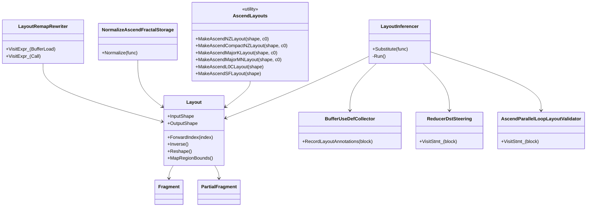
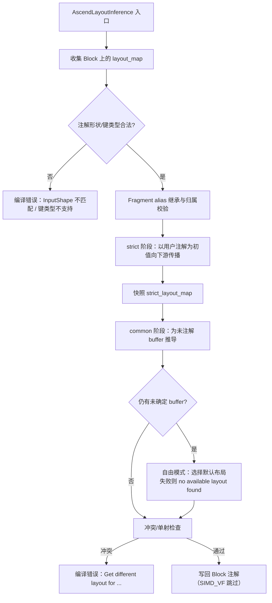
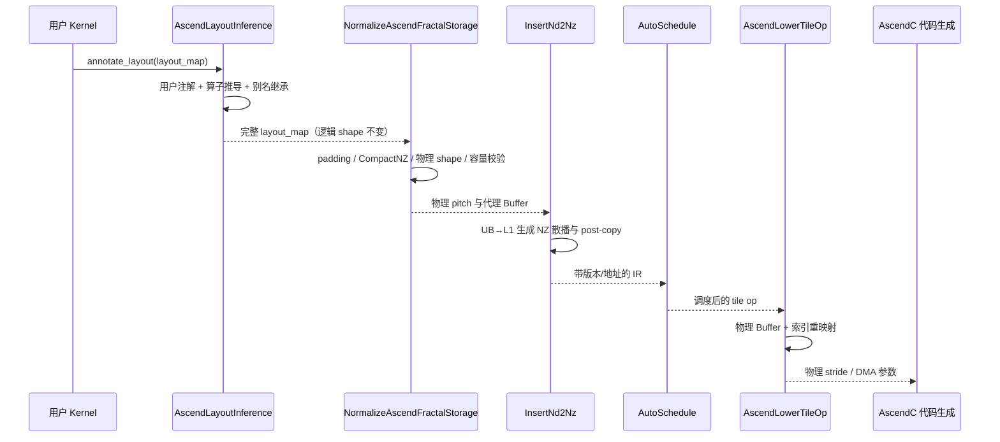

# annotate_layout 需求详细设计文档

# 1、需求概述

## 1.1 场景目标

> 描述需求来源，上下文场景和目标。

- 需求来源：Ascend NPU（AscendC 后端）上，on-chip buffer 的逻辑形状与硬件物理布局（分形）并不一致。GEMM 的 L1/L0 输入要求 NZ（分形）布局，L0C 输出、scale-factor、CompactNZ 等各有独立的物理组织方式；用户需要在不改变逻辑 tile 语义的前提下显式指定物理布局。
- 上下文场景：
  - Cube 输入（L1/L0A/L0B）需要 MajorK / MajorMN / NZ 布局，以匹配矩阵指令的分形访问。
  - L0C 累加结果、scale-factor 需要 L0C / SF 布局。
  - 同一块 UB/L1 storage 会被多个 `T.view` 以不同视角访问（如 Cube 视角与 Vector 视角），这些 view 需要各自独立的 canonical 布局。
  - Vector/SIMT 路径需要声明 Fragment 的线程归属，保证同一份数据在被多个 view 访问时线程映射一致。
- 需求目标：提供 `T.annotate_layout({buffer: layout})` 声明式原语，让用户为指定的 Buffer view 固定物理布局；由编译器完成注解收集、与算子推导结果的融合、合法性校验、物理形状生成、索引重映射，并最终由 AscendC 代码生成消费。注解只改变寻址解释，不搬运、不转置已有数据。
- 典型调用（参考 [flashmla/kernel.py](file:///d:/codes/yyz/tilelang/examples/ascend/flashmla/kernel.py#L378-L391)）：

```python
T.annotate_layout({
    a_q_l1: make_ascend_major_k_layout(a_q_l1),                 # L1 输入
    b_v_l1: make_ascend_major_mn_layout(b_v_l1),
    qk_l0c: make_ascend_l0c_layout(qk_l0c),
    p_nz_ub: make_ascend_compact_nz_layout(p_nz_ub),            # CompactNZ，降低 L1 占用
})
```

构造器接收 Buffer 本身（`C0` 由 dtype 自动推出），也接受 `BufferRegion`。

## 1.2 约束限制

> 描述该需求有哪些关键的约束限制。

1. **目标后端**：AscendC 后端（`src/ascend` + `tilelang/ascend`，`codegen_ascend.cc` 路径）。
2. **作用对象**：注解只作用于被显式命名的 Buffer view，不穿透 `T.view` / `T.reshape`，也不会把布局传播到共享同一 storage 的其他 view；需要特殊解释的每个 view 都必须单独注解。未注解的 view 走普通推断或默认的 dense/strided 寻址。
3. **注解键类型**：Ascend 版 `annotate_layout` 的键是 **Buffer 对象**（而非 `buffer.data` Var）；同一 storage 可以有多个 view、多个布局，手写 IR 以 `Var` 作键会在 Pass 中类型转换失败。
4. **形状一致性**：Layout 的 `InputShape` 必须等于对应 Buffer 的逻辑 shape，否则编译期报错。
5. **单射要求**：shared（内存）buffer 的前向映射必须单射，避免两个逻辑元素落到同一物理位置；reducer 的布局必须是 `PartialFragment` 且单射。
6. **别名一致性**：共享 storage 的 canonical Cube view 必须 dtype 相同、padding 后的物理尺寸相同，且保持 dense stride 与零偏移；Fragment alias 必须线程归属一致，否则报 `Conflicting fragment layouts for aliases`。
7. **注解优先级**：用户注解作为推断初值并处于 strict 阶段，不会为了满足下游算子而被放宽；与算子推导结果冲突时报 `Get different layout for ...`（swizzle 冲突会先尝试合并，Ascend 侧以分形布局为主）。
8. **多 Block 一致性**：不同 Block 对同一 buffer 的注解最终必须一致，否则 `NormalizeAscendFractalStorage` 报 `Conflicting layouts for ...`；同一 Block 内重复注解以最后一次为准。
9. **物理可行性**：分形布局会引入 padding，物理尺寸、容量、对齐由 `NormalizeAscendFractalStorage` 校验（含 32 KiB SIMT UB 预留、L1/L0 容量与对齐），不满足时编译失败。
10. **语义边界**：注解只解释存储，不搬迁数据。生产者必须按消费者使用的表示写入；把一个 view 注解成另一种布局不会自动转置已有值。
11. **SIMD_VF 区域**：SIMD_VF 块内的布局由 SIMT 推导自行处理，`AscendLayoutInference` 不向其写回布局注解。
12. **调度无关性**：布局推断发生在自动/手动调度分支之前，两种模式的结果一致；自动调度随后可能因多缓冲重写版本化 storage 的布局，手动调度则通过别名分析保持 view 关系。
13. **分形布局专属约束**：CompactNZ 的 padding 行不初始化，`T.copy` 只应覆盖有效区域；用 L0C 布局注解 UB 时，拷贝区域必须覆盖完整的 16 列面板；NZ/MajorK 的 `C0` 由 dtype 推导，不支持任意自定义分形宽度。

## 1.3 功能规格

> 描述该需求有哪些功能规格。

| 编号 | 功能 | 说明 |
| --- | --- | --- |
| F1 | 声明式布局注解 | `T.annotate_layout({buffer: layout})`，发出 `layout_map` Block 注解 |
| F2 | 注解值规范化 | `Layout` 原样使用；`Callable` 包装为 `Layout(buffer.shape, fn)`；reducer 必须是 `PartialFragment`，Fragment buffer 必须是 `Fragment` |
| F3 | 多 view 独立布局 | 同一 storage 的多个 view 可各自注解不同的 canonical 布局，互不传播 |
| F4 | 与算子推导融合 | 用户注解作为初值参与 strict/common/free 三阶段推断，GEMM/COPY/SIMT 的推导补充未注解 buffer |
| F5 | 合法性校验 | 形状、单射、别名、Fragment 归属、物理尺寸/容量/对齐等编译期检查 |
| F6 | 物理化 | 生成 padded/CompactNZ 物理 shape 与代理 Buffer，完成视图解析 |
| F7 | 索引重映射 | `LowerTileOp` 用物理 Buffer 与 `LayoutRemapRewriter` 重写所有访问与 `access_ptr` |

# 2、需求实现分析设计

## 2.1 方案分析

> 描述该需求的总体实现方案，包括选择什么方案、采用什么技术、使用什么算法等。

1. **复用既有布局对象，不新增布局 IR**
   - 布局用通用的 `Layout`（`forward_index` + `InputShape`/`OutputShape`）与 `Fragment`/`PartialFragment` 表达，Ascend 只提供分形布局构造器（NZ、CompactNZ、MajorK、MajorMN、L0C、SF）。
   - 注解沿用既有 `layout_map` Block 注解，不引入新的 pass 输入格式，避免与通用布局基础设施分叉。

2. **注解与推断分离**
   - 前端只做值规范化（`Layout` / `Callable` / `Fragment` / `PartialFragment`），不做形状校验。
   - `AscendLayoutInference` 负责：收集用户注解 → 以注解为初值做 strict 推断 → 快照后做 common 推断 → 自由模式下为剩余 buffer 选择默认布局；同时完成别名继承、冲突检测与单射检查。
   - 这样用户只需表达「哪些 buffer 需要特殊物理布局」，其余 buffer 交给算子语义（GEMM 复用 shared 布局、COPY 默认 MajorK 等）推导。

3. **逻辑 shape 与物理 shape 分离**
   - 布局只影响物理形状与索引映射；逻辑 tile 的形状、拷贝区域、版本数仍是独立概念。
   - 物理化由 `NormalizeAscendFractalStorage` 完成：按分形尾部维度计算 padding、插入 CompactNZ 代理 buffer、生成代理 Buffer 的物理 shape，并校验容量与对齐。
   - `LowerTileOp` 的 `makeBufferWithLayout` 生成物理 Buffer 并替换 Var，`LayoutRemapRewriter` 重写索引与 `access_ptr` 地址。

4. **多 view 语义**
   - 同一 storage 的多个 view 共享存储、不共享布局；这使 UB 上的数据可以同时被 Cube 视图（分形）与 Vector 视图（线性/Fragment）访问，而无需额外拷贝或转置。
   - 因为不传播，用户必须为每个需要特殊解释的 view 单独注解；这是「显式优先、避免隐式污染」的取舍。

5. **与调度解耦**
   - 推断发生在 `AutoSchedule` 之前，自动/手动两条路径共享同一份布局结果。
   - 自动路径由 `MaterializeMultiBuffer` + `RewriteAscendBufferVersionLayout` 在版本化 storage 上重写布局；手动路径调用 `InferBufferAliases` 分析别名与复用，不会重新推断布局。

6. **管线位置**（参考 [pipeline.py](file:///d:/codes/yyz/tilelang/tilelang/ascend/pipeline.py#L93-L141)）

```text
AscendLayoutInference
  → ReducerPlanAndMaterialize
  → NormalizeAscendFractalStorage
  → InsertNd2Nz
  → VFChecker / OOB padding
  → AutoSchedule 组（自动） / InferBufferAliases（手动）
  → AscendLowerTileOp
  → AscendC 代码生成
```

## 2.2 模型设计

> 以类图等形式描述模型结构关系。

**组件视图**


**类图**

类的详细定义参考接口设计。



## 2.3 流程设计

> 以顺序图、活动图、状态图等形式描述实现流程，包括正常流程和异常流程。

**A. 布局推断活动图**



**B. 端到端顺序图**



**C. 异常流程**

- Layout 的 `InputShape` 与 Buffer 逻辑 shape 不一致 → 编译错误。
- shared buffer 前向映射非单射、reducer 非 `PartialFragment` 或非单射 → 编译错误。
- Fragment alias 线程归属不一致 → `Conflicting fragment layouts for aliases`。
- 与算子推导结果冲突 → `Get different layout for ...`；无法放宽用户注解。
- 不同 Block 对同一 buffer 注解不一致 → `Conflicting layouts for ...`。
- 分形 padding 后超出 UB/L1/L0 容量或对齐不满足 → 编译错误。
- 自由模式无法为剩余 buffer 找到布局 → `no available layout found`。

## 2.4 表设计

> 如涉及数据库表，需要对表及字段进行设计描述。

不适用。本需求是编译期布局注解与 TIR 变换，不涉及数据库、持久化表或运行期数据结构升级；注解契约见 2.5 节。

## 2.5 接口设计

> 如涉及接口变化，需要对接口进行设计描述。


### 2.5.1 op 定义

`T.annotate_layout` 是编译期注解 op：不产生运行期指令、不读写数据，只把「Buffer view → 物理布局」登记到当前 SBlock，供 `AscendLayoutInference` 使用；用于让逻辑 tile 与物理分形布局（NZ、CompactNZ、MajorK/MajorMN、L0C、SF）解耦，配合 `T.copy` / `T.gemm` / Vector 计算使用。仅 AscendC 后端。

```python
T.annotate_layout(layout_map: dict)
```

- 作用对象：片上 Buffer view（UB / L1 / L0A / L0B / L0C / Fragment）。
- 语义：登记 `layout_map`（Buffer view → 物理布局），固定该 view 的物理布局；逻辑 shape 不变，数据不搬动。
- 返回值：`sblock_attr` 语句；无数据输入、无数据输出。
- 生效阶段：编译期（`AscendLayoutInference` 起，直到 `LowerTileOp` 物理化）。
- 失败方式：编译期报错（非法 layout 值、形状不匹配、非单射、别名冲突、容量不足等）。

**参数**

| 参数 | 类型 | 必填 | 说明 |
| --- | --- | --- | --- |
| `layout_map` | `dict` | 是 | 键为 Buffer（Ascend 版；可用同一 storage 的不同 view）；值为该 view 的物理布局。通用版内部会把键转换成 `buffer.data`，Ascend 版保留 Buffer 以支持多 view |

**布局取值**

| 取值类型 | 说明 |
| --- | --- |
| `Layout` | 显式的 `forward_index` 映射；建议使用分形布局构造器生成 |
| `Callable` | 自动包装为 `Layout(buffer.shape, fn)`；函数入参个数必须等于 buffer 秩 |
| `Fragment` | 仅用于 Fragment buffer（`T.alloc_fragment` 等），描述线程归属与索引映射 |
| `PartialFragment` | 仅用于 reducer buffer（`T.alloc_reducer`），描述每线程部分和 |

**返回值**：`sblock_attr` 语句，把 `{"layout_map": {buffer: layout}}` 写入当前 SBlock 注解；建议放在 Kernel 体内 buffer 声明之后。

**异常**

| 场景 | 报错 |
| --- | --- |
| 值不是上述类型 | `ValueError("Invalid layout: ...")` |
| reducer buffer 注解了非 `PartialFragment` | 断言失败，提示必须描述 per-thread partials |
| Fragment buffer 注解了非 `Fragment` | 断言失败 |

注：参数类型/取值错误在调用 `T.annotate_layout` 时抛出；形状、单射、别名、容量等语义错误在 `AscendLayoutInference` / `NormalizeAscendFractalStorage` 阶段报出。

### 2.5.2 支持规格

**datatype 支持**

布局本身与 dtype 解耦，但分形构造器依赖元素位宽：`C0 = 32B / element_size`，且要求位宽整除 256。`L0C` 布局固定 16×16，与 dtype 无关。

| 元素位宽 | C0 | NZ / MajorK / MajorMN / CompactNZ | L0C | SF |
| --- | --- | --- | --- | --- |
| 4 bit | 64 | 支持构造（CompactNZ 列向需整除 64） | 支持 | 支持（K 需为 4 的倍数） |
| 8 bit（int8 / uint8 / fp8） | 32 | 支持构造 | 支持 | 支持（K 需为偶数） |
| 16 bit（fp16 / bf16） | 16 | 支持构造 | 支持 | 支持（无额外检查） |
| 32 bit（fp32 / int32） | 8 | 支持构造 | 支持 | 不支持（16 % 32 ≠ 0） |
| 64 bit | 4 | 支持构造 | 支持 | 不支持 |

> 表格描述的是布局构造能力；具体算子（GEMM / COPY）是否支持该 dtype 由算子自身契约决定。

**shape 支持**

| 布局 | 逻辑形状（尾部两轴） | 物理形状 | 约束 |
| --- | --- | --- | --- |
| `make_ascend_nz_layout` / `make_ascend_major_k_layout` | `[.., MN, K]` | `[.., K/C0, MN/16, 16, C0]` | rank ≥ 2；`k_align > 1` 时 K 必须静态且整除 |
| `make_ascend_major_mn_layout` | `[.., K, MN]` | `[.., MN/C0, K/16, 16, C0]` | rank ≥ 2；`k_align > 1` 时 MN 必须静态且整除 |
| `make_ascend_compact_nz_layout` | `[.., rows, cols]` | 连续 `[C0-group, rows, C0]` | rank ≥ 2；最后一维必须静态且整除 C0 |
| `make_ascend_l0c_layout` | `[.., M, N]` | `[.., N/16, M/16, 16, 16]` | rank ≥ 2 |
| `make_ascend_sf_layout` | `[.., MN, K]` | `[.., MN/16, K/(16/bits), 16, 16/bits]` | rank ≥ 2；非 16 bit 时 K 必须静态且 `K×bits` 为 16 的倍数 |
| `Fragment` / `PartialFragment` | 任意逻辑形状 | 由线程映射决定 | Fragment buffer 必须与注解类型一致；alias 线程归属一致 |

- 前导轴（leading dims）允许动态；需要除法/整除检查的尾部轴必须能静态化（构造器会在编译期 `ICHECK`）。
- 同一 storage 的多个 view 可以声明不同布局，但共享 storage 的 canonical Cube view 必须同 dtype、padding 后物理尺寸相同。

### 2.5.3 布局构造接口

| 接口 | 用途 |
| --- | --- |
| `make_ascend_nz_layout(buffer)` | 标准 NZ 分形布局：`[.., rows, cols] → [.., rows/16, cols/C0, 16, C0]` |
| `make_ascend_compact_nz_layout(buffer)` | CompactNZ，按分配行 extent 决定 32 字节块的 pitch，减少 padding 占用 |
| `make_ascend_major_k_layout(buffer, k_align=1)` / `make_ascend_major_mn_layout(buffer, k_align=1)` | L1/L0 的 MajorK / MajorMN 布局 |
| `make_ascend_l0c_layout(buffer)` | L0C 输出布局；也可注解 UB 以在 L0C→UB 搬运中保留 NZ |
| `make_ascend_sf_layout(buffer)` | scale-factor 布局 |
| `make_strided_slice(phys_buf, layout, logical_region)` / `try_extract_fractal_layout(...)` | 分形布局的切片与提取辅助 |

构造器接收 Buffer / BufferRegion（`C0 = 32B / element_size` 自动推导），位于 [tilelang/layout/ascend.py](file:///d:/codes/yyz/tilelang/tilelang/layout/ascend.py#L20-L109)，并从 `tilelang.layout` 导出。不建议手写 `Layout` 函数，除非有明确的分形语义。

### 2.5.4 使用方法

**1. 放置位置与作用域**

- 在 `T.Kernel` 体内、buffer 分配之后、第一次使用之前调用；每次调用作用于当前 SBlock。
- 只注解 **view（Buffer）**，不注解 storage；同一 storage 的多个 view 需要分别注解。
- 自动调度与手动调度下的写法一致，不需要额外适配。

```python
with T.Kernel(grid, ...) as bx:
    a_l1 = T.alloc_l1((block_M, block_K), dtype)
    b_l1 = T.alloc_l1((block_N, block_K), dtype)
    c_l0c = T.alloc_l0c((block_M, block_N), "float32")

    T.annotate_layout({
        a_l1: make_ascend_major_k_layout(a_l1),
        b_l1: make_ascend_major_k_layout(b_l1),
        c_l0c: make_ascend_l0c_layout(c_l0c),
    })

    T.copy(...); T.gemm(...)
```

**2. 同一 storage 多 view**

只给需要非默认解释的 view 注解；未注解的 view 保持普通 dense/strided 寻址，且不会继承兄弟 view 的布局。

```python
# Cube 视角按 NZ 解释，Vector 视角按行主序解释，两者共享同一份 UB 数据
T.annotate_layout({
    cube_view: make_ascend_nz_layout(cube_view),
    vector_view: Layout(vector_view.shape, lambda i, j: i * vector_view.shape[1] + j),
})
```

**3. Fragment / SIMT 线程映射**

Fragment buffer 的注解必须使用 `T.Fragment`，通过 `forward_thread_fn` 指定线程归属、`forward_index_fn` 指定线程内偏移；alias 之间必须保持一致。

```python
T.annotate_layout({
    y_local: T.Fragment(
        (block_groups, group_size),
        forward_thread_fn=lambda i, j: (i % 32) * 32 + (j // 2) % 32,
        forward_index_fn=lambda i, j: (i // 32) * 4 + (j // 64) * 2 + j % 2,
    )
})
```

**4. CompactNZ：按分配行 extent 决定 pitch**

```python
# 分配时预留 gap 行；只拷贝有效区域，gap 行不初始化
p_ub = T.alloc_shared((tile_rows + 1, cols), T.bfloat16)
T.annotate_layout({p_ub: make_ascend_compact_nz_layout(p_ub)})
T.copy(p_ub[:tile_rows, :], p_l1)
```

**5. L0C 布局注解 UB：保留 NZ**

```python
# 拷贝区域必须覆盖完整的 16 列面板
s_ub = T.alloc_shared((tile_rows, cols), T.float32)
T.annotate_layout({s_ub: make_ascend_l0c_layout(s_ub)})
T.copy(s_l0c, s_ub[0:tile_rows, 0:cols])
```

**6. 带对齐要求的 L1 操作数**

blockscaled GEMM 等场景可用 `k_align` 要求尾部 K 轴静态可整除；不满足时在构造布局阶段即报错，并提示把 L1/L0 的 K 轴补齐：

```python
T.annotate_layout({a_l1: make_ascend_major_k_layout(a_l1, k_align=128)})
```

**7. 使用检查清单**

1. 键是 Buffer，不是 `buffer.data`；
2. 每个需要特殊解释的 view 都单独注解；
3. Layout 的 `InputShape` 等于 buffer 逻辑 shape；
4. 共享 storage 的 Cube view 同 dtype、padding 后物理尺寸一致；
5. Fragment 注解类型与 buffer 类型一致，alias 线程归属一致；
6. CompactNZ 只拷贝有效区域，L0C-on-UB 覆盖完整 16 列面板；
7. 分形 padding 后仍满足容量与对齐；
8. 不要指望注解穿透 `T.view` / `T.reshape` 或自动转置数据。

   ```python
   T.annotate_layout({a: make_ascend_nz_layout(a)})
   b = T.view(a, shape=(...))                        # b 不会继承 a 的布局
   T.annotate_layout({b: make_ascend_nz_layout(b)})  # 需要时单独注解
   ```

   注解以 Buffer 对象为键，派生 view 是新 Buffer，必须显式注解；注解也不会替你搬动或转置数据。

**8. 常见错误**

| 错误写法 | 现象 | 正确做法 |
| --- | --- | --- |
| `T.annotate_layout({buf.data: layout})` | 推断阶段类型转换失败 | 传 Buffer 本身 |
| 只注解一个 view，期望兄弟 view 生效 | 兄弟 view 仍按默认寻址 | 逐个 view 注解 |
| Fragment buffer 传普通 `Layout` | 断言失败 | 使用 `T.Fragment` / `PartialFragment` |
| CompactNZ 拷贝覆盖 gap 行 | 读到未初始化数据 | 只拷贝有效区域 |
| 32 bit 数据用 SF 布局 | 构造期 `ICHECK`：元素位宽必须整除 16 | 改用 16 bit 存储或不做 SF 布局 |
| 注解后希望自动转置 | 数据未被搬动 | 生产者按目标表示写入，或显式转置 |
| 共享 storage 的 Cube view 非 dense / 非零偏移 | 物理化校验失败 | 使用 dense、零偏移的 view |


## 2.10 性能分析

> 性能影响分析。

1. **避免运行期转置/重排**：直接声明硬件分形布局，省去为了适配 GEMM 而在 UB/L1 之间做额外转置或 `T.copy`。
2. **DMA 效率**：NZ/MajorK 布局让 UB→L1 的搬运按 32 字节分形对齐，`NZPitch` 与连续维长度一致时可减少碎片化传输。
3. **容量占用**：分形 padding 会增加物理尺寸；CompactNZ 通过压缩尾部 padding 降低 L1/UB 占用，有利于提高多缓冲深度。
4. **索引开销**：布局在 `LowerTileOp` 阶段被烘焙为常量 stride 与地址表达式，运行期没有额外的布局函数调用。
5. **编译期开销**：注解参与 strict/common/free 三阶段推断，冲突检测与单射检查增加少量编译时间；推断失败会在编译期暴露而不是生成低效代码。

## 2.11 可靠性分析

> 可靠性影响分析。

1. **显式语义**：注解不传播、不搬数据，避免「以为自动转换、实际读到旧表示」的隐式错误。
2. **静态校验**：形状一致性、单射、别名归属、dtype/物理尺寸、容量与对齐全部在编译期检查，错误信息包含具体 buffer 与布局。
3. **冲突策略确定**：用户注解在 strict 阶段不被放宽，与算子推导冲突直接报错，不会静默选择其中之一。
4. **多 Block 一致性**：不同 Block 的注解统一收敛，冲突时 `Conflicting layouts for ...`，避免同一 storage 在不同区域被解释成两种物理布局。
5. **别名安全**：Fragment alias 必须线程归属一致；内存 view 共享 storage 时要求同 dtype、等物理尺寸、dense stride、零偏移，防止越界或错误寻址。
6. **调度一致性**：自动/手动调度共享同一份推断结果，版本化 storage 的布局由自动调度统一重写，避免版本切换后寻址错位。
7. **已知边界**：SIMD_VF 区域不写回布局注解，其布局由 SIMT 推导负责；未注解 view 不会继承任何特殊布局。

## 2.12 可维护性分析

> 可维护性影响分析。

1. **分层清晰**：前端只做值规范化，推断只产出 `layout_map`，物理化与索引重映射各由独立 Pass 承担，代码生成只消费烘焙结果。
2. **单一契约**：`layout_map` 是前后端唯一接口，避免在多个 Pass 中重复判断布局。
3. **可测试性**：布局推断、物理化、索引重映射均可通过 IR 断言测试，不依赖上板；数值正确性可复用现有算子示例。
4. **可扩展性**：新增分形布局只需增加构造器与 `NormalizeAscendFractalStorage` 的 padding 规则，无需改动推断主流程。

# 3、开发者测试设计

> 开发者测试用例设计。

| 用例编号 | 用例名称 | 测试目的 | 前置条件/输入 | 操作步骤 | 预期结果 | 实际结果/备注 |
| --- | --- | --- | --- | --- | --- | --- |
| AL-01 | 多 view 独立布局 | 校验同一 storage 的不同 view 各自注解被保留 | 两个 view 分别注解不同布局 | 运行 `AscendLayoutInference` | 两个 view 的布局均保留，不传播 | `test_ascend_buffer_view_layouts.py` |
| AL-02 | 未注解 view 不继承 | 校验未注解 view 使用默认寻址 | 仅注解其中一个 view | 运行推断 | 未注解 view 无特殊布局 | 同上 |
| AL-03 | 拷贝不继承布局 | 校验 COPY 推导不会复制相邻 view 布局 | 注解 view + 普通 COPY | 运行推断 | COPY 按自身规则推导 | 同上 |
| AL-04 | 键类型校验 | 校验 Var 作键失败 | 手写 IR 用 `buffer.data` 作键 | 运行推断 | `TypeError` | 同上 |
| AL-05 | Fragment alias 冲突 | 校验线程归属一致性 | 两个 alias Fragment 注解不同归属 | 运行推断 | `Conflicting fragment layouts for aliases` | 同上 |
| AL-06 | 物理尺寸校验 | 校验共享 storage 的 Cube view 物理尺寸一致 | 注解两种 padding 不同的布局 | 运行 Normalize | 编译错误 | 同上 |
| AL-07 | 同 storage 双布局指针 | 校验不同 view 的地址解释正确 | 同一 storage 两种布局 | 编译并检查生成的 `access_ptr` | 地址按各自布局生成 | 同上 |
| AL-08 | 运行期转置语义 | 校验注解只解释存储、不搬数据 | 生产者写一种表示、消费者按另一种 view 读 | 上板运行 | 结果符合「按 view 解释」的语义 | 同上 |
| AL-09 | Fragment reshape | 校验 reshape 后线程归属保持 | Fragment 注解 + `T.reshape` | 运行推断 | 线程映射一致或报错 | 同上 |
| AL-10 | CompactNZ 三路径等价 | 校验自动插入、显式注解、预打包结果一致 | 三种写法的 UB→L1 路径 | 编译并对比 IR/数值 | 物理 pitch 与结果一致 | `test_tilelang_ascend_padded_nz.py` |
| AL-11 | L0C 布局 + UB alias | 校验 L0C 分形注解作用于 UB alias、版本扩展与拷贝尾块正确 | L0C 布局 + 多版本 | 编译并运行 | 尾块搬运用正确区域 | `test_ascend_fractal_storage_integration.py` |
| AL-12 | 版本化 storage 视图 | 校验版本化 storage 上 owner/view 布局一致 | 参数化 `both/owner/none` | 运行自动调度 | 布局随版本正确重写 | `test_cube_storage_views.py` |
| AL-13 | NZ/CompactNZ 访问足迹 | 校验布局下访问区域统计正确 | 带 padding 的 NZ 布局 | 运行足迹分析 | 足迹覆盖 padding 实际范围 | `test_access_footprints.py` |
| AL-14 | 布局影响拷贝地址 | 校验物理布局进入拷贝地址计算 | 注解分形布局 | 运行 `LowerTileOp` | 地址/stride 与布局一致 | `test_ascend_lower_copy.py` |
| AL-15 | 形状不匹配 | 校验 `InputShape` 与逻辑 shape 一致 | 构造不符的 Layout | 运行推断 | 编译错误 | 待补自动化 |
| AL-16 | 非单射布局 | 校验 shared 前向映射单射要求 | 构造多对一映射 | 运行推断 | 编译错误 | 待补自动化 |
| AL-17 | reducer 布局类型 | 校验 reducer 必须是 `PartialFragment` | 用普通 `Layout` 注解 reducer | 运行推断 | 编译错误 | 待补自动化 |
| AL-18 | 跨 Block 冲突 | 校验不同 Block 注解不一致时报错 | 两个 Block 注解不同布局 | 运行 Normalize | `Conflicting layouts for ...` | 待补自动化 |

# 4、资料建议

> 提供资料修改关注点。

| 资料名称 | 修改内容/关注点 | 是否需要修改 | 备注 |
| --- | --- | --- | --- |
| [SKILL.md](file:///d:/codes/yyz/tilelang/.agents/skills/tilelang-ascend/SKILL.md#L337-L370) | 标注「分配 shape / copy 区域 / 物理布局」是不同量，及注解只作用于命名 view、dense stride/零偏移/同 dtype/等物理尺寸要求 | 是 | 与实现保持一致 |
| [SKILL.md](file:///d:/codes/yyz/tilelang/.agents/skills/tilelang-ascend/SKILL.md#L350-L357) | 说明 Cube view 可用不同 canonical layout、共享 `.data` 与版本时钟 | 是 | 多 view 场景的推荐写法 |
| [SKILL.md](file:///d:/codes/yyz/tilelang/.agents/skills/tilelang-ascend/SKILL.md#L395-L403) | L1 输入 NT 权重 `[N,K]` 约定与 MajorK 布局 | 视需要 | 与 GEMM 推导对应 |
| [annotations.py](file:///d:/codes/yyz/tilelang/tilelang/ascend/language/annotations.py#L33-L46) docstring | 多 view 语义、dtype/物理尺寸约束 | 是 | 用户可见 API 文档 |
| [ascend.py](file:///d:/codes/yyz/tilelang/tilelang/layout/ascend.py#L20-L109) docstring | 分形布局构造器参数与适用场景 | 视需要 | 建议补充 CompactNZ 与容量说明 |
| 本文档 | 设计基线 | 否 | 行为变更时同步更新 |

# 5、测试建议

> 提供集成测试关注点。

| 测试范围/场景 | 测试关注点 | 前置条件/依赖 | 预期结果 | 风险/备注 |
| --- | --- | --- | --- | --- |
| FlashMLA | L1 MajorK/MajorMN、L0C、CompactNZ、SF 四类布局协同 | Ascend 环境 + 示例 | 数值与参考实现一致 | `examples/ascend/flashmla/kernel.py` |
| Per-token cast to FP8 | SIMT 内 Fragment 线程/索引映射 | Ascend 环境 + 示例 | 结果正确、线程映射无冲突 | `examples/ascend/example_per_token_cast_to_fp8.py` |
| FlashAttention | `P_nz_ub` CompactNZ 布局与 UB→L1 搬运 | Ascend 环境 + 示例 | ND→NZ 正确、无越界 | `examples/ascend/flash_attention/core.py` |
| 手动调度管线 | 布局在手动 `T.Vector()`/`T.Cube()` 下一致，`InferBufferAliases` 保持 view 关系 | 关闭自动调度 | 编译通过、数值正确 | 与自动路径结果一致 |
| 多版本 storage | 版本切换后物理布局与寻址正确 | 多缓冲版本 >= 2 | 各版本访问正确，无别名错位 | 关注布局重写 |
| 容量边界 | 分形 padding 后接近 UB/L1/L0 容量 | 大 tile / CompactNZ 对比 | 合法时编译通过，非法时明确报错 | 关注 32 KiB SIMT UB 预留 |
| 非法用法 | 形状不匹配、非单射、Var 键、跨块冲突、Fragment 归属冲突 | 无需上板 | 编译期明确报错 | 避免静默错误 |
| 数值回归 | 同一 Kernel 注解前后结果一致（仅改变物理布局） | Ascend 环境 + 参考输出 | 输出一致或按 view 语义预期 | 验证「注解不搬数据」 |
| 性能对比 | 注解分形布局 vs 默认布局 | Ascend 环境 + 计时 | DMA 与 GEMM 效率提升 | 记录 padding 带来的容量变化 |
