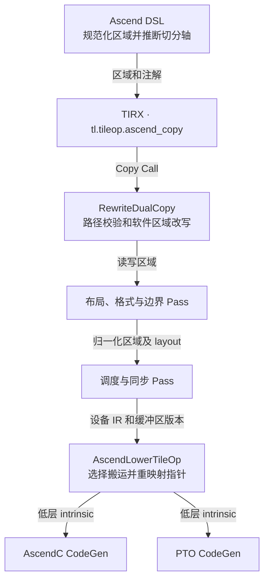
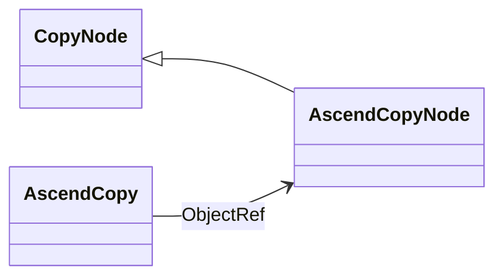
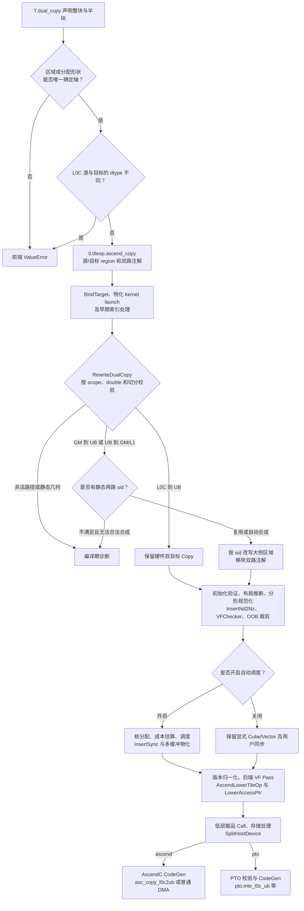
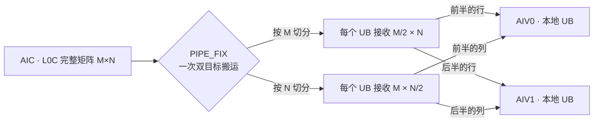

# TileLang Ascend Dual Copy 详细设计文档

| 项目 | 内容 |
|---|---|
| 代码基线 | `test_memory`，`74a53f4c89c462cb7370e1cd69977631aefc09d4` |
| 仓库 | yyyy999/tilelang，本地工作区 D:/codes/yyz/tilelang |
| 适用目标 | TileLang Ascend 方言，主要面向 Ascend 950（A5，默认架构 dav-3510）的 Ascend C API 后端。PTO 按其 CodeGen 约束单独描述。 |

本文以该提交中的实现和用例定义为准。本次完成源码和文档静态核对，真机数值与性能结果需在交付环境记录。[Ascend 目标说明](../../tilelang/ascend/README.md#L24)

# 1、SR概述

## 1.1 场景目标

Ascend 混合核由一个 AIC（Cube 矩阵计算核）和两个 AIV（Vector 核）协作。Cube 将累加结果写入 L0C，两个 AIV 在各自的 UB（Unified Buffer，片上统一缓冲区）处理半块结果。如 GEMM 将 L0C 结果分给两个 AIV，再把两个 UB 半块合并写回 GM（Global Memory）。FlashAttention 还使用 UB→L1 合并 Vector 结果，供后续 Cube 计算消费。

`T.dual_copy` 用一个逻辑 tile 表达双路数据的归属。分发时 AIV0 获取前半、AIV1 获取后半，合并时各 AIV 按同一规则写回共享区域。算子可通过 Buffer 或切片指定实际搬运范围，并按所选调度方式完成生产、消费和缓冲区复用。[GEMM 示例](../../examples/ascend/example_gemm.py#L76) · [FlashAttention 示例](../../examples/ascend/flash_attention/core.py#L90)

## 1.2 约束限制

| 项目 | 约束 |
|---|---|
| 内核 | Ascend 混合核须包含 Cube 工作。软件双路要求静态的 `cthread=2`。关闭自动调度时，将软件双路放在 `T.Kernel` 的显式 `T.Vector()` 作用域内，按 kernel 依赖建立同步。 |
| 区域 | 两端同时为一维或同时至少二维。一维仅用于软件双路，二维及以上以倒数第二轴 M、末轴 N 为切分候选。切分轴必须能唯一推断，静态完整轴长度为半轴的两倍。非切分轴按各路径的实际布局及搬运几何校验。 |
| 动态区域 | 分配形状可帮助推断切分轴，实际区域仍参与搬运。`RewriteDualCopy` 在两侧切分 extent 都为常量时检查静态比例。符号场景须保证运行时比例、容量和对齐。 |
| L0C→UB | 源与目的 dtype 相同。A5 FixPipe 的硬件双目标模式与 `quant_pre` 互斥，双路使用 `quant_pre=0`。M 切分整块 M 为偶数，N 切分要求整块源 N 是 32 元素的倍数。 |
| L0C 源布局 | 矩阵尾两轴起点为零，前导轴只选择一个平面。生产者实际 L0C pitch 须匹配源切片归一化得到的紧凑 pitch。`T.dual_copy` 当前公开签名没有 `l0_pitch`。 |
| UB 目的布局 | ND（行主序）目的遵循 FixPipe 地址及 stride 的 32 字节对齐。NZ（分形布局）目的走 16 列面板约束和物理 pitch 计算。PTO 的 L0C→UB CodeGen 当前要求 ND，另对常量描述符执行 stride 和 size 检查。 |
| 软件布局 | GM↔UB 使用普通 MTE（搬运引擎）几何。UB→L1 按布局走连续 DMA 或 NZ 搬运，要求各 AIV 写入在物理地址上互不覆盖。 |

来源：[DSL 签名与约束](../../tilelang/ascend/language/copy_op.py#L53) · [静态检查](../../src/ascend/transform/rewrite_dual_copy.cc#L140) · [L0C lowering](../../src/ascend/op/copy.cc#L682) · [PTO L0C→UB](../../src/ascend/codegen/codegen_pto.cc#L3372) · [昇腾 Fixpipe 双目标模式](https://www.hiascend.com/doc_center/source/zh/CANNCommunityEdition/910beta2/API/ascendcopapi/atlasascendc_api_07_0251.html)

## 1.3 功能规格

| 路径 | 调用方提交的区域 | 可观测结果 |
|---|---|---|
| L0C→UB | 完整 L0C tile 和每个 AIV 的 UB 半块。 | AIC 发出一条硬件双目标 FixPipe，将前后半写入两个 UB 的相同局部偏移。 |
| GM→UB | 完整 GM tile 和每个 AIV 的 UB 半块。 | 每个 AIV 从 GM 的相应半块读入自己的 UB。 |
| UB→GM | 每个 AIV 的 UB 半块和完整 GM 目标。 | 两个 AIV 将前后半写入 GM 的对应区域，支持 L2 cache hint。 |
| UB→L1 | 每个 AIV 的 UB 半块和完整 L1 目标。 | 两个 AIV 各写对应区域，满足布局条件时复用 ND→NZ 或 NZ post-copy。 |

所有路径的验收均需核对两路不同的行列数据，验证实际切分、读写覆盖范围及同步后的可见性。对 GM 边缘验证裁剪后的有效数据，对空区域验证无有效搬运。AscendC 与 PTO 分别记录源码编译和设备结果。[内存路径分类](../../src/ascend/transform/rewrite_dual_copy.cc#L106) · [搬运空范围保护](../../src/ascend/op/copy.cc#L407)

# 2、SR实现分析设计

## 2.1 方案分析

| 实现机制 | 选用位置 | 取舍 |
|---|---|---|
| 普通 `T.copy` | 单路搬运及软件双路改写后的基础 op。 | 直接表达一次区域搬运。两个 AIV 对整块的归属需要由区域或控制流表达。 |
| 原生双目标 FixPipe | L0C→UB。 | 完整矩阵的尺寸、起点和 stride 只编码一次，硬件负责切分和目的 UB 路由。要求满足双目标、同 dtype 及目标布局约束。 |
| 按 AIV 分流 | GM→UB、UB→GM、UB→L1。 | 编译期改写大侧区域后复用普通 Copy 和后续布局、裁剪、调度 pass。实际可用的 burst 形状和物理布局由每路搬运决定。 |

四条路径共用同一 DSL。实施分界由存储 scope 决定，L0C→UB 让硬件解释双目标，三条软件路径先物化各 AIV 的逻辑访问范围。后续 Pass 共用普通区域分析与目标 lowering。具体选择条件与指令映射见 2.3 节。

## 2.2 模型设计

### 组件视图



DSL 定义整块和半块的逻辑归属。Rewrite 负责选择路径并把软件双路改写成可被下游分析的读写范围。布局、边界和调度 pass 处理这些范围及存储版本。Lowering 才计算物理指针和指令字段，CodeGen 将它们映射到目标接口。[Pass 流水](../../tilelang/ascend/pipeline.py#L73) · [LowerArgs 与指针重映射入口](../../src/ascend/transform/lower_tile_op.cc#L1254)

### 关键数据结构及所有者

| 结构或表示 | 保存的信息 | 创建或更新者 | 使用者 |
|---|---|---|---|
| `BufferRegion`、`tl.region` | Buffer、切片起点及范围。`tl.region` 调用还带访问掩码。 | DSL 将 BufferLike 参数规范化。软件路径由 `RewriteRegion` 重写整块一侧的范围。 | Copy 解析、布局分析、OOB 裁剪、核间同步与 Lowering。 |
| `tl.tileop.ascend_copy` 的 `Call` | 两个 region 参数，`dual_dst_ctl`、`double`、UnitFlag、L2 cache 等注解。注解保留在 IR，供不同 Pass 解码。 | Ascend DSL 发出。`RewriteDualCopy` 保留原生双路注解，软件分流后删除已消费的双路字段。 | Rewrite、布局和调度分析、TileOp Lowering。 |
| `CopyNode`、`AscendCopyNode` | 源、目标、各轴 Range，以及从 IR 注解解码的 `dual_dst_ctl`、`unit_flag_ctl`、`sub_blockid` 等类型化字段。 | `AscendCopy` 从 Call 的参数和注解构造类型化视图。 | C++ Pass 分类和校验搬运，`Lower` 选择 DMA 或普通 Copy 分支。 |
| `AscendFractalLayoutInfo`、`AscendFractalRegionInfo` | 分形内层尺寸、分形轴及映射后的区域 bounds。 | Layout inference 提供布局；`TryExtractAscendFractalLayout` / `TryExtractAscendFractalRegion` 从布局及区域提取。 | Normalize 和 L0C→UB Lowering 计算物理容量、pitch 和 NZ 描述符。 |
| `StridedLayout`、`MTECopy2D` | 内外轴 extent、元素 stride；DMA 规划结果包含行数、每行元素数、每侧行 stride 和基址偏移。 | 从实际 Buffer 和 Range 构造 `StridedLayout`；GM↔UB 由 `PlanMTECopy` 归并并求得二维方案。 | DMA Lowering 换算字节并发出对应的 MTE intrinsic。 |
| `tl.ascend_copy_matrix_cc_to_ub` 等低层 Call | 物理端点、有效尺寸、stride 和指令模式字段。 | `LowerDMACopy` 生成，`AscendLowerTileOp` 递归处理生成结果及访问指针。 | AscendC / PTO CodeGen 按各自接口重排并验证参数。 |

来源：[区域改写](../../src/ascend/transform/rewrite_dual_copy.cc#L56) · [类型化 Copy 解析](../../src/ascend/op/copy.cc#L1200) · [分形布局与范围信息](../../src/ascend/layout/ascend_layouts.h#L92) · [MTECopy2D 与 PlanMTECopy](../../src/ascend/op/ascend_mte_plan.h#L343) · [低层 FixPipe Call](../../src/ascend/op/copy.cc#L787) · [TileOp lowering 后递归重映射](../../src/ascend/transform/lower_tile_op.cc#L1271)

### Copy 类型关系

只展示用于解析 Copy 和执行 lowering 的源码类型关系。`AscendCopy` 持有类型化节点引用，`AscendCopyNode` 在通用 `CopyNode` 上增加 Ascend 字段并实现 `Lower` 与 `InferLayout`。[CopyNode](../../src/op/copy.h#L30) · [AscendCopyNode 和 AscendCopy](../../src/ascend/op/copy.h#L27)



## 2.3 流程设计

### 从 DSL 到指令

前端按实际区域判断切分轴。常量按值比较，符号形状按 `structural_equal(half*2, full)` 比较；无法唯一判定时尝试比较分配形状，仍保留原始区域。通过 dtype 检查后，前端调用 Ascend `copy` 构造 `tl.tileop.ascend_copy`，注解 `dual_dst_ctl=1/2` 表示 M/N，`double` 标记整块在目的侧。[前端区域推断及注解](../../tilelang/ascend/language/copy_op.py#L107)



### 路径判定、异常和尾块

| 处理点 | 正常分支 | 诊断或边界分支 |
|---|---|---|
| 轴、scope 和 dtype | 一维软件双路仅有一个候选轴；矩阵比较 M/N。L0C→UB、GM→UB 以源为整块，另外两条软件路径以目的为整块。 | 前端在 rank 组合不合法、轴无法唯一推断或 L0C dtype 不同时拒绝。Rewrite 拒绝不支持的路径、静态非 2:1 或原生 N 切分的整宽非 32 倍数。 |
| sid 和控制路径 | 软件路径复用 extent 为 2 的 `cthread`，或在自动模式的 `tilelang_root` 合成。原生双路走 AIC 一致路径。 | 手动模式的软件双路无显式 `T.Vector()` 或 sid extent 不等于 2 时拒绝。自动调度拒绝将原生双路投影到依赖 sid 的控制分支。 |
| 归一化与空区间 | 符合布局时按实际区域改写，ND M 切分可有条件扩大搬运列，原生 N 切分保留边界。支持的 GM 路径在分流后裁剪。 | ND 步长或补齐容量无法证明时可能仅告警。静态空区域化为 no-op，动态空区域由 Lowering 的 `has_data` guard 跳过。 |
| 描述符与目标 | `AscendLowerTileOp` 用区域及布局生成描述符；目标 CodeGen 输出 C API 或 PTODSL。 | 布局不可表达或参数不合法时由对应阶段诊断。PTO 对 ND 格式、dtype 及常量 stride 额外检查，见下文指令示例。 |

来源：[Rewrite 分类与静态限制](../../src/ascend/transform/rewrite_dual_copy.cc#L106) · [sid 验证](../../src/ascend/transform/rewrite_dual_copy.cc#L335) · [子核一致路径](../../src/ascend/transform/auto_schedule/subcore.h#L782) · [边界规范化](../../src/ascend/transform/normalize_fractal_storage.cc#L313) · [编译流水](../../tilelang/ascend/pipeline.py#L37)

### 指令执行与两路归属

硬件分发时，M 切分把前后半行写往各自 UB，N 切分把前后半列写往各自 UB。两种方式的目的基址是各 AIV 本地 UB 中的同一偏移。软件分流时各 AIV 按改写后的地址执行普通搬运，既可从 GM 读取半块，也可将半块写往共享 GM 或 L1。以下时序图描述单个逻辑 tile 的选中路径，数据依赖及同步按实际 kernel 建立。

```mermaid
sequenceDiagram
    participant AIC as AIC
    participant FIX as FixPipe
    participant V0 as AIV0 和 UB0
    participant V1 as AIV1 和 UB1
    participant MEM as 共享 GM 或 L1
    alt L0C 到 UB
        AIC->>FIX: 按 L0C 生产依赖发出完整 M/N 和双目标模式
        par 前半写 UB0
            FIX-->>V0: M 前半行或 N 前半列
        and 后半写 UB1
            FIX-->>V1: M 后半行或 N 后半列
        end
        Note over AIC,V1: 两个 AIV 在各自的发布同步后消费本地 UB
    else GM 到 UB
        par AIV0 读取前半
            V0->>MEM: 发出从原起点读的普通 DMA
            MEM-->>V0: 本地 UB0 得到前半
        and AIV1 读取后半
            V1->>MEM: 发出从原起点加半块偏移读的普通 DMA
            MEM-->>V1: 本地 UB1 得到后半
        end
    else UB 到 GM 或 L1
        par AIV0 写入前半
            V0->>MEM: 本地半块写目的原起点
        and AIV1 写入后半
            V1->>MEM: 本地半块写目的原起点加半块偏移
        end
        Note over V0,MEM: 两路写各自物理区域，消费者按对应依赖等待
    end
```



### 软件双路的区域和地址

| 方向 | AIV sid = 0 / 1 的区域 | 下游 |
|---|---|---|
| GM→UB | 只移动源切分轴，`src_min + sid × dst_half_extent`，源切分轴 extent 设为目标半块大小。每核写其本地 UB。 | `PlanMTECopy` 规划连续或二维 burst → `asc_copy_gm2ub_align`。 |
| UB→GM | 只移动目标切分轴，`dst_min + sid × src_half_extent`，目标切分轴 extent 设为源半块大小。 | `PlanMTECopy` → `asc_copy_ub2gm_align`，保留传入的 L2 cache hint。 |
| UB→L1 | 目标按相同 sid 规则切分。两个 AIV 的 L1 写入区需在物理布局下互不覆盖。 | `InsertNd2Nz` 处理带 NZ 布局的目的区域。原始搬运分支要求同元素位宽、两端连续、元素数匹配以及传输字节数可证明为 32 的倍数。 |

`RequireSid` 要求 `cthread` extent 静态为 2。自动模式可从已有 `T.MixedKernel` 取 sid，或由 Rewrite 在 `tilelang_root` 构造一个；手动模式仅复用显式 `T.Vector` 的 sid。软件重写剥离 `dual_dst_ctl`、`unit_flag_ctrl` 及使用过的 `double`。一维软件搬运直接切唯一轴。GM DMA 按实际源/目标 stride 形成字节描述符。

UB→L1 的 NZ 目标要求匹配的逻辑区间与 C0 列对齐。C0 是 NZ 的内层列分组宽度，按该布局及 dtype 决定。`RewriteUBToL1` 对已有的同 dtype NZ 源发 `ascend_nd2nz_post_copy`，保留源/目的各自的 NZ pitch。对稠密 ND 源，源范围须覆盖完整连续行并满足起始地址 32 字节对齐，M/N 需静态确定。宽度恰为一个 C0 且 dtype 相同时可直接 post-copy；其余受支持场景先以 SIMD scatter 转到 `pitch=rows+1` 的 UB 临时区，再用 post-copy 写 L1。AscendC scatter 自身有受约束的 FP32↔BF16 组合，PTO scatter 要求同类型。

| 例子 | sid=0 | sid=1 | stride 与地址 |
|---|---|---|---|
| GM→UB，M 切分。GM tile `G[8:72, 16:80]`，每核 UB `32×64` | 读行 `[8,40)` | 读行 `[40,72)` | 如 GM 整行 stride=128 元素，则两个源起点为 `8×128+16=1040` 与 `40×128+16=5136`。 |
| UB→GM，N 切分。每核 UB `32×32`，写 `G[8:40,16:80]` | 写列 `[16,48)` | 写列 `[48,80)` | 目标起点分别为元素偏移 1040 和 1072。每行只写 32 个元素；两路 GM 行 stride 均为 128 元素，不能把整个半块当作连续 GM 区域。 |
| 一维 UB→GM，`UB[0:32]` 写到 `G[64:128]` | `G[64:96]` | `G[96:128]` | sid 仅改变目标起点，extent 均为 32。 |

以表中的 N 切分为例，Rewrite 前后对比仅展示逻辑区域。后续调度可以把 `sid` 具体化到各 AIV 的执行分支。

```text
T.dual_copy(UB[0:32, 0:32], G[8:40, 16:80])
  → tl.tileop.ascend_copy(region(UB, 0, 0, 32, 32),
                          region(G, 8, 16, 32, 64), dual_dst_ctl=2, double=1)
  → tl.tileop.ascend_copy(region(UB, 0, 0, 32, 32),
                          region(G, 8, 16 + sid * 32, 32, 32))
```

对 GM 边缘，`AscendInsertOOBPadding` 在软件分流后按两侧可配对且同长度的有效轴裁剪。若上例的 GM 分配宽度改为 70，仍提交列 `[16,80)` 的逻辑目标，sid=1 的源、目标有效宽度同时裁为 22。已证明的空搬运在 lowering 化为 no-op，动态空搬运用 `has_data` 保护。消费者必须遵守有效数据范围。GM→L1 的零填充有独立条件，软件双路应按裁剪后的区域消费有效数据。

来源：[RewriteRegion](../../src/ascend/transform/rewrite_dual_copy.cc#L56) · [改写与 sid 校验](../../src/ascend/transform/rewrite_dual_copy.cc#L309) · [DMA Lower](../../src/ascend/op/copy.cc#L407) · [UB→L1 原始搬运](../../src/ascend/op/copy.cc#L817) · [RewriteUBToL1](../../src/ascend/transform/insert_nd2nz.cc#L371) · [scatter dtype 检查](../../src/ascend/transform/insert_nd2nz.cc#L190) · [ClampDMACopyTail](../../src/ascend/op/oob_padding.cc#L76) · [PTO scatter](../../src/ascend/codegen/codegen_pto.cc#L4833)

### 原生 L0C→UB 几何、对齐与同步



| 关键字段 | 基线算法 |
|---|---|
| `m_size` / `n_size` | 硬件双路取源矩阵的完整 M、N，目的接收半块。普通 `T.copy` 的 `dual_dst_ctl=0`，尺寸取目的区域；若能证明目的超出源矩阵则报错。 |
| L0C 源指针 | L0C 的 canonical NZ 排列把 `(m,n)` 映射为 `(n//16,m//16,m%16,n%16)`。源矩阵尾两轴起点必须为零，前导轴可选择平面/版本。原生双路只给一个源基址，第二半的读取由硬件处理。 |
| `loop_src_stride` | 相邻 16 列分形面板的起点间隔，单位为 `16 × sizeof(src_dtype)`。默认 `映射后的 M 分形行数 × 16`。普通 `T.copy(...,l0_pitch=P)` 传分形行数，要求覆盖区域且不超过 L0C 容量；stride 为 `16×P`。 |
| `loop_dst_stride`，ND | 目的物理行 stride，以目的元素计。来自 `NormalizeMTE2DLayout` 选定的 row mode。它可大于每路有效 N。非单位内 stride 或不可表示的布局会影响描述符合法性。 |
| `loop_dst_stride`，NZ | 仅适用于符合 L0C 式 16 列布局的 UB 目标。取分形输出 shape 末三维的乘积，即相邻 N 面板的元素间距。要求列起点、目的宽和搬运宽可证明是 16 元素倍数，显式逻辑 strides 需稠密。 |
| `dual_dst_ctl` / `sub_blockid` | 0 写单目标，由 `sub_blockid` 选 UB；1 按 M 等分；2 按 N 等分；3 不使用。原生双路的 UB0 吃前半，UB1 吃后半，两边目的指针含义是相同的本地偏移。 |
| `quant_pre` / `NZ2ND_en` | 原生同 dtype 的 `quant_pre=0`。ND 目的发 `NZ2ND_en=1`，NZ 目的发 0。当前 `NZ2DN_en=0`。 |

**示例**。紧凑 `64×64` FP32 L0C：两种切分的描述符均为 `m_size=64,n_size=64,src_stride=64`。M 切分给每个 UB `32×64`，稠密 ND `dst_stride=64`；N 切分给每个 UB `64×32`，稠密 ND `dst_stride=32`。若 N 切分写入 `UB[:, 0:32]` 且 UB 分配宽 64，目的 stride 仍为 64。若在 `64×128` 分配中实际只生产紧凑 `32×64` L0C，`src_stride=32`。若同样 `32×64` 是已存储的 `64×128` 结果的前缀，实际存储 pitch 为 64 行。普通 Copy 可传 `l0_pitch=4`；当前 Dual Copy 的公开入口无法显式传该值，应将生产布局与默认 pitch 匹配后使用。

**对齐与尾块**。ND 目的按 32 字节校对行 stride；目的起始地址也需符合 C API 的 32 字节要求。对普通 Copy 和硬件 M 切分，`NormalizeFixpipeCopy_` 按目标元素大小将搬运 N 向上对齐到 32 字节，例如 FP32 的 10 列向上对齐为 16 列。普通 Copy 从目标宽推导，M 切分从源宽推导。只有能够证明扩大区间落在 L0C 物理容量以及 UB shape 和行 stride 内才改写。譬如源物理宽 16，目的分配宽 16、起点 8，待写 4 个 FP32 元素时可写到列 16；起点 12 时扩到 8 列会越界，Pass 保留原区间并告警。增加的列属于物理搬运范围，不保证补零。N 切分保留原分界，以免调整宽度使每个 AIV 的起点或跨度改变。NZ 目的绕过该 ND 补齐并在 lowering 校验。对动态原生双路，描述符继续使用源的有效 M/N，硬件据此等分；需保证运行时比例、容量与对齐。静态空范围不发指令，动态空范围以非空谓词控制。对未能证明的对齐或布局，需要检查最终描述符与真机结果。

**同步与调度**。`RewriteDualCopy` 先运行，`EstimateLatency` 获取软件路径改写后的区域，或从 FixPipe 的双目标语义计算每核半块成本。子核分析让原生双路的目标 UB 在两边使用同一局部偏移和版本，并禁止把任务投影成依赖 sid 的原生分支。混合核同步和版本化在 `ResolveCore → InsertSync → MaterializeMultiBuffer` 等步骤完成，手动模式由算子维护生产、消费和 slot 复用顺序。UnitFlag 是 MAD 和 FixPipe 之间的细粒度协作控制。值 0 不走该协议，值 2 仅检查并保留，值 3 检查并在完成后清除。Cube→AIV 的可见性仍由跨核同步保证。

来源：[L0C 布局映射](../../src/ascend/layout/ascend_layouts.cc#L256) · [L0C DMA lowering](../../src/ascend/op/copy.cc#L682) · [零起点与空 tile 谓词](../../src/ascend/op/copy.cc#L134) · [NormalizeFixpipeCopy_](../../src/ascend/transform/normalize_fractal_storage.cc#L313) · [动态及边界测试](../../testing/ascend/transform/test_ascend_normalize_fractal_storage.py#L482) · [子核投影](../../src/ascend/transform/auto_schedule/subcore.h#L248) · [延迟 geometry](../../src/ascend/transform/estimate_latency.cc#L1428) · [昇腾 Fixpipe 参数与 UnitFlag](https://www.hiascend.com/doc_center/source/zh/CANNCommunityEdition/910beta2/API/ascendcopapi/atlasascendc_api_07_0251.html)

### IR、CodeGen 与硬件接口

下面示意 `64×64` FP32 L0C → ND UB `64×32` 的 N 切分；省略 AccessPtr extent 及零值配置。CodeGen 将 TIRX 参数重新排列为 C API 参数，`sid` 与 `sub_blockid` 是两个字段。

```text
T.dual_copy(acc, ub)
  → tl.tileop.ascend_copy(region(acc, 64, 64), region(ub, 64, 32), dual_dst_ctl=2)
  → tl.ascend_copy_matrix_cc_to_ub(ub_ptr, acc_ptr, 0, 64, 64, 32, 64,
                                  2, 0, 0, unit_flag, 0, 0, 0, 1, ...)
  → asc_set_l0c_copy_nz_para(1, 0, 0)
  → asc_copy_l0c2ub(ub_ptr, acc_ptr, 64, 64, 32, 64,
                   sub_blockid=0, dual_mode=2, unit_flag, quant=0, ...)
```

| TIRX 参数索引 | 含义 | AscendC C API |
|---|---|---|
| 0, 1 | 目标、源指针 | 经 layout remap，直接传入 |
| 2 | IR `sid`，在该 lowering 中为 0 | 不传给 `asc_copy_l0c2ub` |
| 3–6 | N、M、目的 stride、源 stride | 按此顺序传入 |
| 7, 8 | dual mode、单路目标子块 | C API 先传 `sub_blockid`，再转枚举传 dual mode |
| 10, 11 | unit flag、pre-quant | `asc_unit_flag_mode`、`asc_quant_mode` |
| 14, 25 | NZ2ND、NZ2DN | 分别传入两个格式开关 |

AscendC 生成代码由 Bisheng 编译，`asc_copy_l0c2ub` 对应 PIPE_FIX。普通 GM/UB 与 UB/L1 使用相应 MTE 接口，例如 `asc_copy_gm2ub_align`、`asc_copy_ub2gm_align` 和 `asc_copy_ub2l1`。PTO 复用前段 IR，双目标生成 `pto.mte_l0c_ub(..., split=pto.SplitMode.M/N)`。PTO 要求匹配的 storage dtype、`quant_pre=0`、`NZ2ND_en=1`。当尺寸和 stride 都是常量时，CodeGen 还检查两侧 stride 均不小于完整的 `n_size`。因此上例的 `n_size=64,dst_stride=32` 可按 AscendC 路径生成，PTO 会在目的 stride 检查处拒绝。

来源：[Ascend C API 发射器](../../src/ascend/codegen/codegen_ascend.cc#L1520) · [通过 C API 发出 GM/UB DMA](../../src/ascend/codegen/codegen_ascend.cc#L1429) · [PTO FixPipe 发射器](../../src/ascend/codegen/codegen_pto.cc#L3372) · [昇腾 asc_copy_l0c2ub](https://www.hiascend.com/document/detail/en/CANNCommunityEdition/910/API/ascendcopapi/docs/en/api/SIMD-API/C-API/cube_datamove/asc_copy_l0c2ub.md)

## 2.4 表设计

不适用。Dual Copy 的区域、布局、地址和调度元数据存在于编译期间的 IR 与 Pass 数据结构中，无数据库表或持久化字段。

## 2.5 接口设计

调用方使用 Ascend 方言 `import tilelang.ascend.language as T`。接口如下。

```python
T.dual_copy(src, dst, *, unit_flag_ctrl=None, l2_cache_ctrl=0)
```

| 参数或输出 | 定义 |
|---|---|
| `src`、`dst` | Buffer、BufferRegion 或可归一化的 BufferLoad。传入切片可指定实际区域。整块位于哪一侧由内存路径规则决定。 |
| `unit_flag_ctrl` | 整数或 PrimExpr。省略时无注解，按 0 lowering。原生 FixPipe 保留该参数，软件双路改写时移除。 |
| `l2_cache_ctrl` | 默认整数 0，也可使用可归一化的缓存策略名称，例如 `NOTALLOC_PW`。UB→GM 双路改写保留该注解。 |
| 调用结果 | 写目标区域的 TileOp，可在 PrimFunc 中作为语句使用。 |

来源：[接口签名](../../tilelang/ascend/language/copy_op.py#L53) · [缓存策略解析](../../tilelang/ascend/language/copy_op.py#L202) · [注解清理](../../src/ascend/transform/rewrite_dual_copy.cc#L84)

## 2.6 配置设计

新增配置不涉及。已有目标和调度配置直接决定生成路径。

| 配置 | 实际作用 |
|---|---|
| `target="ascend"` | 生成 Ascend C API 源码，Ascend 950 默认架构为 `dav-3510`。 |
| `target="pto"` | 复用 Ascend 前段流水，采用 PTO 合法性检查、CodeGen 和工具链。 |
| `tl.enable_auto_schedule` | 默认 `True`。软件路径可复用 `T.MixedKernel` 的 sid 或在 `tilelang_root` 合成 `cthread=2`。设为 `False` 时使用显式 `T.Cube()` / `T.Vector()` 和调用方的同步协议，软件路径复用 Vector 作用域的 sid。 |

来源：[目标架构](../../tilelang/ascend/README.md#L24) · [后端注册](../../tilelang/ascend/backend.py#L86) · [自动调度配置](../../tilelang/ascend/pipeline.py#L23) · [自动 sid 合成](../../src/ascend/transform/rewrite_dual_copy.cc#L263)

## 2.7 升级设计

不涉及专项升级。Dual Copy 由编译器在生成 kernel 时完成 lowering，本设计无独立服务、安装包或持久化状态需要升级。

### 2.7.1 数据库数据结构的升级方案

不适用。该特性不使用 KV 数据库，无 schema 或历史数据迁移。

## 2.8 兼容性分析

### 2.8.1 老版本兼容

本设计无 API 迁移项。复用已有 kernel 时，需核对两端区域和 `unit_flag_ctrl`、`l2_cache_ctrl` 是否符合本基线签名。普通 `T.copy` 仍按单目标或普通搬运规则 lowering。跨编译器、CANN 或芯片版本的二进制兼容性尚未验证。[公开签名](../../tilelang/ascend/language/copy_op.py#L53) · [普通 Copy 和双目标描述符](../../src/ascend/op/copy.cc#L735)

### 2.8.2 上下游兼容

上游算子应提供正确的混合核结构、区域形状和 Buffer layout。用 `T.gemm` 得到的 L0C 紧凑布局须与复制范围匹配。下游 AIV 按自己的 half 消费，GM/L1 消费端在同步后读取实际有效区。AscendC 与 PTO 共有前段 IR，后端对 UB 格式及描述符的限制分别验收，尤其是 PTO 的常量 N 切分 stride。[Ascend 混合核示例](../../tilelang/ascend/README.md#L149) · [PTO 描述符校验](../../src/ascend/codegen/codegen_pto.cc#L3389)

## 2.9 安全分析

安全边界是 kernel 已声明的 GM 和片上缓冲区。基线对适用的 GM 路径裁剪越界范围，ND FixPipe 仅在扩展后的范围可证明落在源、目的容量内时修改 extent。符号范围的实际跨度、目的指针对齐和各 AIV 写入是否重叠仍需在生成代码和设备用例中核对。对齐或容量无法证明时，应保留诊断并检查该条描述符。对齐补搬的区域只作为预留空间，算子消费者读取其逻辑有效区。[GM 范围裁剪](../../src/ascend/op/oob_padding.cc#L76) · [FixPipe 扩展边界](../../src/ascend/transform/normalize_fractal_storage.cc#L401)

### 2.9.1 虚机信息安全分析

不适用。功能主体是编译器 IR 变换和 NPU 内存搬运，不采集或传输虚机信息。

### 2.9.2 采集数据上报安全分析

不适用。Dual Copy 的接口只描述 kernel 中的搬运，不提供数据采集或上报功能。

## 2.10 性能分析

| 路径 | 源码可推导的性能特征 | 验证指标 |
|---|---|---|
| L0C→UB | 每个非空 tile 发出一个硬件双目标描述符，两核独立消费半块。`256×256` FP32 完整 tile 逻辑读、写各 256 KiB，每个 UB 写 128 KiB。 | FixPipe 调用数及周期，逻辑传输字节，ND/NZ、M/N、padding，UB 占用及端到端耗时。 |
| GM→UB、UB→GM | 两侧连续时可合成一次 burst。M 切分可能保持整行连续，N 切分常形成跨行的二维 burst。边缘裁剪改变实际长度。 | 每核有效字节、行宽、burst 数、源和目的 stride、L2 策略及端到端耗时。 |
| UB→L1 | 连续区域可走原始 DMA；ND→NZ 路径可能先经 SIMD scatter，再用 DMA 写 L1。 | 区分直接 post-copy 和经 UB scratch 的路径，分别记录中间区占用、MTE 数据量及同步。 |

`EstimateLatency` 生成编译调度使用的成本元数据。基线未取得可归属该提交和路径的性能采样，模型和逻辑字节数用于对齐测试口径。实测时固定硬件、CANN、提交、dtype、布局和同步条件，记录完整 tile、边缘 tile 以及端到端的结果。[DMA 规划](../../src/ascend/op/copy.cc#L455) · [成本几何](../../src/ascend/transform/estimate_latency.cc#L1457) · [等价路径成本测试](../../testing/ascend/auto_schedule/test_estimate_latency.py#L379)

## 2.11 可靠性分析

| 风险 | 已有处理 | 验收边界 |
|---|---|---|
| split 推断或作用域错误 | DSL 和 Rewrite 检查 axis、静态比例、scope、硬件 N 对齐及软件 sid。 | 用两路可区分的数据验证区域切分；对动态区间同时记录编译证明和运行时范围。 |
| padding 或 DMA 写入超出有效邻域 | 支持的 GM 路径裁剪。ND FixPipe 按源物理容量、UB shape 和 stride 做补齐空间证明。 | 对有告警或不能证明的场景检查实际指令。有效邻域和允许写入的 padding 区分开验证。 |
| 非对齐窗口和 pitch 误用 | Lowering 检查 L0C 源矩阵为零起点，按源区域推导紧凑 pitch。目的侧按 ND/NZ 确定 stride。 | 用非零 UB 切片和较大 allocation 内的紧凑生产块验证 pointer、stride 和数据。调用方还需保证推导的 pitch 与生产者一致。 |
| 读写竞争、复用时过早覆盖 | 自动模式跟踪核间依赖和版本；原生双路 UB 保持共同的局部地址与版本。手动模式由算子维护 flag。 | 连续执行多个 tile 并复用同一 slot，验收两路发布、等待和归还。区分 UnitFlag 与 Cube/AIV 跨核同步。 |
| target 差异 | AscendC 与 PTO 各自生成代码，PTO 有附加描述符校验。 | 错误需定位到目标与校验字段，PTO 的 M/N 分别检查目标代码和设备结果。 |

来源：[Rewrite 静态检查](../../src/ascend/transform/rewrite_dual_copy.cc#L152) · [Normalize FixPipe 容量检查](../../src/ascend/transform/normalize_fractal_storage.cc#L390) · [AutoSchedule 和同步](../../tilelang/ascend/pipeline.py#L113) · [双目标 UB 存储](../../src/ascend/transform/auto_schedule/subcore.h#L248)

## 2.12 可维护性分析

用最小 kernel 保留基线 SHA、目标及运行环境。可启用 `TL_LOWER_TRACE`，从首个出现差异的 IR 阶段开始定位。[Lower Trace 使用说明](../../docs/tools/lower_trace.md#L32)

| 步骤 | 核对信息 |
|---|---|
| DSL 与 Rewrite | 对照实际 region 与 allocation shape，检查 `dual_dst_ctl`、`double`、dtype 与 scope，确认软件路径仅移动大侧切分轴。 |
| 布局及调度 | 查看归一化后的 UB shape、逻辑 extent、物理 pitch、裁剪范围、sid 和 buffer version。同步异常时检查两个 AIV 的实际消费与归还顺序。 |
| Lowering 与 CodeGen | 保存 lowering IR 和 C API/PTODSL。核对完整 M/N 或软件半块长度、行步长、UB 起点、dual mode 和 UnitFlag。 |
| 设备复现 | 用可区分行列的输入和目标边界哨兵复现。保存真机首个失败 tile 或迭代位置，以及 CANN、芯片型号和对应生成代码。 |

来源：[调度 Pass 入口](../../tilelang/ascend/pipeline.py#L113) · [Ascend C API 参数映射](../../src/ascend/codegen/codegen_ascend.cc#L1520) · [PTO 参数映射](../../src/ascend/codegen/codegen_pto.cc#L3372)

# 3、AR开发者测试设计

下表映射到当前提交中已有的 pytest 用例，编号仅用于本表索引。IR 与 CodeGen 用例通过调用 Pass 或 `tilelang.lower` 比较结构及生成代码。设备用例通过 `tilelang.compile` 执行 kernel，再和参考结果比较。用于本节的项目构建应和文档基线一致。以下均为测试源码中的预期结果，本次未执行。

| 用例编号 | 用例名称 | 测试目的 | 前置条件/输入 | 操作步骤 | 预期结果 | 实际结果/备注 |
|---|---|---|---|---|---|---|
| DC-DEV-01 | `test_software_copy_splits_the_full_region` | 验证软件分流改写。 | 一维 `128↔64` 的三条软件路径，二维 M/N，以及自动和手动 Vector 作用域。 | 对构造的 TIRX 运行 `RewriteDualCopy`，读取改写后的两个 region。 | 大侧切分轴起点为 `sid × extent`，大小等于半块，其他轴起点保持。移除 `double`、`dual_dst_ctl`、`unit_flag_ctrl`。 | 未执行。Pass 单测。 |
| DC-DEV-02 | `test_automatic_copy_synthesizes_one_subcore_scope` | 验证自动 sid 合成。 | `tilelang_root` 下两个未绑定 sid 的一维 GM→UB Copy。 | 运行 Rewrite 并遍历 `thread_extent`。 | 只合成一个 extent 为 2 的子核作用域，两个 Copy 均位于其中。 | 未执行。Pass 单测。 |
| DC-DEV-03 | `test_hardware_copy_retains_dual_destination_and_unit_flags` | 验证原生路径透传。 | FP32 L0C `64×64` → UB `32×64`，M 模式，UnitFlag 3。 | 运行 Rewrite，对比变换前后的 IR。 | 结构相同，区域、双目标模式和 UnitFlag 保留。 | 未执行。Pass 单测。 |
| DC-DEV-04 | `test_invalid_copy_regions`、`test_manual_copy_requires_vector_scope` | 验证失败阶段和诊断。 | GM→L1 非法双路、奇数完整轴、原生 N=48、硬件一维，以及无显式 Vector 的手动软件双路。 | 对每个负例运行 Rewrite，匹配 `ValueError`。 | 诊断指向具体路径、比率、N 对齐、rank 或 Vector 作用域。 | 未执行。Pass 单测。 |
| DC-DEV-05 | `test_l0c_to_ub_n_split_dual_copy_keeps_its_region`、`test_l0c_to_ub_lowered_descriptor_is_aligned` | 区分 N 切分的分界保留和 M 切分的条件对齐。 | N 切分 `4×32→4×16`；FP32 M 切分源 `4×10`，目的 `2×8`，分配行 stride 为 16。 | 对 N 用例运行归一化；对 M 用例用 pass instrument 捕获 `AscendLowerTileOp` 后的描述符。 | N 用例区域保持；M 分支断言 `(n_size,dst_stride,dual_dst_ctl)=(16,16,1)`。 | 未执行。Pass 和 Lowering 用例。 |
| DC-DEV-06 | `test_l0c_to_ub_empty_copy_does_not_warn_or_pad`、`test_l0c_to_ub_padding_respects_destination_offset` | 验证共享 FixPipe 归一化的空区间和边缘容量。 | 源或目的的 M/N 为零；普通 L0C→UB FP32 目的列起点分别为 8 和 12。 | 运行归一化。空搬运检查范围和 stderr，非空例检查目的起点和宽度。 | 空操作不改变范围，无对齐告警。非空例保留起点，目的 N 分别为 8 和 4。 | 未执行。共享规则单测，动态原生双路由第 5 章验收。 |
| DC-DEV-07 | `test_nd2nz_matmul_reuses_mixed_kernel_sid` | 检查软件路径在布局变换和 CodeGen 后的地址。 | `64×128` FP32，两个 AIV，分别取 M/N 切分。 | Lower 到 AscendC，读取两个互斥 AIV 分支的 GM 指针及 NZ post-copy 字段。 | 共用一次 sid 读取。AIV1 的 GM 元素偏移在 M/N 下分别为 4096、64，L1 目的偏移差为 256、4096。 | 未执行。CodeGen 和设备 IR 用例。 |
| DC-DEV-08 | `test_manual_mixed_pipeline_shares_sub_block_id`、`test_manual_pipeline_rewrites_compact_nz_dual_copy` | 验证手动混合核经同一个 Vector sid 下沉至普通 DMA。 | 显式 Cube/Vector 的 GM→UB→GM 及紧凑 NZ UB→L1 kernel，关闭自动调度。 | Lower 到 AscendC，检查 kernel 声明、sid 读取及接口。 | 生成 `__mix__(1, 2)`、一次 sid 读取和对应的普通 DMA 调用。 | 未执行。CodeGen 用例。 |
| DC-DEV-09 | `test_nz_fixpipe_layout_survives_full_lowering`、`test_nz_fixpipe_logical_reads_npu` | 验证物理 NZ pitch 及两路读出的数值。 | 输入 BF16，L0C FP32，目的 UB 有 plane 和非零切片起点，测试含 alias 变体。 | 捕获 Lowering 后的描述符；在 AscendC 真机执行 M/N 模式并读回逻辑元素。 | M 描述符的 `dst_stride=48×16` 且 `NZ2ND_en=0`。设备输出与小整数输入的参考计算逐元素相等。 | 未执行。Lowering 和设备用例。 |
| DC-DEV-10 | `test_subcore_fixpipe_synchronization` | 验证 AIC 分发后两个 AIV 的消费同步。 | BF16 GEMM，原生 M 切分的 M=16 或 32，`unit_flag_ctrl=3`。 | 编译 AscendC kernel，在 NPU 上读出 AIV 处理后的拼接结果。 | 与参考 GEMM 在现有测试容差内一致。 | 未执行。设备用例。 |
| DC-DEV-11 | `test_pto_tvm_ffi_mixed_cube_vector_gemm` | 确认已有的 PTO 手动混合核调用。 | `128×64×128` GEMM，FP32 L0C→ND UB 的 M 切分，PTO tvm_ffi。 | 关闭自动调度，以 `target="pto"` 编译并在设备执行。 | 输出与参考 GEMM 在现有测试容差内一致。 | 未执行。设备用例，覆盖 M 切分。 |

可从仓库根目录直接指定 pytest 节点。以下两条分别选择纯 Pass 断言与实际设备断言。

```text
python -m pytest -q testing/ascend/transform/test_ascend_rewrite_dual_copy.py::test_hardware_copy_retains_dual_destination_and_unit_flags
python -m pytest -q testing/ascend/auto_schedule/test_schedule_integration.py::test_subcore_fixpipe_synchronization
```

来源：[Rewrite 用例](../../testing/ascend/transform/test_ascend_rewrite_dual_copy.py#L33) · [FixPipe 边界和空块](../../testing/ascend/transform/test_ascend_normalize_fractal_storage.py#L437) · [对齐与描述符](../../testing/ascend/transform/test_ascend_normalize_fractal_storage.py#L567) · [软件双路 IR 与 CodeGen](../../testing/ascend/layout/test_tilelang_ascend_nd2nz_matmul.py#L103) · [手动软件双路](../../testing/ascend/language/test_tilelang_ascend_nd2nz_scatter.py#L87) · [NZ 用例](../../testing/ascend/layout/test_ascend_fractal_storage_integration.py#L44) · [设备同步用例](../../testing/ascend/auto_schedule/test_schedule_integration.py#L530) · [PTO 设备用例](../../testing/ascend/runtime/test_tilelang_pto_tvm_ffi.py#L271)

# 4、资料建议

| 资料名称 | 修改内容/关注点 | 是否需要修改 | 备注 |
|---|---|---|---|
| 用户文档 · [Ascend 使用说明](../../tilelang/ascend/README.md#L126) | 在现有 GEMM 示例旁补充数据归属，列出四条内存路径、M/N 形状、软件一维和混合核条件。注明 L0C 同 dtype、PTO 目标限制。 | 建议补充 | 用户据此选择 `T.copy` 或 `T.dual_copy`。 |
| 接口参考 · [Ascend DSL docstring](../../tilelang/ascend/language/copy_op.py#L53) | 保持签名和提示参数说明，补充区域 shape 与分配 shape 的选轴顺序，明确 L0C 紧凑 pitch 和目的 alignment 的单位。 | 建议补充 | 核对 `l2_cache_ctrl` 保留路径、UnitFlag 语义和非法输入诊断。 |
| 开发文档 · [IR Lower Trace](../../docs/tools/lower_trace.md#L32) | 增加一个 Ascend 排查示例，比较 Rewrite 前后的区域、分形归一化后的宽度，以及 Lowering 后的物理指针、stride 和低层 Call。 | 建议补充 | 排障时将 trace 与 target、提交和生成代码关联。 |
| 测试交付记录 | 建立按硬件、CANN、target 和提交记录的验收表，分别归档 IR/CodeGen、设备数值、同步和性能。 | 建议整理 | 记录首次错误的参数、tile 和迭代位置。 |

# 5、测试建议

本节用于整 kernel 和环境组合验收。第 3 章的已提交测试可用于定位具体阶段；以下场景需在交付环境中执行并记录结果。

| 测试范围/场景 | 测试关注点 | 前置条件/依赖 | 预期结果 | 风险/备注 |
|---|---|---|---|---|
| 算子闭环 · GEMM 或 Attention | 覆盖 AIC 生产、FixPipe 双路分发、AIV 消费再到 GM/L1 合并。给两路使用显著不同的行列数据，以验证前后半归属。 | A5、AscendC、部署使用的 CANN 和实际算子配置。分别选 M/N 方向以及支持的 ND/NZ 场景。 | 按完整算子参考比对；两核局部区、合并目标和外部有效邻域正确。 | 只比较总和可能漏掉半块顺序颠倒。算子使用的 layout 与测试输入需一起存档。 |
| 实际边缘 tile 与 UB 非零窗口 | 同时覆盖零长度、较短的有效长度、保留 pitch 的 UB 切片和 GM 边界。用哨兵检查相邻有效区域。 | 运行时参数能触及 0、最小合法非零和完整 extent；L0C 生产 pitch 明确，并有可验证的目标分配边界。 | 原生双路空块不搬运，合法块按实际范围切分；GM 路径仅搬裁剪后的区域；写入止于逻辑范围和允许补齐区。 | 编译期对齐告警须关联实际地址和描述符。静态 Pass 用例无法覆盖所有符号形状组合。 |
| 跨次同步和内存复用 | 验证 UB 发布后消费、归还后覆盖，覆盖多 tile、流水和复用同一 slot。 | 设备，分别采用自动调度和实际支持的手动 flag 协议。 | 多轮输出稳定，无超时、陈旧数据或两路覆盖。 | 更长运行可放大偶发竞争。记录首个异常轮次，保留调度 IR 和版本信息。 |
| 混合布局的 UB→L1 | 验证两个 AIV 的逻辑切片投影到共享 L1 后的物理间距，并由 Cube 实际读取。 | 原始连续、已 NZ 的 post-copy、ND→NZ scatter 各选适用算子，用完整 tile 与边缘合法配置。 | Cube 消费结果与参考一致，无两路物理写入冲突。 | L1 物理重叠无法仅靠逻辑区域不重叠判断；根据 NZ pitch 检查偏移。 |
| AscendC / PTO 交付矩阵 | 分开验证有效 M/N descriptor、常量 stride，以及目标对未支持格式或组合的诊断。 | 使用交付工具链分别构建和运行。PTO 包含能通过描述符检查及会触发校验的 N 切分两个样例。 | 支持的组合正确编译和执行，违反目标规则的组合给出对应诊断或由测试记录其它平台限制。 | 当前已有 PTO 设备用例覆盖 M 切分。N 切分确认结果需单独记录。 |
| 实际性能与资源 | 同时记录端到端时延、FixPipe/MTE 搬运、burst、UB 占用及跨核同步。 | 正确性先通过，固定设备型号、频率条件、工具链、输入规模和编译参数，完整与尾块分别采样。 | 可复现实测结果，与第 2.10 节的逻辑字节数、布局和指令路径可对应。 | 端到端结果受重叠与同步影响，目标阈值待同条件数据确认。 |
