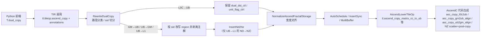
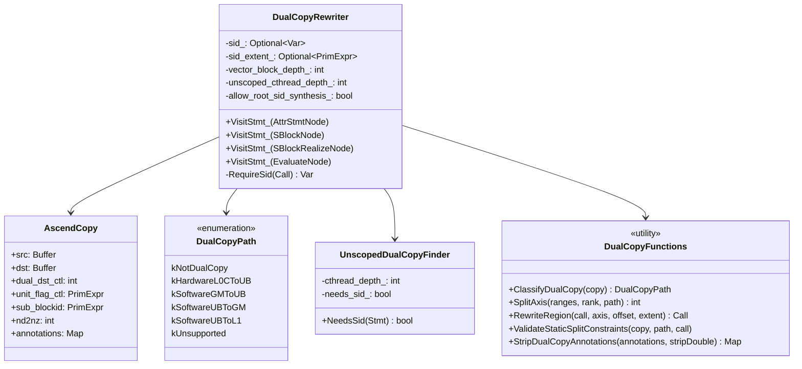
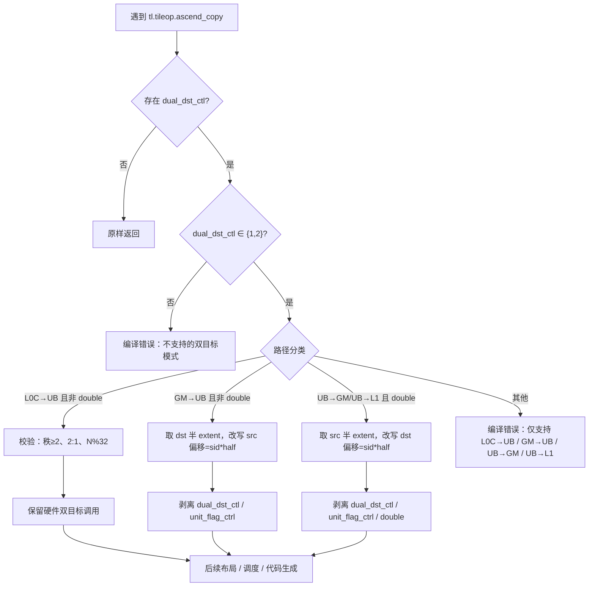
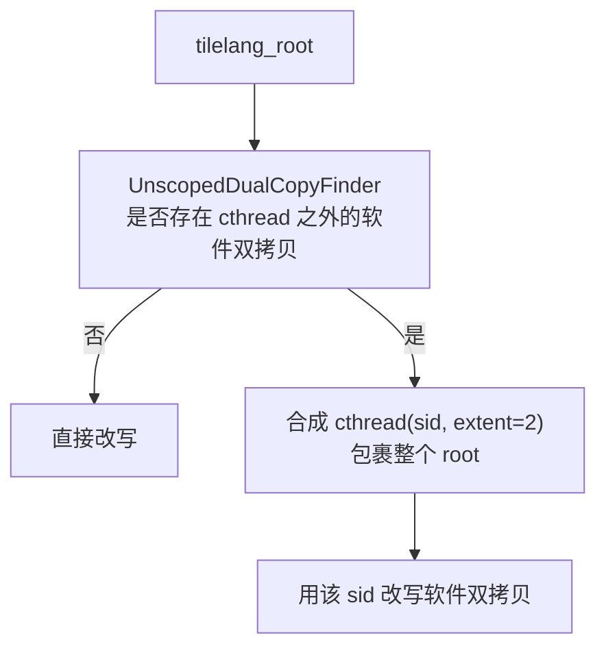
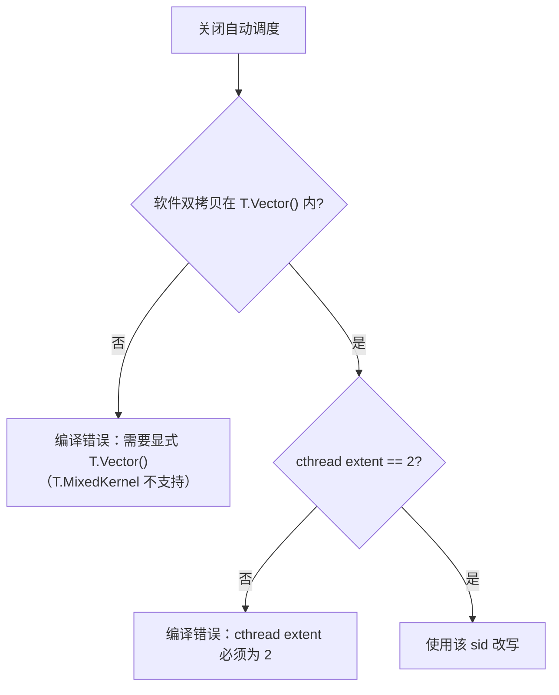
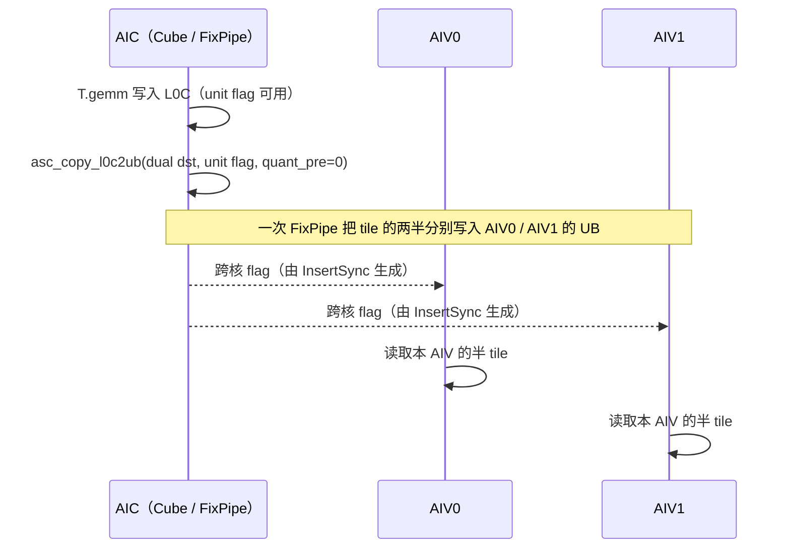

# dual_copy 需求详细设计文档

# 1、需求概述

## 1.1 场景目标

> 描述需求来源与上下文场景。

- 需求来源：Ascend NPU（AscendC 后端）混合算子（Cube + Vector）需要把同一个逻辑 tile 对半切分给两个 AIV 子核并行处理。
- 需求编号（AR）：待补充（仓库内暂无对应 AR 单据号）。
- 上下文场景：
  - GEMM / FlashAttention 等算子的累加结果位于 L0C，需要搬入 UB 后由 Vector 继续计算（softmax、rescale、累加）。
  - P 矩阵等 UB 数据需要按 NZ（分形）布局搬入 L1 供下一次 GEMM 使用。
  - 最终结果位于 UB，需要写回 GM。
  - 上述搬运如果由用户手写「按 `sid` 计算半 tile 偏移 + 两次 `T.copy`」，既容易出错，也无法表达 L0C→UB 的硬件双目标 FixPipe 能力。
- 需求目标：提供 `T.dual_copy` 前端原语，用一条语句表达「M/N 方向 2:1 切分、两个 AIV 各处理一半」，由编译器完成切分方向推断、按子核偏移的软件切分、L0C→UB 硬件双目标搬运、ND→NZ 转换、同步与多缓冲接入，并复用既有 AscendC 代码生成路径。
- 典型调用（来自现有示例）：

```python
# L0C -> UB 硬件双目标（M 切分，两个 AIV 各拿 BR/2 行）
T.dual_copy(qk_acc_l0c, S_ub[0:ROWS, 0:BC])

# UB -> L1（半 tile 源 -> 完整 L1 tile，自动做 ND->NZ）
T.dual_copy(P_nz_ub[0:ROWS, 0:BC], P_shared[0:BR, 0:BC])

# UB -> GM（半 tile 源 -> 完整 GM tile）
T.dual_copy(O_ub[0:ROWS, 0:D], O[mt * BR : (mt + 1) * BR, 0:D])
```

参考实现位置：[copy_op.py](file:///d:/codes/yyz/tilelang/tilelang/ascend/language/copy_op.py#L53-L163)、[rewrite_dual_copy.cc](file:///d:/codes/yyz/tilelang/src/ascend/transform/rewrite_dual_copy.cc)。

## 1.2 约束限制

> 描述本需求的关键约束限制。

1. **目标后端**：AscendC 后端（`codegen_ascend.cc` 路径）。
2. **必须是混合核（Cube + Vector）**：`T.dual_copy` 本身不合成 Cube 侧工作，用户必须同时提供 Cube 工作；纯 Vector 核不会因为使用 `T.dual_copy` 而变成双 AIV 启动。双 AIV 启动通过 `T.MixedKernel(..., sids=2)` 或包含 Cube + Vector 工作的 `T.Kernel` 获得。
3. **支持的内存路径**：
   - `L0C → UB`：硬件双目标 FixPipe，一条指令完成两个 AIV 的搬运。
   - `GM → UB`、`UB → GM`、`UB → L1`：软件按 `cthread` 的 `sid` 做每 AIV 的普通搬运。
   - 其他组合（如 `GM → L1`）不支持，编译期报错。
4. **形状约束**：
   - 源与目的要么都是一维，要么都至少二维，不支持混合秩。
   - 恰好一个尾部维度呈现精确 2:1 的比例；较大一侧是完整逻辑 tile，较小一侧是单个 AIV 的一半。
   - 静态可知的完整 extent 必须为偶数；奇数直接报错，不做不等分取整。
   - `L0C → UB` 硬件路径要求区域秩 ≥ 2；N 切分还要求完整 N 是 32 的倍数。
   - 一维区域仅允许软件路径。
5. **数据类型约束**：`L0C → UB` 双目标拷贝不支持类型转换（dav-950 上 FixPipe 双目标 + `quant_pre` 不可靠），源/目的 dtype 不一致时前端直接抛错；需要转换时改用独立拷贝或 VF 内 cast。
6. **同步与调度约束**：
   - 软件路径依赖 `cthread` 作用域且 extent 必须为 2。
   - 关闭自动调度（manual 模式）时，软件 `dual_copy` 必须位于 `T.Kernel` 内的显式 `T.Vector()` 块中；`T.MixedKernel` 在该模式下不支持。
   - 硬件 `L0C → UB` 要求跨 sub-core 一致的控制流，不能按 `sid` 选择目的 AIV；需要独立选择目的地时使用守卫的 `T.copy`。
7. **对齐约束**：`L0C → UB` 的 FixPipe 传输宽度需按 32 字节对齐；无法证明可对齐/可放入缓冲时给出编译告警并保留原区域。
8. **UB→L1 约束**：目的必须是 MajorK 的 NZ 布局，区域秩 ≥ 2 且源/目的逻辑行列一致，源地址 32 字节对齐；ND→NZ 只对 16/32 位浮点数据提供实现，不初始化填充空洞。

## 1.3 功能规格

> 描述本需求提供的功能规格。

| 编号 | 功能 | 说明 |
| --- | --- | --- |
| F1 | 切分方向推断 | 从源/目的区域形状推断 M 切分（轴 -2，`dual_dst_ctl=1`）或 N 切分（轴 -1，`dual_dst_ctl=2`）；区域形状无法判定时回退到分配形状（用于动态尾部） |
| F2 | 四类内存路径 lowering | L0C→UB 保留硬件双目标；GM→UB、UB→GM、UB→L1 改写为按 `sid` 切分的普通拷贝 |
| F3 | 硬件双目标 FixPipe | L0C→UB 一条 `asc_copy_l0c2ub` 携带 `asc_dual_dst_mode`，一次覆盖两个 AIV 的目的 UB |
| F4 | 软件按子核切分 | 自动模式在 `tilelang_root` 合成 extent=2 的 `cthread`；manual 模式复用 `T.Vector()` 的 `sid` |
| F5 | 双模式支持 | 自动调度（默认）与关闭自动调度（manual）两种使用方式 |
| F6 | 搬运提示透传 | `unit_flag_ctrl`（Cube 单元标志）与 `l2_cache_ctrl`（UB→GM 的 L2 策略）透传到拷贝注解 |
| F7 | ND→NZ 转换 | UB→L1 在布局推断后由 `InsertNd2Nz` 改写为 ND→NZ scatter + post-copy |
| F8 | 编译期校验 | 路径、秩、2:1 比例、偶数、N%32、`cthread` extent、手动作用域、dtype 等检查 |
| F9 | 调度/同步/多缓冲集成 | 与 `AutoSchedule`、`InsertSync`、多缓冲版本、延迟估计、缓冲区别名分析协同 |
| F10 | UB 容量收益表达 | 硬件双目标与 `double` 形式都只需半个 tile 的 UB 分配（每 AIV 一半） |

# 2、需求实现分析设计

## 2.1 方案分析

> 描述总体实现方案、技术选型与算法。

1. **前端原语 + IR 注解 + 独立 TIR Pass**
   - 新增 Python 前端 `T.dual_copy`，只做**形状语义层**工作：切分方向推断、2:1 校验、`double` 标记、dtype 检查，然后复用 `T.copy` 生成 `tl.tileop.ascend_copy` 并附带注解。
   - 新增 `RewriteDualCopy` Pass 承担**IR 层**工作：路径分类、子核 `sid` 获取、区域改写与注解剥离；硬件路径原样保留。
   - 后续布局推断、自动调度、同步插入、多缓冲、LowerTileOp 与代码生成全部复用现有管线，避免出现第二套拷贝实现。

2. **两条 lowering 路线**
   - **硬件路线（L0C→UB）**：AscendC 的 FixPipe 原生支持双目标（`asc_dual_dst_mode`），一次搬运把源 tile 的两半分别写入两个 AIV 的 UB。保留为一条指令可减少 AIC 侧指令数、减少与 AIV 的交互次数；在 `unit_flag_ctrl=3` 时还能与前一 MAD 通过单元标志流水，省去额外的 FixPipe 同步。
   - **软件路线（GM→UB / UB→GM / UB→L1）**：普通 DMA 没有双目标能力，因此改写为「目的/源偏移 = `sid * half_extent`，extent = `half_extent`」的普通拷贝，两个 AIV 各搬一半，MTE 带宽并行。改写后剥离 `dual_dst_ctl`、`double`、`unit_flag_ctrl` 注解，回到既有拷贝 lowering 与调度语义。

3. **Pass 在管线中的位置**
   - 在 `MaterializeKernelLaunch` 之后、布局推断/自动调度之前执行：此时启动维度已经物化为 `cthread` 的 `thread_extent`，可以直接复用；改写后的普通拷贝能被后续 `AscendLayoutInference`、`InsertNd2Nz`、`AutoSchedule` 正常分析。
   - 参见 [pipeline.py](file:///d:/codes/yyz/tilelang/tilelang/ascend/pipeline.py#L73-L111)。

4. **与调度器协同**
   - 自动调度：`RewriteDualCopy` 在 `tilelang_root` 上合成 `cthread`（extent=2），`subcore.h` 的投影逻辑保证带 `sid` 依赖地址的软件双拷贝可以保持共享循环体，并按参与度展开；硬件双目标任务不允许被按 sub-core 投影（要求控制流一致），其 UB 目的地址在两个 AIV 地址空间中保持同一分配。
   - 延迟估计：`EstimateLatency` 把双拷贝归一化为「单个 AIV 的半个 payload」，避免把共享搬运重复计费。
   - 同步：硬件路径在 AIC（FixPipe）执行、在 AIV 读取，由 `InsertSync` 依据读写区域生成跨核 flag；软件路径按普通 DMA 的 pipe 依赖处理。
   - 多缓冲：UB 半 tile 的版本由 `T.annotate_buffer_versions` / `PrepareMultiBuffer` 统一管理；manual 模式下由 `InferBufferAliases` 依据跨核握手的 happens-before 关系判断 UB staging 缓冲可复用性。

## 2.2 模型设计

> 以组件视图与类图描述模型结构关系。

**组件视图**



**类图**

类的详细定义参考接口设计。



关键数据字段（`AscendCopyNode`，见 [copy.h](file:///d:/codes/yyz/tilelang/src/ascend/op/copy.h#L27-L45)）：

| 字段 | 来源注解 | 含义 |
| --- | --- | --- |
| `dual_dst_ctl` | `dual_dst_ctl` | 0=非双目标；1=M 切分；2=N 切分 |
| `unit_flag_ctl` | `unit_flag_ctrl` | Cube 单元标志模式（如 3=与 MAD 流水） |
| `sub_blockid` | `sub_blockid` | FixPipe 目的子块路由（由调度投影写入） |
| `nd2nz` | `nd2nz` | 是否走 ND→NZ 语义（UB→L1 前端旁路/散播路径） |
| `data_select` | `data_select` | GM→UB 右侧填充复用 pad 寄存器 |

前端还会产生一个辅助标记 `double=1`：表示**源区域是一半**（目的为完整 tile），用于 UB→GM、UB→L1 这类写法，供改写、延迟估计与合法性判断使用。

## 2.3 流程设计

> 以流程图、顺序图描述正常/异常流程。

**A. 编译期改写流程**



**B. 自动模式：子核作用域合成**



**C. manual 模式：显式作用域要求**



**D. 运行时执行（L0C→UB 硬件路径）**



**E. 运行时执行（软件路径）**

每个 AIV 独立执行一条普通拷贝：`GM→UB` 读 `src + sid*half`，`UB→GM` / `UB→L1` 写 `dst + sid*half`；`UB→L1` 在编译期已被 `InsertNd2Nz` 改写为「NZ scatter + post-copy」，运行时先 scatter 到 UB scratch，再按 NZ pitch 搬入 L1。

**F. 异常流程**

- 路径不支持、秩不匹配、2:1 不成立、奇数 extent、N 非 32 倍数、`cthread` extent ≠ 2、manual 模式作用域不合法、`L0C→UB` dtype 不一致：一律在编译期抛 `ValueError`/`ICHECK`，不生成可能静默算错的代码。
- 32 字节对齐无法证明：`NormalizeAscendFractalStorage` 给出告警并保留原区域，由调用方保证对齐。

## 2.4 表设计

> 如涉及数据库表，需要对表及字段进行设计描述。

不适用。本需求是编译器前端原语与 TIR 变换，不涉及数据库、持久化表或运行时数据结构升级；TIR 注解契约见 2.5 节。

## 2.5 接口设计

> 如涉及接口变化，需要对接口进行设计描述。

### 2.5.1 Python 前端接口

```python
def dual_copy(
    src: BufferLikeType,
    dst: BufferLikeType,
    *,
    unit_flag_ctrl: int | tirx.PrimExpr | None = None,
    l2_cache_ctrl: int | str = 0,
) -> tirx.PrimExpr | tirx.Stmt
```

| 参数 | 类型 | 说明 |
| --- | --- | --- |
| `src` | Buffer / BufferRegion / BufferLoad | 源区域，支持 GM / L0C / UB（取决于路径） |
| `dst` | Buffer / BufferRegion / BufferLoad | 目的区域，支持 UB / GM / L1 |
| `unit_flag_ctrl` | int / PrimExpr / None | Cube 单元标志控制；`None` 表示不写注解（等价 0） |
| `l2_cache_ctrl` | int / str | UB→GM 存储的 L2 策略；默认 0（`NORMAL_FV`），支持大小写不敏感的策略名 |

返回值：`tl.tileop.ascend_copy` 调用（普通标量拷贝仍返回 `BufferStore` 不受影响）。

异常：

| 场景 | 异常信息要点 |
| --- | --- |
| 秩组合不支持 | `requires source and destination regions that are both one-dimensional or both have rank at least two` |
| 无法推断切分方向 | `Cannot infer dual_copy split direction` |
| `L0C→UB` dtype 不一致 | `Type conversion during cc->ub dual-destination copy is NOT supported on dav-950` |

### 2.5.2 TIR 注解契约

| 注解键 | 取值 | 产生方 | 消费方 |
| --- | --- | --- | --- |
| `dual_dst_ctl` | 1 / 2 | 前端 | `RewriteDualCopy`、`AscendCopyNode`、Normalize、延迟估计 |
| `double` | 1 | 前端（源为半 tile 时） | `RewriteDualCopy`、延迟估计、别名分析 |
| `unit_flag_ctrl` | int / PrimExpr | 前端 | `LowerTileOp` → `asc_unit_flag_mode` |
| `l2_cache_ctrl` | int | 前端 | UB→GM 代码生成 → `asc_store_l2_cache_mode` |
| `sub_blockid` | int / PrimExpr | 调度投影 | FixPipe 目的子块路由 |

### 2.5.3 Pass 与内建接口

| 接口 | 说明 |
| --- | --- |
| `tl.transform.RewriteDualCopy` | PrimFunc Pass，签名 `Pass RewriteDualCopy()`；读取 `tl.enable_auto_schedule` 决定是否允许在 root 合成 `cthread` |
| `tl.tileop.ascend_copy` | Ascend 方言拷贝 tile op，携带上述注解 |
| `tl.ascend_copy_matrix_cc_to_ub` | L0C→UB 下降结果（26 个参数），包含 `dual_dst_ctl`、`unit_flag_ctl`、`quant_pre`、`NZ2ND_en` 等 |
| `asc_copy_l0c2ub` | AscendC 运行时调用：`asc_set_l0c_copy_nz_para(1,0,0)` 后发射，第 8 个实参为 `static_cast<asc_dual_dst_mode>(...)` |
| `asc_copy_gm2ub_align` / `asc_copy_ub2gm_align` | 软件路径改写后的普通 DMA 调用 |
| `tl.ascend_nd2nz_scatter` / `tl.ascend_nd2nz_post_copy` | UB→L1 ND→NZ 的散播与按 pitch 搬运 |
| `ascend_nd2nz_post_copy`（Python） | 前端直接构造 NZ post-copy 的辅助接口（用于手工路径） |

### 2.5.4 使用方式

```python
# 自动调度：T.Kernel 中同时存在 Cube 与 Vector 工作
with T.Kernel(NUM_BLOCKS) as bx:
    ...
    for kv in T.Pipelined(NUM_KV_BLOCKS, num_stages=3):
        T.gemm(qk_a_l0, qk_b_l0, qk_acc_l0c, transpose_B=True, clear_accum=True)
        T.dual_copy(qk_acc_l0c, S_ub[0:ROWS, 0:BC])

# 手动调度：软件双拷贝必须位于显式 T.Vector() 中
with T.Kernel(NUM_BLOCKS) as bx:
    with T.Cube():
        T.gemm(...)
    with T.Vector() as sid:
        T.dual_copy(...)
```

## 2.6 配置设计

> 如涉及配置改动，需要对变动的配置进行描述。

本需求**不新增配置项**，行为由既有配置与代码结构决定：

| 配置/开关 | 影响 |
| --- | --- |
| `PassConfigKey.TL_ENABLE_AUTO_SCHEDULE`（默认 True） | 关闭时进入 manual 模式：不合成 `cthread`，软件双拷贝必须位于 `T.Vector()` 内，`T.MixedKernel` 被拒绝；开启时由 Pass 在 `tilelang_root` 合成 extent=2 的 `cthread` |
| `T.MixedKernel(..., sids=2)` / `T.Vector(vector=2)` | 显式请求双 AIV 启动与子核 ID |
| `T.annotate_buffer_versions` | 控制双拷贝涉及的 UB / L1 / L0C 缓冲版本数，与双拷贝本身解耦 |

## 2.7 升级设计

> 如涉及升级改动，需要对升级修改进行描述。

不适用。本需求为编译期能力增强，无持久化数据格式、无运行时协议字段，不需要升级步骤。

### 2.7.1 数据库数据结构的升级方案

不适用。本需求不涉及数据库（含 KV 数据库）或任何持久化数据结构。

## 2.8 兼容性分析

> 兼容性影响分析，包括系统上下游兼容性和新老版本兼容性。

### 2.8.1 老版本兼容

首次引入 `T.dual_copy` 原语，老代码不使用该 API，其 `T.copy` 生成结果与调度行为不变。`dual_dst_ctl` 等注解仅由新前端产生，旧 IR 不会意外触发硬件双目标路径。因此无新老版本兼容问题。

### 2.8.2 上下游兼容

- 上游（Python 前端）：新增 `tilelang.ascend.language.dual_copy` 导出，不修改既有 `copy` 签名与语义。
- 下游（AscendC 代码生成）：复用已有 `asc_copy_*` 模板与参数布局，不改变运行时 ABI、Kernel 启动协议或 tvm-ffi 交换格式。

## 2.9 安全分析

> 安全影响分析。

### 2.9.1 虚机信息安全分析

不适用。本需求为编译期代码生成特性，不采集、不传输虚机基础信息、内存信息或 CPU 信息。

### 2.9.2 采集数据上报安全分析

不适用。本需求不包含任何数据上报或采集逻辑，不引入新的对外网络接口。

## 2.10 性能分析

> 性能影响分析。

1. **指令数**：`L0C→UB` 硬件双目标把原本「AIC 发两次 FixPipe（各自一个 AIV）」合并为一条指令，减少 AIC 侧指令发射与跨核交互。
2. **并行度**：软件路径让两个 AIV 各搬一半数据，GM↔UB、UB↔L1 的 MTE 带宽并行；同时 AIV 计算量也按半 tile 切分。
3. **UB 容量**：硬件双目标的目的是每个 AIV 的半 tile（如 `[M/2, N]`），`double` 形式的软件路径源也是半 tile，相比完整 tile 分配可降低 UB 占用，有利于提高多缓冲深度。
4. **流水**：`unit_flag_ctrl=3` 让 FixPipe 与前序 MAD 通过单元标志流水，省去额外的 `PIPE_FIX` 同步开销。
5. **代价与注意**：
   - `L0C→UB` 的传输宽度不足 32 字节对齐时会被补齐，可能略微增加搬运量；无法证明可补齐时只告警。
   - 软件路径每个 AIV 各发一条 DMA，指令数相对单条完整拷贝可能增加，但带宽利用更充分。
   - 延迟估计按单 AIV 半 payload 归一化，避免共享搬运重复计费导致调度决策偏差。

## 2.11 可靠性分析

> 可靠性影响分析。

1. **编译期失败优先于静默错误**：路径、秩、2:1、偶数、N%32、`cthread` extent、manual 作用域、dtype 等全部静态校验；错误信息包含具体操作与形状，便于定位。
2. **控制流一致性**：硬件双目标要求跨 sub-core 一致的控制流；按 `sid` 分散目的地的场景改用守卫 `T.copy`，避免投影后执行次数与同步参与度失真。
3. **同步正确性**：硬件路径的 UB 写由 AIC 发起、AIV 读取，`InsertSync` 依据真实读写区域插入跨核 flag；软件路径按普通 DMA 的 pipe 依赖处理。
4. **动态尾部**：区域形状无法保留 2:1 结构时，切分方向回退到分配形状推断，实际搬运仍使用真实区域 extent，避免运行期尾部被错误放大或缩小。
5. **内存安全**：补齐后的目的宽度受 UB 行 stride 与分配容量约束；不可证明时保留原区域并告警，防止越过最后一行。
6. **多缓冲/别名**：manual 模式下 UB staging 缓冲的可复用性由跨核握手建立 happens-before 关系后判定；同一流水循环内共存的缓冲不会被错误复用。
7. **已知失败模式**：`sid == 0` 搭配不匹配的 `sub_blockid` 可能使隐式 FixPipe 路由被消除（属既有路由语义），本需求通过「硬件双目标要求一致控制流」规避该类问题。

## 2.12 可维护性分析

> 可维护性影响分析。

1. **单一事实来源**：前端只负责形状语义与注解，Pass 只负责路径分类与区域改写，注解是前后端唯一契约，避免两处逻辑漂移。
2. **职责边界清晰**：ND→NZ 交给 `InsertNd2Nz`，宽度对齐交给 `NormalizeAscendFractalStorage`，同步与多缓冲交给 `AutoSchedule`，双拷贝不重复实现这些能力。
3. **可测试性**：改写逻辑可用纯 TIR 单测覆盖（无需上板），代码生成可用字符串/IR 断言覆盖，数值正确性复用现有算子示例。
4. **可扩展性**：新增路径时只需扩展 `DualCopyPath` 分类与对应改写分支。

# 3、需求开发者测试设计

> 开发者测试用例设计。

现有自动化用例集中在 [test_ascend_rewrite_dual_copy.py](file:///d:/codes/yyz/tilelang/testing/ascend/transform/test_ascend_rewrite_dual_copy.py)、[test_ascend_normalize_fractal_storage.py](file:///d:/codes/yyz/tilelang/testing/ascend/transform/test_ascend_normalize_fractal_storage.py)、[test_ascend_lower_copy.py](file:///d:/codes/yyz/tilelang/testing/ascend/transform/test_ascend_lower_copy.py)。

| 用例编号 | 用例名称 | 测试目的 | 前置条件/输入 | 操作步骤 | 预期结果 | 实际结果/备注 |
| --- | --- | --- | --- | --- | --- | --- |
| DC-01 | GM→UB 一维切分（自动） | 校验软件路径按 sid 偏移源区域 | `global(128,) → shared.dyn(64,)`，auto 模式 | 运行 `RewriteDualCopy` | 唯一拷贝的源索引 = `sid*64`、extent=64；注解被剥离 | 自动化 |
| DC-02 | GM→UB 一维切分（manual） | 校验 `T.Vector()` 内复用 sid | 同上，外包 `VECTOR` block，关闭自动调度 | 运行 Pass | 同 DC-01 | 自动化 |
| DC-03 | UB→GM 一维切分 | 校验 double 形式改写目的区域 | `shared.dyn(64,) → global(128,)`，`double=1` | 运行 Pass | 目的索引 = `sid*64`、extent=64；`double/dual_dst_ctl/unit_flag_ctrl` 被剥离 | 自动化 |
| DC-04 | UB→L1 一维切分 | 校验 L1 目的改写 | `shared.dyn(64,) → shared.l1(128,)`，`double=1` | 运行 Pass | 目的索引与 extent 正确 | 自动化 |
| DC-05 | 二维 M 切分 | 校验轴 -2 切分 | `global(64,64) → shared.dyn(32,64)` | 运行 Pass | 切分轴为 -2，其它维索引为 0 | 自动化 |
| DC-06 | 二维 N 切分 | 校验轴 -1 切分 | `shared.dyn(64,32) → global(64,64)`，`double=1` | 运行 Pass | 切分轴为 -1 | 自动化 |
| DC-07 | 自动模式合成子核作用域 | 校验仅合成一个 extent=2 的 cthread | `tilelang_root` 内含两个双拷贝 | 运行 Pass | 只出现一个 `thread_extent=2` 的 AttrStmt，且包含两个拷贝 | 自动化 |
| DC-08 | 硬件双目标保持不变 | 校验 L0C→UB 不被改写 | `shared.l0c(64,64) → shared.dyn(32,64)` | 运行 Pass | IR 与输入结构等价（保留 dual/unit flag） | 自动化 |
| DC-09 | 不支持路径 | 校验错误信息 | `global → shared.l1` | 运行 Pass | 抛错：`supports only L0C->UB` | 自动化 |
| DC-10 | 奇数 M | 校验偶数约束 | `shared.l0c(127,64) → shared.dyn(63,64)` | 运行 Pass | 抛错：`exact 2:1 extent ratio` | 自动化 |
| DC-11 | N 未对齐 32 | 校验 N 切分对齐 | `shared.l0c(64,48) → shared.dyn(64,24)`，split=2 | 运行 Pass | 抛错：`multiple of 32` | 自动化 |
| DC-12 | 一维 L0C→UB | 校验硬件路径秩约束 | `shared.l0c(128,) → shared.dyn(64,)` | 运行 Pass | 抛错：`at least two-dimensional` | 自动化 |
| DC-13 | 一维奇数软件区域 | 校验软件路径 2:1 | `global(127,) → shared.dyn(64,)` | 运行 Pass | 抛错：`exact 2:1 extent ratio` | 自动化 |
| DC-14 | manual 模式作用域缺失 | 校验必须在 `T.Vector()` 内 | 关闭自动调度，无 Vector block / 或使用混合核 cthread | 运行 Pass | 抛错：`explicit T.Vector` | 自动化 |
| DC-15 | L0C→UB 跨 dtype | 校验前端拒绝 | 源 float32、目的 bfloat16 | 调用 `T.dual_copy` | `ValueError`，提示改用独立拷贝或 VF cast | 待补自动化（当前靠前端断言） |
| DC-16 | N 切分区域保留 | 校验归一化不改变 N 切分点 | `dual_dst_ctl=2` | 运行 `NormalizeAscendFractalStorage` | 源/目的区域 extents 保持不变 | 自动化 |
| DC-17 | 传输宽度 32B 补齐 | 校验 M 切分/普通双目标的宽度补齐 | 多种 `src_n/dst_n` 组合 | 运行归一化 Pass | extents 按预期补齐；幂等 | 自动化 |
| DC-18 | 参数下降 | 校验 L0C→UB 参数映射 | 带 `dual_dst_ctl` 的 L0C→UB | 运行 `LowerTileOp` | `dual`、`unit_flag_ctrl=3`、`quant_pre=0` 落在约定参数位置 | 自动化 |
| DC-19 | UB→L1 ND→NZ | 校验 scatter + post-copy 生成 | UB(ND) → L1(NZ) | 全管线编译 | 生成 scatter 与 post-copy；区域秩/行列匹配校验生效 | 自动化/示例 |

# 4、资料建议

> 提供资料修改关注点。

| 资料名称 | 修改内容/关注点 | 是否需要修改 | 备注 |
| --- | --- | --- | --- |
| [SKILL.md](file:///d:/codes/yyz/tilelang/.agents/skills/tilelang-ascend/SKILL.md#L506-L548) 6.2 节 | 保持 `T.dual_copy` 的四条路径、2:1 规则、manual 模式要求与实现一致 | 是 | 当前内容基本一致，需随实现变更同步 |
| [synchronization.md](file:///d:/codes/yyz/tilelang/.agents/skills/tilelang-ascend/references/synchronization.md#L258-L283) | 硬件双目标要求跨 sub-core 一致控制流、独立路由用守卫 `T.copy` | 是 | 与 `subcore` 投影约束对应 |
| [copy_op.py](file:///d:/codes/yyz/tilelang/tilelang/ascend/language/copy_op.py#L53-L163) docstring | 路径、约束、异常说明 | 是 | 作为用户可见 API 文档 |
| Ascend 后端 README/示例 | FlashAttention、GEMM 混合核中的双拷贝用法 | 视需要 | 示例已覆盖主要路径 |
| 本文档 | 设计基线 | 否 | 后续行为变更时更新 |

# 5、测试建议

> 提供集成测试关注点。

| 测试范围/场景 | 测试关注点 | 前置条件/依赖 | 预期结果 | 风险/备注 |
| --- | --- | --- | --- | --- |
| FlashAttention 前向（含 LSE） | L0C→UB 硬件双目标、UB→L1 ND→NZ、UB→GM 写回、跨核同步 | Ascend 环境 + 示例 | 数值与 CPU/参考实现一致；双 AIV 均参与 | `examples/ascend/flash_attention/core.py` |
| FlashAttention 反向 | 多条 L0C→UB 双目标、多缓冲版本 | 同上 | 数值一致，无竞争 | `core_bwd.py` |
| 混合 GEMM（MIXED） | `unit_flag_ctrl=UF_3` 与 FixPipe 流水、写回正确性 | 同上 | 结果正确、无多余同步 | `examples/ascend/example_gemm.py` |
| manual 调度管线 | `T.Vector()` 作用域、`T.Stage` 手工流水 | 关闭自动调度 | 编译通过且数值正确，无未同步读写 | 混合核在该模式下应被拒绝 |
| 动态尾部 | 尾部区域退化为奇数/不足 2:1 | 动态 shape 输入 | 不越界、不重复写；必要时保留原始语义 | 依赖分配形状回退 |
| 非法用法 | 奇数、N%32、非支持路径、dtype 转换 | 无需上板 | 编译期明确报错 | 避免静默错误 |
| 性能对比 | 双目标 vs 两次普通 `T.copy`；软件双拷贝 vs 单 AIV 全量拷贝 | Ascend 环境 + 计时 | 双目标减少 AIC 指令；软件路径带宽更好 | 记录 UB 占用与流水深度 |
