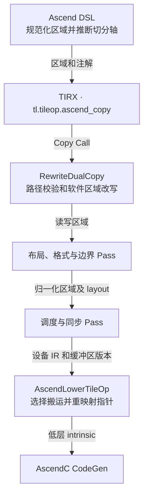
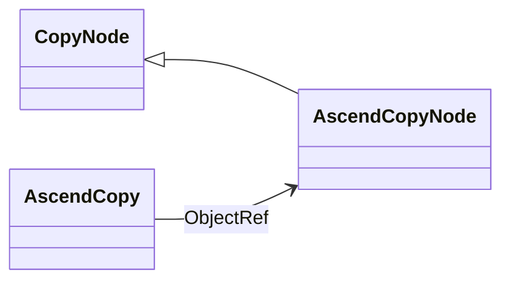
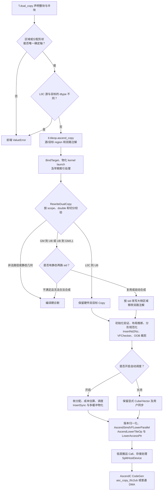
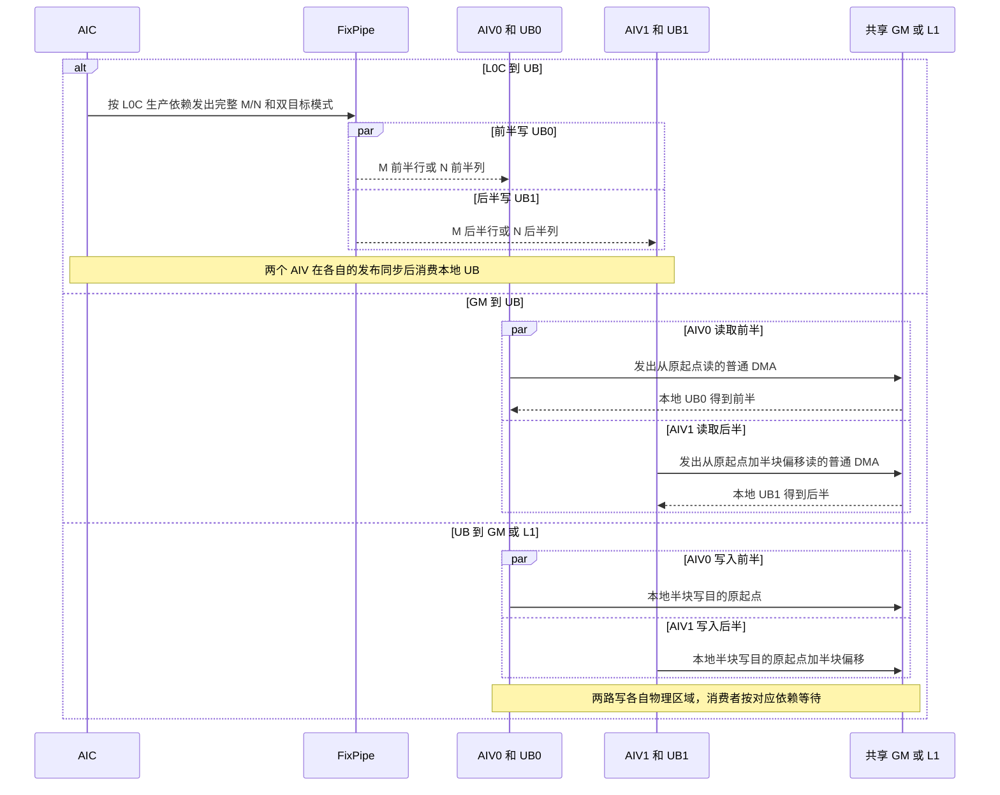

# TileLang Ascend Dual Copy 详细设计文档

| 项目 | 内容 |
|---|---|
| 代码基线 | `test_memory`，`26335cc7e83d896c973e5e7ee81d3bf7910a8e4f` |
| 仓库 | yyyy999/tilelang，本地工作区 D:/codes/yyz/tilelang |
| 适用目标 | TileLang Ascend 方言的 AscendC 后端（`target="ascend"`），面向 Ascend 950（A5，默认架构 `dav-3510`）。 |

本文以该提交中的实现和用例定义为准。本次完成源码和文档静态核对，真机数值与性能结果需在交付环境记录。[Ascend 目标说明](../../tilelang/ascend/README.md#L24)

# 1、SR概述

## 1.1 场景目标

`T.dual_copy(src, dst)` 表达一个整块与两份半块之间的分发或合并。本文的**整块**是两个 AIV 合计处理的逻辑区域，**半块**是单个 AIV 的区域。沿切分轴，AIV0 对应前半，AIV1 对应后半。GEMM 示例先从 L0C 分发到两个 UB，再由两个 AIV 合并写回 GM。[GEMM 调用示例](../../examples/ascend/example_gemm.py#L76)

源码 `DualCopyPath` 区分硬件路径与三条软件路径。本文沿用“硬件双路”和“软件双路”作为这两种实现的简称，同一个 `T.dual_copy` 调用根据两端 scope 及整块所在侧选择路径。

| 术语 | 分路发生在哪里 | 执行行为和适用条件 |
|---|---|---|
| **硬件双路** | `RewriteDualCopy` 保留双目标 Copy，FixPipe 根据模式在执行时划分源矩阵并路由。 | 仅 L0C→UB。AIC 提交一条双目标 FixPipe，携带整块 M/N 和一组基址。两个 UB 使用相同的本地目的偏移，分别收到前、后半。 |
| **软件双路** | `RewriteDualCopy` 在编译期用 `sid` 改写整块一侧的逻辑范围。`sid` 是执行该 Copy 的 AIV 编号，取 0 或 1。 | GM→UB、UB→GM、UB→L1。两个 AIV 分别执行自己那一半的普通搬运。分路由编译器表达，搬运仍走目标的 DMA 或布局搬运指令。 |

来源：[源码路径分类](../../src/ascend/transform/rewrite_dual_copy.cc#L97) · [硬件保留与软件改写](../../src/ascend/transform/rewrite_dual_copy.cc#L309)

## 1.2 约束限制

| 约束 | 当前规则 |
|---|---|
| 执行上下文 | 这是混合核 API，kernel 须包含 Cube 工作。Rewrite 阶段的软件双路要求 `cthread` extent 静态为 2。手动模式须把软件双路放在 `T.Kernel` 的显式 `T.Vector()` 中。 |
| 切分形状 | 一维仅用于软件双路。二维及以上只从尾两轴选 M 或 N。静态整块和半块的切分轴必须严格为 2:1。符号 extent 可借分配 shape 推断方向，调用方仍需保证运行时比例和容量。 |
| 硬件双路 | A5 的双目标模式与 `quant_pre` 互斥。L0C 和 UB 须同 dtype，描述符使用 `quant_pre=0`。M 切分要求整块 M 为偶数；N 切分要求整块 N 为 32 元素的倍数。自动调度时，两路共用一次 AIC 搬运触发，调用点须处在与 `sid` 无关的控制路径。 |
| L0C 地址 | 源矩阵尾两轴起点为零，前导索引一次只选中一个矩阵。**紧凑 pitch**指按本次源区域的 M 向上对齐至 16 行得到的源面板间隔参数。实际 L0C 生产布局须与该值匹配。`T.dual_copy` 无 `l0_pitch` 参数。 |
| 目的地址与布局 | ND UB 的起始地址和行 stride 需按 FixPipe 的 32 字节要求检查。NZ UB 使用 16 列面板的布局校验。 |

来源：[DSL 约束](../../tilelang/ascend/language/copy_op.py#L53) · [静态比例校验](../../src/ascend/transform/rewrite_dual_copy.cc#L152) · [L0C 描述符](../../src/ascend/op/copy.cc#L682)

## 1.3 功能规格

| 路径 | 源 / 目的区域 | AIV0 / AIV1 的结果 |
|---|---|---|
| L0C→UB | 整块 / 本地半块 | FixPipe 将前、后半写到两个 UB 的相同局部偏移。 |
| GM→UB | 整块 / 本地半块 | 两个 AIV 从 GM 的不同半块读入各自 UB。 |
| UB→GM | 本地半块 / 整块 | 每个 AIV 写入 GM 中自己的半块，保留 `l2_cache_ctrl`。 |
| UB→L1 | 本地半块 / 整块 | 各 AIV 写自己的 L1 区域，按实际布局选用连续或 NZ 搬运。 |

验收检查前后半归属、实际读写窗口和同步后的可见性。GM 边缘按每路裁剪后的范围比较；空范围应跳过有效搬运。[范围改写](../../src/ascend/transform/rewrite_dual_copy.cc#L309) · [空区间保护](../../src/ascend/op/copy.cc#L407)

# 2、SR实现分析设计

## 2.1 方案分析

选择路径的依据是**谁负责切分输入与路由目的地址**。L0C→UB 的 FixPipe 描述符允许用一对指针表达两个目标，因此保留一个带双目标模式的 Copy。将它拆为按 AIV 独立调度的任务会丢失该描述符所表达的共同触发、偏移和版本关系。GM→UB、UB→GM、UB→L1 的普通搬运各自只处理一个明确的源、目的区域，因此在调度前先改写两路范围。否则下游会用整块估算单路范围，边界裁剪也无法保留两路原定分界。

普通 `T.copy` 仍是软件改写后的搬运语义。`T.dual_copy` 增加的是整块与两个 AIV 半块的归属关系，`RewriteDualCopy` 在这里决定保留该关系到 FixPipe，还是用范围表达式将它落实到各 AIV。[Rewrite 的流水位置](../../tilelang/ascend/pipeline.py#L73) · [子核分析保护双目标任务](../../src/ascend/transform/auto_schedule/subcore.h#L248)

## 2.2 模型设计

### 组件视图



布局和调度分析依赖改写后的读写范围。Lowering 还接收 layout map 和 buffer remap，将区域映射到实际存储和指令字段。[Pass 流水](../../tilelang/ascend/pipeline.py#L73) · [LowerArgs 与指针重映射](../../src/ascend/transform/lower_tile_op.cc#L1254)

### 关键数据结构及所有者

| 结构或表示 | 保存的信息 | 创建或更新者 | 使用者 |
|---|---|---|---|
| `BufferRegion`、`tl.region` | Buffer、切片起点及范围。`tl.region` 调用还带访问掩码。 | DSL 将 BufferLike 参数规范化。软件路径由 `RewriteRegion` 重写整块一侧的范围。 | Copy 解析、布局分析、OOB 裁剪、核间同步与 Lowering。 |
| `tl.tileop.ascend_copy` 的 `Call` | 两个 region 参数，`dual_dst_ctl` 控制切分轴，`double` 标识整块在目的侧，另有 `unit_flag_ctrl` 和 L2 cache 等注解。 | Ascend DSL 发出。`RewriteDualCopy` 保留硬件双路注解，软件改写后删除已消费的双路字段。 | Rewrite、布局和调度分析、TileOp Lowering。 |
| `CopyNode`、`AscendCopyNode` | 源、目标、各轴 Range，以及从 IR 注解解码的 `dual_dst_ctl`、`unit_flag_ctl`、`sub_blockid` 等类型化字段。 | `AscendCopy` 从 Call 的参数和注解构造类型化视图。 | C++ Pass 分类和校验搬运，`Lower` 选择 DMA 或普通 Copy 分支。 |
| `AscendFractalLayoutInfo`、`AscendFractalRegionInfo` | 分形内层尺寸、分形轴及映射后的区域 bounds。 | Layout inference 提供布局；`TryExtractAscendFractalLayout` / `TryExtractAscendFractalRegion` 从布局及区域提取。 | Normalize 和 L0C→UB Lowering 计算物理容量、pitch 和 NZ 描述符。 |
| `StridedLayout`、`MTECopy2D` | 内外轴 extent、元素 stride；DMA 规划结果包含行数、每行元素数、每侧行 stride 和基址偏移。 | 从实际 Buffer 和 Range 构造 `StridedLayout`；GM↔UB 由 `PlanMTECopy` 归并并求得二维方案。 | DMA Lowering 换算字节并发出对应的 MTE intrinsic。 |
| `tl.ascend_copy_matrix_cc_to_ub` 等低层 Call | 物理端点、有效尺寸、stride 和指令模式字段。 | `LowerDMACopy` 生成，`AscendLowerTileOp` 递归处理生成结果及访问指针。 | AscendC CodeGen 将这些字段映射为 C API 参数。 |

来源：[区域改写](../../src/ascend/transform/rewrite_dual_copy.cc#L56) · [类型化 Copy 解析](../../src/ascend/op/copy.cc#L1200) · [分形布局与范围信息](../../src/ascend/layout/ascend_layouts.h#L92) · [MTECopy2D 与 PlanMTECopy](../../src/ascend/op/ascend_mte_plan.h#L343) · [低层 FixPipe Call](../../src/ascend/op/copy.cc#L787) · [TileOp lowering 后递归重映射](../../src/ascend/transform/lower_tile_op.cc#L1271)

### Copy 类型关系

只展示用于解析 Copy 和执行 lowering 的源码类型关系。`AscendCopy` 持有类型化节点引用，`AscendCopyNode` 在通用 `CopyNode` 上增加 Ascend 字段并实现 `Lower` 与 `InferLayout`。[CopyNode](../../src/op/copy.h#L30) · [AscendCopyNode 和 AscendCopy](../../src/ascend/op/copy.h#L27)



## 2.3 流程设计

### 从 DSL 到指令



### 切分方向与路径合法性

1. **选轴**。两端同时为一维时只比较唯一轴。矩阵比较尾两轴。对每个候选轴检查源或目的是否恰为另一侧的两倍，常量按值比较，符号用 `structural_equal(half*2, full)`。先用实际区域，候选数不为一时再比较分配 shape；仍无法唯一选轴时前端报错。分配 shape 仅辅助选轴，Copy 继续携带原有切片起点和 extent。
2. **编码方向**。`dual_dst_ctl=1/2` 在 TileOp 阶段分别表示 M/N；一维软件路径沿唯一轴，内部编码为 2。`double` 是整块在目的侧的标记。所选轴上，只要实际区域或分配 shape 表明目的侧为源侧两倍，就带上该标记。`RewriteDualCopy` 同时检查 scope 和标记是否匹配，存在 `double` 的路径仅为 UB→GM、UB→L1。标记方向与路径不匹配会拒绝，即使某个轴从数值看满足 2:1。
3. **校验实际区间**。两端切分 extent 均为常量时，Rewrite 验证整块长度等于半块长度的两倍。硬件 N 切分还要求整块 N 能被 32 整除。例如 `64×48→64×24` 可以选出 N，但 L0C→UB 校验失败。某一侧为符号时，本阶段跳过这组常量校验；后续的 `has_data` 只保护非空条件，运行时比例和布局仍是调用方契约。

同一 `dual_dst_ctl` 在两条实现中的去向不同。软件路径在范围改写后消费掉该注解，普通 DMA 不会读取它。硬件路径将它传入 FixPipe 描述符，设备据此选择切分轴。[DSL 选轴与编码](../../tilelang/ascend/language/copy_op.py#L107) · [路径分类](../../src/ascend/transform/rewrite_dual_copy.cc#L106) · [静态校验](../../src/ascend/transform/rewrite_dual_copy.cc#L152) · [注解消费](../../src/ascend/transform/rewrite_dual_copy.cc#L309)

### 指令执行与两路归属

下图按一个 tile 展示三种执行方向；每条路径的等待和复用顺序取决于所在 kernel 的依赖。



### 软件双路的范围改写与地址

设整块一侧的切分轴起点为 `S`，另一侧对应轴的实际 extent 为 `H`。`RewriteDualCopy` 只改整块一侧：将起点改为 `S + sid × H`，extent 改为 `H`。其他轴和本地 UB 范围保持原样。因此两个 AIV 分别访问 `[S,S+H)` 和 `[S+H,S+2H)`。偏移需要加到原切片起点，省略 `S` 会使带偏移的 tile 搬错位置。

| 路径 | 被改写的一侧 | 改写后的实际搬运 |
|---|---|---|
| GM→UB | GM 源 | 同一 GM 区域的两个半块分别进入本地 UB。 |
| UB→GM | GM 目标 | 两份本地 UB 半块写入 GM 的不同区域。 |
| UB→L1 | L1 目标 | 两路各写自己的区间，再依据目标布局生成连续 DMA 或 NZ 版本。 |

两次执行来自同一个带 `sid` 的逻辑 Copy。自动模式复用已有 `cthread`，必要时在 `tilelang_root` 合成 extent 为 2 的作用域；手动模式复用显式 `T.Vector()` 内的绑定。`RewriteDualCopy` 删除已消费的 `dual_dst_ctl`、`double`，同时去掉不适用于软件路径的 `unit_flag_ctrl`。后续调度可将 `sid` 具体化，地址仍按执行该分支的 AIV 计算。[范围改写和注解清理](../../src/ascend/transform/rewrite_dual_copy.cc#L309) · [作用域校验](../../src/ascend/transform/rewrite_dual_copy.cc#L335)

**从逻辑起点换算物理地址。** 对内轴连续的二维 ND 区域，元素偏移为 `row × row_stride + col`，再按 dtype 换算字节。切分改变的是起点和搬运长度；逐行寻址仍使用底层 Buffer 的行 stride。

| 算例 | AIV0 | AIV1 |
|---|---|---|
| GM→UB，M 切分。GM 区域 `G[8:72,16:80]`，每路 `32×64`，GM 行 stride 为 128 元素。 | 行 `[8,40)`，起始元素偏移 `8×128+16=1040`。 | 行 `[40,72)`，起始偏移 `40×128+16=5136`。 |
| UB→GM，N 切分。每核 UB `32×32`，目标 `G[8:40,16:80]`，GM 行 stride 为 128 元素。 | 列 `[16,48)`，起始元素偏移 1040。 | 列 `[48,80)`，起始元素偏移 1072。 |
| 一维 UB→GM，`UB[0:32]` 到 `G[64:128]`。 | `G[64:96]`。 | `G[96:128]`。 |

N 切分示例用 FP32 时，每路 32 行，每行搬 `32×4=128 B`。GM 的行间距为 `128×4=512 B`。`PlanMTECopy` 保留这个行间距；将半块合成连续字节搬运会跨入另一半或行间空隙。仅单行，或两侧由规划结果证明行间距均等于有效行长时，GM↔UB Lowering 才合并成一个连续 burst。[普通 DMA 规划](../../src/ascend/op/copy.cc#L455) · [连续搬运条件](../../src/ascend/op/copy.cc#L497)

**UB→L1 的布局分支。** 原始搬运要求源、目的都可合并为连续范围，元素位宽与数量相符，并满足 32 字节传输粒度。带 NZ 布局的 L1 由 `InsertNd2Nz` 处理。这里的 **post-copy** 指在数据已按目标列分组排布后，按源、目标各自的 NZ pitch 写入 L1 的 `ascend_nd2nz_post_copy`。已有同 dtype NZ 源可直接用此步骤；满足条件的 ND 源若只有一个 C0 列分组且同 dtype，也可直接发出。其他受支持的 ND 场景先 scatter 到 UB 临时区，再按该区实际的 `rows+1` pitch 读出。L1 目标列起点、宽度和基址偏移须满足其 C0 对齐，ND 输入还要是完整连续行并满足源地址对齐。scatter 另有 dtype 组合和列宽约束。

物理偏移由 NZ 布局决定。例如现有 `64×128` FP32 用例的 L1 列分组宽度为 8。M 切分的后半从第 32 行开始，目标元素偏移差为 `32×8=256`；N 切分的后半从第 64 列开始，跨 8 个列分组，目标偏移差为 `8×64×8=4096`。两例均在 `test_nd2nz_matmul_reuses_mixed_kernel_sid` 中检查。按 ND 行 stride 线性化会得到不同的目标地址。[UB→L1 原始搬运](../../src/ascend/op/copy.cc#L817) · [NZPitch](../../src/ascend/transform/insert_nd2nz.cc#L231) · [RewriteUBToL1](../../src/ascend/transform/insert_nd2nz.cc#L371) · [物理偏移断言](../../testing/ascend/layout/test_tilelang_ascend_nd2nz_matmul.py#L103)

**GM 尾块在定好分界后裁剪。** 对支持的 GM↔UB 描述符，可配对的源、目的非单例轴须有可证明相同的 extent。分流后，各对应轴取 `min(声明长度, 源剩余容量, 目的剩余容量)` 作为有效长度，两端剩余容量均以零为下限。以上述 N 切分为例，若 GM 分配宽度为 70，声明目标仍到第 80 列，AIV1 的起点仍为 48，只把源、目标的搬运宽度从 32 缩到 22。若先裁整块再等分，AIV1 的起点会移到第 43 列，与原定半块归属不一致。若 GM 分配止于第 48 列之前或恰好宽 48，AIV1 的有效长度为 0。Lowering 对已知空块省略搬运，动态空块由 `has_data` 保护；UB 上未写的位置不属于本次结果。[GM 路径裁剪](../../src/ascend/transform/insert_oob_padding.cc#L399) · [逐轴有效长度](../../src/ascend/op/oob_padding.cc#L189) · [空操作保护](../../src/ascend/op/copy.cc#L407)

### 硬件双路的描述符、对齐与同步

**尺寸与路由。** `LowerDMACopy` 从布局处理后的源区域取完整 `m_size/n_size`。FixPipe 用 `dual_dst_ctl=1` 把 M 分成两半，用 `2` 把 N 分成两半。描述符中的源指针始终指向完整源 tile 的起点；两个目标共享同一个局部 UB 指针偏移。若把每个 AIV 的半块尺寸传入，硬件会再次切半。`sub_blockid` 是单目标模式 `dual_dst_ctl=0` 的 UB 选择字段；硬件双路由模式完成路由。

**源和目的的 stride 独立计算。** 源 L0C 逻辑坐标 `(m,n)` 映射为 `(n//16,m//16,m%16,n%16)`。当两矩阵轴都从零开始时，按本次源区域计算紧凑 pitch `P=ceildiv(M,16)×16`。描述符写入 `src_stride=P`，单位为 `16×sizeof(src_dtype)` 字节，因此每跨一个 16 列面板跨 `P×16` 个源元素。若在 `64×128` 分配内生产了紧凑的 `32×64` 结果，N 切分的后半从第 32 列开始，对应源元素偏移为 `2×32×16=1024`；若误用分配 M=64，偏移就成了 2048。如果实际生产的是 64 行、搬运其中的 32 行前缀，`T.dual_copy` 仍按源区域推导 pitch，调用方需使该值与实际生产布局匹配。

| UB 目的布局 | 描述符中 `dst_stride` 的含义 | 计算例 |
|---|---|---|
| ND | 相邻目标行的元素间距，取 Buffer 的 row stride，`NZ2ND_en=1`。 | `64×64` 源做 N 切分，每核写 32 列。若 UB 行宽是 64，指令的 `dst_stride` 仍为 64；填 32 会把下一行写进上一行的未选列。 |
| NZ | 相邻 16 列目的面板的元素间距，取布局输出 shape 末三维乘积，`NZ2ND_en=0`。 | 物理上每列面板包含 48 行时，`dst_stride=48×16=768`；即使每核只在其中写 16 行，面板间隔也保持 768。 |


**M/N 与对齐如何相互影响。** ND 目的的基址对齐、行 stride 对齐和实际搬运宽度分别检查。`NormalizeFixpipeCopy_` 对 ND 行 stride 无法证实为 32 字节倍数的场景告警，原有 stride 保持。在 M 切分中，切分点取决于 M，扩大 N 不会移动前后半行的边界。设 `A=32/sizeof(dst_dtype)`，可将源 N 上取整到 `ceildiv(N,A)×A`，目的宽度按需要增至该值。只有能证明扩大后的源范围在物理容量内，且目的范围落在 `min(UB 分配列数, 目的行 stride)` 内时才改写。例如 FP32 的 `4×10→2×10` M 切分，有 16 列源物理容量与 16 列可写 UB 时，可把搬运宽度从 10 提到 16。补搬的是源数据，逻辑输出仍只消费声明的 10 列。容量无法证明时保留原区间并告警。

N 切分以 `N/2` 定义后半的源起点；调整整块 N 会移动该起点，因此本 Pass 保留 N 分界。NZ 目的绕过 ND 宽度补齐，在 Lowering 检查 16 列面板、列起点和宽度对齐，以及显式逻辑 strides 是否稠密。动态硬件双路仍从运行时有效 M/N 取整块尺寸，调用方需满足选定切分轴的比例和对齐要求。归一化用条件表达式保留空宽度，Lowering 在实际范围为空时保护整条描述符，避免把零宽块扩大成有效搬运。

**两路共享局部偏移和存储版本。** 子核分析保留硬件双路的目的 UB 为两个地址空间中的同一偏移和版本槽位，拒绝依 `sid` 复制该 AIC 任务。一条指令只有一个目的偏移，若两路各自推进缓冲区版本，就无法用这条指令表达两个不同的目标槽位。`unit_flag_ctrl` 透传给 FixPipe 以配合 MAD 的生产；AIV 读 UB 前的等待和上一版 UB 复用前的依赖仍由跨核同步保证。软件双路在 Rewrite 后只保留普通搬运的同步依赖。

来源：[L0C 布局映射](../../src/ascend/layout/ascend_layouts.cc#L256) · [L0C 描述符计算](../../src/ascend/op/copy.cc#L682) · [ND 容量、N 切分与空块处理](../../src/ascend/transform/normalize_fractal_storage.cc#L313) · [NZ stride 断言](../../testing/ascend/layout/test_ascend_fractal_storage_integration.py#L44) · [子核版本和投影约束](../../src/ascend/transform/auto_schedule/subcore.h#L248) · [Fixpipe 字段与对齐](https://www.hiascend.com/doc_center/source/zh/CANNCommunityEdition/910beta2/API/ascendcopapi/atlasascendc_api_07_0251.html)

### 指令映射与参数核对

以下用同一个 `64×64` FP32 源说明描述符中三个容易混淆的尺寸。源为紧凑 L0C，目的为 ND UB。

| 调用场景 | 每个 UB 的写入区域 | `(n_size, m_size, dst_stride, src_stride)` | 双目标模式 |
|---|---|---|---|
| M 切分 | `32×64`，UB 行宽 64 | `(64,64,64,64)` | `1` |
| N 切分，紧凑目的 | `64×32`，UB 行宽 32 | `(64,64,32,64)` | `2` |
| N 切分，目标切片 | `UB[:,0:32]`，UB 行宽 64 | `(64,64,64,64)` | `2` |

AscendC 从 `tl.ascend_copy_matrix_cc_to_ub` 生成 `asc_set_l0c_copy_nz_para(1,0,0)` 和一条 `asc_copy_l0c2ub`。IR 的 3–6 号参数按上表顺序进入接口，双目标模式是 IR 参数 7，`sub_blockid` 是参数 8，在 C API 中先传 `sub_blockid` 再传模式。低层 Call 的 IR 参数 2 固定为 0，C API 会略过它；它与软件路径中用于计算区域的 `cthread sid` 用途不同。对 L0C 双路，`quant_pre=0` 且 `NZ2DN_en=0`。

软件路径 Lowering 在已改写的每路区域上发出普通搬运。AscendC 的 GM→UB、UB→GM 分别对应 `asc_copy_gm2ub_align`、`asc_copy_ub2gm_align`，UB→L1 的直接搬运对应 `asc_copy_ub2l1`。NZ post-copy 携带该半块的实际 pitch，CodeGen 据此生成写 L1 的搬运。

来源：[AscendC FixPipe 参数映射](../../src/ascend/codegen/codegen_ascend.cc#L1520) · [GM/UB DMA 映射](../../src/ascend/codegen/codegen_ascend.cc#L1429) · [UB→L1 及 NZ post-copy](../../src/ascend/codegen/codegen_ascend.cc#L1648)

## 2.4 表设计

不适用。Dual Copy 的区域、布局、地址和调度元数据存在于编译期间的 IR 与 Pass 数据结构中，无数据库表或持久化字段。

## 2.5 接口设计

调用方使用 Ascend 方言 `import tilelang.ascend.language as T`。接口如下。

```python
T.dual_copy(src, dst, *, unit_flag_ctrl=None, l2_cache_ctrl=0)
```

| 参数或输出 | 定义 |
|---|---|
| `src`、`dst` | Buffer、BufferRegion 或可归一化的 BufferLoad。传入切片可指定实际区域。整块位于哪一侧由内存路径规则决定。 |
| `unit_flag_ctrl` | 整数或 PrimExpr。用于 MAD→FixPipe 的 UnitFlag 控制，省略时按 0 lowering。硬件双路透传给 FixPipe，软件双路在 Rewrite 时移除。 |
| `l2_cache_ctrl` | 默认整数 0，也可使用可归一化的缓存策略名称，例如 `NOTALLOC_PW`。UB→GM 双路改写保留该注解。 |
| 调用结果 | 写目标区域的 TileOp，可在 PrimFunc 中作为语句使用。 |

来源：[接口签名](../../tilelang/ascend/language/copy_op.py#L53) · [缓存策略解析](../../tilelang/ascend/language/copy_op.py#L202) · [注解清理](../../src/ascend/transform/rewrite_dual_copy.cc#L84)

## 2.6 配置设计

新增配置不涉及。已有目标和调度配置直接决定生成路径。

| 配置 | 实际作用 |
|---|---|
| `target="ascend"` | 生成 Ascend C API 源码，Ascend 950 默认架构为 `dav-3510`。 |
| `tl.enable_auto_schedule` | 默认 `True`。软件路径可复用 `T.MixedKernel` 的 sid 或在 `tilelang_root` 合成 `cthread=2`。设为 `False` 时使用显式 `T.Cube()` / `T.Vector()` 和调用方的同步协议，软件路径复用 Vector 作用域的 sid。 |

来源：[目标架构](../../tilelang/ascend/README.md#L24) · [后端注册](../../tilelang/ascend/backend.py#L86) · [自动调度配置](../../tilelang/ascend/pipeline.py#L23) · [自动 sid 合成](../../src/ascend/transform/rewrite_dual_copy.cc#L263)

## 2.7 升级设计

不涉及专项升级。Dual Copy 由编译器在生成 kernel 时完成 lowering，本设计无独立服务、安装包或持久化状态需要升级。

### 2.7.1 数据库数据结构的升级方案

不适用。该特性不使用 KV 数据库，无 schema 或历史数据迁移。

## 2.8 兼容性分析

### 2.8.1 老版本兼容

本设计无 API 迁移项。复用已有 kernel 时，需核对两端区域和 `unit_flag_ctrl`、`l2_cache_ctrl` 是否符合本基线签名。普通 `T.copy` 仍按单目标或普通搬运规则 lowering。跨编译器、CANN 或芯片版本的二进制兼容性尚未验证。[公开签名](../../tilelang/ascend/language/copy_op.py#L53) · [普通 Copy 和双目标描述符](../../src/ascend/op/copy.cc#L735)

### 2.8.2 上下游兼容

上游算子应提供正确的混合核结构、区域形状和 Buffer layout。用 `T.gemm` 得到的 L0C 紧凑布局须与复制范围匹配。下游 AIV 按自己的半块消费，GM/L1 消费端在同步后读取实际有效区。[Ascend 混合核示例](../../tilelang/ascend/README.md#L149)

## 2.9 安全分析

安全边界是 kernel 已声明的 GM 和片上缓冲区。基线对适用的 GM 路径裁剪越界范围，ND FixPipe 仅在扩展后的范围可证明落在源、目的容量内时修改 extent。符号范围的实际跨度、目的指针对齐和各 AIV 写入是否重叠仍需在生成代码和设备用例中核对。对齐或容量无法证明时，应保留诊断并检查该条描述符。对齐补搬的区域只作为预留空间，算子消费者读取其逻辑有效区。[GM 范围裁剪](../../src/ascend/op/oob_padding.cc#L76) · [FixPipe 扩展边界](../../src/ascend/transform/normalize_fractal_storage.cc#L401)

### 2.9.1 虚机信息安全分析

不适用。功能主体是编译器 IR 变换和 NPU 内存搬运，不采集或传输虚机信息。

### 2.9.2 采集数据上报安全分析

不适用。Dual Copy 的接口只描述 kernel 中的搬运，不提供数据采集或上报功能。

## 2.10 性能分析

| 路径 | 源码可推导的性能特征 | 验证指标 |
|---|---|---|
| L0C→UB | 每个非空 tile 发出一个硬件双目标描述符，两核独立消费半块。`256×256` FP32 完整 tile 逻辑读、写各 256 KiB，每个 UB 写 128 KiB。 | FixPipe 调用数及周期，逻辑传输字节，ND/NZ、M/N、padding，UB 占用及端到端耗时。 |
| GM→UB、UB→GM | 两侧连续时可合成一次 burst。M 切分可能保持整行连续，N 切分常形成跨行的二维 burst。边缘裁剪改变实际长度。 | 每核有效字节、行宽、burst 数、源和目的 stride、L2 策略及端到端耗时。 |
| UB→L1 | 连续区域可走原始 DMA；ND→NZ 路径可能先经 SIMD scatter，再用 DMA 写 L1。 | 区分直接 post-copy 和经 UB scratch 的路径，分别记录中间区占用、MTE 数据量及同步。 |

`EstimateLatency` 生成编译调度使用的成本元数据。基线未取得可归属该提交和路径的性能采样，模型和逻辑字节数用于对齐测试口径。实测时固定硬件、CANN、提交、dtype、布局和同步条件，记录完整 tile、边缘 tile 以及端到端的结果。[DMA 规划](../../src/ascend/op/copy.cc#L455) · [成本几何](../../src/ascend/transform/estimate_latency.cc#L1457) · [等价路径成本测试](../../testing/ascend/auto_schedule/test_estimate_latency.py#L379)

## 2.11 可靠性分析

| 风险 | 已有处理 | 验收边界 |
|---|---|---|
| split 推断或作用域错误 | DSL 和 Rewrite 检查 axis、静态比例、scope、硬件 N 对齐及软件 sid。 | 用两路可区分的数据验证区域切分；对动态区间同时记录编译证明和运行时范围。 |
| padding 或 DMA 写入超出有效邻域 | 支持的 GM 路径裁剪。ND FixPipe 按源物理容量、UB shape 和 stride 做补齐空间证明。 | 对有告警或不能证明的场景检查实际指令。有效邻域和允许写入的 padding 区分开验证。 |
| 非对齐窗口和 pitch 误用 | Lowering 检查 L0C 源矩阵为零起点，按源区域推导紧凑 pitch。目的侧按 ND/NZ 确定 stride。 | 用非零 UB 切片和较大 allocation 内的紧凑生产块验证 pointer、stride 和数据。调用方还需保证推导的 pitch 与生产者一致。 |
| 读写竞争、复用时过早覆盖 | 自动模式跟踪核间依赖和版本；原生双路 UB 保持共同的局部地址与版本。手动模式由算子维护 flag。 | 连续执行多个 tile 并复用同一 slot，验收两路发布、等待和归还。区分 UnitFlag 与 Cube/AIV 跨核同步。 |

来源：[Rewrite 静态检查](../../src/ascend/transform/rewrite_dual_copy.cc#L152) · [Normalize FixPipe 容量检查](../../src/ascend/transform/normalize_fractal_storage.cc#L390) · [AutoSchedule 和同步](../../tilelang/ascend/pipeline.py#L113) · [双目标 UB 存储](../../src/ascend/transform/auto_schedule/subcore.h#L248)

## 2.12 可维护性分析

用最小 kernel 保留基线 SHA、目标及运行环境。可启用 `TL_LOWER_TRACE`，从首个出现差异的 IR 阶段开始定位。[Lower Trace 使用说明](../../docs/tools/lower_trace.md#L32)

| 步骤 | 核对信息 |
|---|---|
| DSL 与 Rewrite | 对照实际 region 与 allocation shape，检查 `dual_dst_ctl`、`double`、dtype 与 scope，确认软件路径仅移动大侧切分轴。 |
| 布局及调度 | 查看归一化后的 UB shape、逻辑 extent、物理 pitch、裁剪范围、sid 和 buffer version。同步异常时检查两个 AIV 的实际消费与归还顺序。 |
| Lowering 与 CodeGen | 保存 lowering IR 和生成的 Ascend C API 源码。核对完整 M/N 或软件半块长度、行步长、UB 起点、dual mode 和 UnitFlag。 |
| 设备复现 | 用可区分行列的输入和目标边界哨兵复现。保存真机首个失败 tile 或迭代位置，以及 CANN、芯片型号和对应生成代码。 |

来源：[调度 Pass 入口](../../tilelang/ascend/pipeline.py#L113) · [Ascend C API 参数映射](../../src/ascend/codegen/codegen_ascend.cc#L1520)

# 3、AR开发者测试设计

下表映射到当前提交中已有的 pytest 用例，编号仅用于本表索引。IR 与 CodeGen 用例通过调用 Pass 或 `tilelang.lower` 比较结构及生成代码。设备用例通过 `tilelang.compile` 执行 kernel，再和参考结果比较。用于本节的项目构建应和文档基线一致。以下均为测试源码中的预期结果，本次未执行。

| 用例编号 | 用例名称 | 测试目的 | 前置条件/输入 | 操作步骤 | 预期结果 | 实际结果/备注 |
|---|---|---|---|---|---|---|
| DC-DEV-01 | `test_software_copy_splits_the_full_region` | 验证软件分流改写。 | 一维 `128↔64` 的三条软件路径，二维 M/N，以及自动和手动 Vector 作用域。 | 对构造的 TIRX 运行 `RewriteDualCopy`，读取改写后的两个 region。 | 大侧切分轴起点为 `sid × extent`，大小等于半块，其他轴起点保持。移除 `double`、`dual_dst_ctl`、`unit_flag_ctrl`。 | 未执行。Pass 单测。 |
| DC-DEV-02 | `test_automatic_copy_synthesizes_one_subcore_scope` | 验证自动 sid 合成。 | `tilelang_root` 下两个未绑定 sid 的一维 GM→UB Copy。 | 运行 Rewrite 并遍历 `thread_extent`。 | 只合成一个 extent 为 2 的子核作用域，两个 Copy 均位于其中。 | 未执行。Pass 单测。 |
| DC-DEV-03 | `test_hardware_copy_retains_dual_destination_and_unit_flags` | 验证原生路径透传。 | FP32 L0C `64×64` → UB `32×64`，M 模式，UnitFlag 3。 | 运行 Rewrite，对比变换前后的 IR。 | 结构相同，区域、双目标模式和 UnitFlag 保留。 | 未执行。Pass 单测。 |
| DC-DEV-04 | `test_invalid_copy_regions`、`test_manual_copy_requires_vector_scope` | 验证失败阶段和诊断。 | GM→L1 非法双路、奇数完整轴、原生 N=48、硬件一维，以及无显式 Vector 的手动软件双路。 | 对每个负例运行 Rewrite，匹配 `ValueError`。 | 诊断指向具体路径、比率、N 对齐、rank 或 Vector 作用域。 | 未执行。Pass 单测。 |
| DC-DEV-05 | `test_l0c_to_ub_n_split_dual_copy_keeps_its_region`、`test_l0c_to_ub_lowered_descriptor_is_aligned` | 区分 N 切分的分界保留和 M 切分的条件对齐。 | N 切分 `4×32→4×16`；FP32 M 切分源 `4×10`，目的 `2×8`，分配行 stride 为 16。 | 对 N 用例运行归一化；对 M 用例用 pass instrument 捕获 `AscendLowerTileOp` 后的描述符。 | N 用例区域保持；M 分支断言 `(n_size,dst_stride,dual_dst_ctl)=(16,16,1)`。 | 未执行。Pass 和 Lowering 用例。 |
| DC-DEV-06 | `test_l0c_to_ub_empty_copy_does_not_warn_or_pad`、`test_l0c_to_ub_padding_respects_destination_offset` | 验证共享 FixPipe 归一化的空区间和边缘容量。 | 源或目的的 M/N 为零；普通 L0C→UB FP32 目的列起点分别为 8 和 12。 | 运行归一化。空搬运检查范围和 stderr，非空例检查目的起点和宽度。 | 空操作不改变范围，无对齐告警。非空例保留起点，目的 N 分别为 8 和 4。 | 未执行。共享规则单测，动态原生双路由第 5 章验收。 |
| DC-DEV-07 | `test_nd2nz_matmul_reuses_mixed_kernel_sid` | 检查软件路径在布局变换和 CodeGen 后的地址。 | `64×128` FP32，两个 AIV，分别取 M/N 切分。 | Lower 到 AscendC，读取两个互斥 AIV 分支的 GM 指针及 NZ post-copy 字段。 | 共用一次 sid 读取。AIV1 的 GM 元素偏移在 M/N 下分别为 4096、64，L1 目的偏移差为 256、4096。 | 未执行。CodeGen 和设备 IR 用例。 |
| DC-DEV-08 | `test_manual_mixed_pipeline_shares_sub_block_id`、`test_manual_pipeline_rewrites_compact_nz_dual_copy` | 验证手动混合核经同一个 Vector sid 下沉至普通 DMA。 | 显式 Cube/Vector 的 GM→UB→GM 及紧凑 NZ UB→L1 kernel，关闭自动调度。 | Lower 到 AscendC，检查 kernel 声明、sid 读取及接口。 | 生成 `__mix__(1, 2)`、一次 sid 读取和对应的普通 DMA 调用。 | 未执行。CodeGen 用例。 |
| DC-DEV-09 | `test_nz_fixpipe_layout_survives_full_lowering`、`test_nz_fixpipe_logical_reads_npu` | 验证物理 NZ pitch 及两路读出的数值。 | 输入 BF16，L0C FP32，目的 UB 有 plane 和非零切片起点，测试含 alias 变体。 | 捕获 Lowering 后的描述符；在 AscendC 真机执行 M/N 模式并读回逻辑元素。 | M 描述符的 `dst_stride=48×16` 且 `NZ2ND_en=0`。设备输出与小整数输入的参考计算逐元素相等。 | 未执行。Lowering 和设备用例。 |
| DC-DEV-10 | `test_subcore_fixpipe_synchronization` | 验证 AIC 分发后两个 AIV 的消费同步。 | BF16 GEMM，原生 M 切分的 M=16 或 32，`unit_flag_ctrl=3`。 | 编译 AscendC kernel，在 NPU 上读出 AIV 处理后的拼接结果。 | 与参考 GEMM 在现有测试容差内一致。 | 未执行。设备用例。 |

可从仓库根目录直接指定 pytest 节点。以下两条分别选择纯 Pass 断言与实际设备断言。

```text
python -m pytest -q testing/ascend/transform/test_ascend_rewrite_dual_copy.py::test_hardware_copy_retains_dual_destination_and_unit_flags
python -m pytest -q testing/ascend/auto_schedule/test_schedule_integration.py::test_subcore_fixpipe_synchronization
```

来源：[Rewrite 用例](../../testing/ascend/transform/test_ascend_rewrite_dual_copy.py#L33) · [FixPipe 边界和空块](../../testing/ascend/transform/test_ascend_normalize_fractal_storage.py#L437) · [对齐与描述符](../../testing/ascend/transform/test_ascend_normalize_fractal_storage.py#L567) · [软件双路 IR 与 CodeGen](../../testing/ascend/layout/test_tilelang_ascend_nd2nz_matmul.py#L103) · [手动软件双路](../../testing/ascend/language/test_tilelang_ascend_nd2nz_scatter.py#L87) · [NZ 用例](../../testing/ascend/layout/test_ascend_fractal_storage_integration.py#L44) · [设备同步用例](../../testing/ascend/auto_schedule/test_schedule_integration.py#L530)

# 4、资料建议

| 资料名称 | 修改内容/关注点 | 是否需要修改 | 备注 |
|---|---|---|---|
| 用户文档 · [Ascend 使用说明](../../tilelang/ascend/README.md#L126) | 在现有 GEMM 示例旁补充数据归属，列出四条内存路径、M/N 形状、一维软件双路和混合核条件。注明 L0C 双路的同 dtype 及目的布局约束。 | 建议补充 | 用户据此选择 `T.copy` 或 `T.dual_copy`。 |
| 接口参考 · [Ascend DSL docstring](../../tilelang/ascend/language/copy_op.py#L53) | 保持签名和提示参数说明，补充区域 shape 与分配 shape 的选轴顺序，明确 L0C 紧凑 pitch 和目的 alignment 的单位。 | 建议补充 | 核对 `l2_cache_ctrl` 保留路径、UnitFlag 语义和非法输入诊断。 |
| 开发文档 · [IR Lower Trace](../../docs/tools/lower_trace.md#L32) | 增加一个 Ascend 排查示例，比较 Rewrite 前后的区域、分形归一化后的宽度，以及 Lowering 后的物理指针、stride 和低层 Call。 | 建议补充 | 排障时将 trace 与 target、提交和生成代码关联。 |
| 测试交付记录 | 建立按硬件、CANN、target 和提交记录的验收表，分别归档 IR/CodeGen、设备数值、同步和性能。 | 建议整理 | 记录首次错误的参数、tile 和迭代位置。 |

# 5、测试建议

本节用于整 kernel 和环境组合验收。第 3 章的已提交测试可用于定位具体阶段；以下场景需在交付环境中执行并记录结果。

| 测试范围/场景 | 测试关注点 | 前置条件/依赖 | 预期结果 | 风险/备注 |
|---|---|---|---|---|
| 算子闭环 · GEMM 或 Attention | 覆盖 AIC 生产、FixPipe 双路分发、AIV 消费再到 GM/L1 合并。给两路使用显著不同的行列数据，以验证前后半归属。 | A5、AscendC、部署使用的 CANN 和实际算子配置。分别选 M/N 方向以及支持的 ND/NZ 场景。 | 按完整算子参考比对；两核局部区、合并目标和外部有效邻域正确。 | 只比较总和可能漏掉半块顺序颠倒。算子使用的 layout 与测试输入需一起存档。 |
| 实际边缘 tile 与 UB 非零窗口 | 同时覆盖零长度、较短的有效长度、保留 pitch 的 UB 切片和 GM 边界。用哨兵检查相邻有效区域。 | 运行时参数能触及 0、最小合法非零和完整 extent；L0C 生产 pitch 明确，并有可验证的目标分配边界。 | 原生双路空块不搬运，合法块按实际范围切分；GM 路径仅搬裁剪后的区域；写入止于逻辑范围和允许补齐区。 | 编译期对齐告警须关联实际地址和描述符。静态 Pass 用例无法覆盖所有符号形状组合。 |
| 跨次同步和内存复用 | 验证 UB 发布后消费、归还后覆盖，覆盖多 tile、流水和复用同一 slot。 | 设备，分别采用自动调度和实际支持的手动 flag 协议。 | 多轮输出稳定，无超时、陈旧数据或两路覆盖。 | 更长运行可放大偶发竞争。记录首个异常轮次，保留调度 IR 和版本信息。 |
| 混合布局的 UB→L1 | 验证两个 AIV 的逻辑切片投影到共享 L1 后的物理间距，并由 Cube 实际读取。 | 原始连续、已 NZ 的 post-copy、ND→NZ scatter 各选适用算子，用完整 tile 与边缘合法配置。 | Cube 消费结果与参考一致，无两路物理写入冲突。 | L1 物理重叠无法仅靠逻辑区域不重叠判断；根据 NZ pitch 检查偏移。 |
| 实际性能与资源 | 同时记录端到端时延、FixPipe/MTE 搬运、burst、UB 占用及跨核同步。 | 正确性先通过，固定设备型号、频率条件、工具链、输入规模和编译参数，完整与尾块分别采样。 | 可复现实测结果，与第 2.10 节的逻辑字节数、布局和指令路径可对应。 | 端到端结果受重叠与同步影响，目标阈值待同条件数据确认。 |
