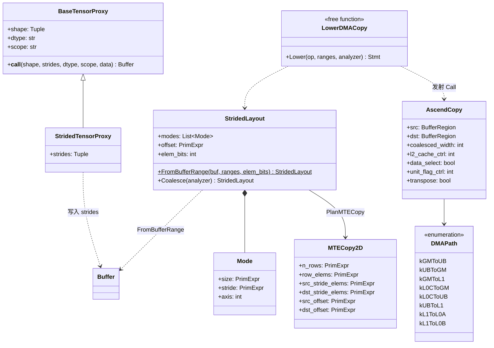
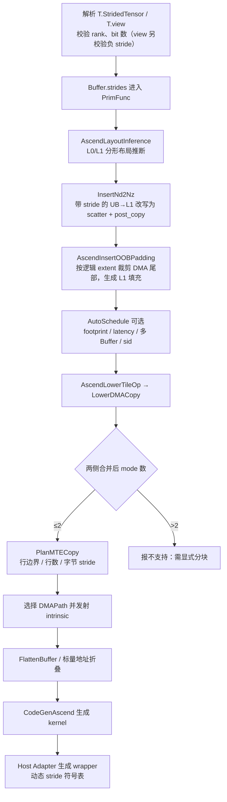
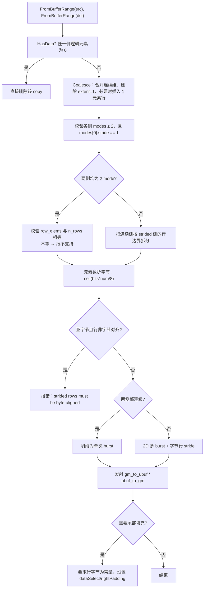
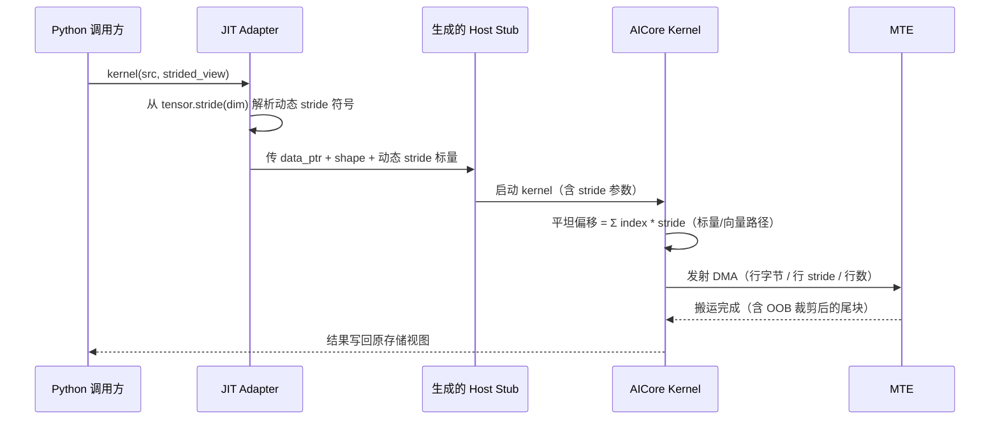

# T.StridedTensor 需求详细设计文档

# 1、需求概述

## 1.1 场景目标

> 描述需求来源与上下文场景。

- 需求来源：Ascend NPU（AscendC 后端）kernel 的 GM 输入输出经常不是独立紧凑张量，而是大块存储上的视图，逻辑 shape 无法表达实际的行间距。
- 上下文场景：
  - 按页拼装的 KV Cache 参与注意力计算时，每一页的有效列数少于页的固定宽度，页与页之间还留有间隙，逻辑形状无法表达这种间距（参见 [flashmla 示例](file:///d:/codes/yyz/tilelang/examples/ascend/flashmla/kernel.py#L690-L696)）。
  - 量化或对齐后的矩阵输入输出，行列之间带有填充，有效列数小于每行的实际宽度。
  - Cube 计算的结果写回外部内存时，输出矩阵每行之间留有空隙，不能按紧凑矩阵直接写出。
  - 两个子核并行处理同一块片上存储的不同列区间，各自按自己的行宽写入。
  - 同一块存储被当作两种不同位宽的数据使用，例如同一段字节既按 8 位整数读，也按 32 位整数读。
- 需求目标：此前这些场景只能通过显式 `T.Tensor((rows, pitch))` 再切片，或在 host 侧做额外拷贝/重排。本需求提供 `T.StridedTensor`，目标是：
  1. 在语言层直接声明带显式 strides 的 Buffer（strides 可为编译期常量，也可为运行期动态值）。
  2. GM↔UB、GM→L1、L0C→GM/UB 的 DMA 直接在描述符中携带字节行 stride，一次搬运完成，不引入中转 buffer。
  3. 标量 / 向量访问通过 stride 参与地址计算，语义与 NumPy 视图一致。
  4. host 侧从实际张量读取动态 stride，不要求调用方先做 `contiguous()`。
  5. 与 OOB padding、AutoSchedule、多 Buffer、Buffer 复用、同步分析协同工作。

典型用法（与 [test_tilelang_ascend_strided_view.py](file:///d:/codes/yyz/tilelang/testing/ascend/language/test_tilelang_ascend_strided_view.py#L34-L50) 一致）：

```python
stride0 = T.dynamic("stride0", dtype=T.int64)

@T.prim_func
def main(
    src: T.Tensor((ROWS, COLS_I8), T.int8),
    out: T.StridedTensor((ROWS, COLS_I8), (stride0, 1), T.int8),
) -> None:
    src_i32 = T.view(src, shape=(ROWS, COLS_I32), dtype=T.int32)
    out_i32 = T.view(out, shape=(ROWS, COLS_I32), dtype=T.int32, strides=(stride0 // 4, 1))
    with T.Kernel(1):
        staging = T.alloc_shared((ROWS, COLS_I32), T.int32)
        T.copy(src_i32, staging)
        T.copy(staging, out_i32)
```

## 1.2 约束限制

> 描述本需求的关键约束限制。

1. **shape 与 strides 维度数必须相等**：strides 长度必须等于 shape 的维度数，前端构造 Buffer 时立即校验，不一致直接报错。
2. **stride 以元素为单位且必须非负**：`T.view` 显式拒绝负 stride；直接用 `T.StridedTensor` 时由调用方保证物理布局合法，编译器不做别名/重叠检查。
3. **GM↔UB 合并后最多 2 个 mode**：`StridedLayout::Coalesce` 把多维合并为“行内连续 + 行间等距”，超过 2 个 mode 不做外层循环展开，直接报不支持。
4. **GM↔UB 两侧可以同时带 stride**：源、目的两侧都非紧凑时，要求行宽（row boundary）与行数一致；否则需要外层循环展开，当前不支持并报错。
5. **行内必须连续**：最内层有效 mode 的 stride 必须为 1；若最内层 stride > 1，Coalesce 会退化为“1 元素行 × N 行”的 2D 描述符，功能正确但带宽很低。
6. **GM→L1 需可归一化为矩阵或 batched 形态**：矩阵形态要求末尾 2 维为行/内维、其余维 extent 为 1；batched 形态要求 ≥3 维且 mode0 连续、3 维以外维度 extent 为 1；目标必须是分形（fractal/NZ）布局的 L1。
7. **L0C→GM/UB 需紧凑尾块**：源 L0C 的尾部 2 维必须从 0 起点、行内连续；L0C→GM 的目标区域必须落在源 tile 范围内；L0C→UB 写 NZ 目标时要求目标逻辑 stride 稠密、列起点与列宽按 16 对齐。
8. **UB→L1 原始搬运不支持 stride**：该路径只接受合并后单 mode 的连续 payload（32B 对齐、字节数为 32B 整数倍）；带 stride 的 UB 源需先经 `InsertNd2Nz` 的 scatter 路径，或先写回紧凑 UB。
9. **亚字节 / 打包 dtype 需按字节行对齐**：行字节数按 `ceil(bits*cols/8)` 计算，行必须字节对齐；host 侧要求静态最内层 stride 为 1 且外层 stride 按元素组对齐。
10. **GM→UB 带 padding 的尾部填充需要静态行字节**：`data_select` / `pad_value` 路径要求行字节数为编译期常量，且元素位宽为 8/16/32；动态行宽不支持填充语义。
11. **动态 stride 由 host 张量决定**：动态 stride 从运行时 `DLTensor` 的 `stride(dim)` 解析；大张量（元素跨度超过 int32）必须使用 `int64`，否则地址计算溢出。
12. **不产生新的 IR 节点**：strides 直接存放在 `tir::Buffer::strides`；所有约束最终在 `LowerDMACopy` / MTE planner 中检查。

## 1.3 功能规格

| 编号 | 功能 | 规格说明 |
| --- | --- | --- |
| F1 | 静态 stride 声明 | `T.StridedTensor(shape, strides, dtype, scope=None, *, data=None)`，strides 为 Python 整数元组，编译期常量折叠 |
| F2 | 动态 stride 声明 | strides 可引用 `T.dynamic(...)` 返回的标量 Var（int32/int64），作为 kernel 的隐式标量参数由 host 解析 |
| F3 | 共享存储视图 | `data=` 可传入已有 Buffer 的 `.data`，声明同一存储上不同 shape/stride 的别名；用于 UB 子核列分区、pitch 视图 |
| F4 | 类型与 rank 变换视图 | `T.view(buffer, shape=None, dtype=None, strides=None)` 返回共享 `.data` 的 StridedTensor，可同时改 shape、dtype、strides |
| F5 | GM↔UB 2D DMA | 单描述符表达 `n_rows × row_elems`，源/目的行 stride 以字节传入；一侧连续时自动按另一侧行边界拆分 |
| F6 | GM→L1 ND2NZ（含 batched） | 带 stride 的 GM 源直接搬入 L1 分形布局，支持 transpose、批量维与尾块 padding |
| F7 | L0C→GM 带 ldd 输出 | 目标行 pitch 取目标 Buffer 的行 stride，以元素为单位传入 `asc_copy_l0c2gm` |
| F8 | L0C→UB 带 pitch 回读 | 目标 UB 行 stride 作为物理 pitch；支持分块读回（部分 N/部分 M） |
| F9 | 标量 / 向量访问 | GM 上的标量读写与 SimtVF 向量化 load/store 通过 stride 计算平坦偏移，可配合 `T.assume` 证明对齐 |
| F10 | 分析协同 | OOB padding 按逻辑 extent 裁剪；AutoSchedule footprint 按物理行计算；延迟估算复用 coalesce 后的行几何；Buffer 复用能区分逻辑视图与物理存储 |
| F11 | 错误诊断 | 不支持的布局、行边界不匹配、亚字节未对齐、动态行宽填充等在 Lower 阶段给出带路径名的 ICHECK 信息 |

# 2、需求实现分析设计

## 2.1 方案分析

方案核心是“不新增 IR 节点，复用 `tir::Buffer` 的 strides 字段 + 一个独立的 MTE 描述符规划器”。

1. **前端声明**：`StridedTensorProxy` 在 `BaseTensorProxy.__call__` 基础上多接收 `strides`，与 `shape` 一起写入 `tir.Buffer`（[proxy.py](file:///d:/codes/yyz/tilelang/tilelang/language/proxy.py#L167-L176)、[proxy.py](file:///d:/codes/yyz/tilelang/tilelang/language/proxy.py#L108-L160)）。`T.view` 做 bit 数守恒、elem_offset 为零、非负 stride 校验后创建共享 `.data` 的新 Buffer（[customize.py](file:///d:/codes/yyz/tilelang/tilelang/language/customize.py#L80-L139)）。
2. **统一规划器**：`StridedLayout` 把 Buffer 的 `(shape, strides)` 与一个访问区域（BufferRegion）合成为“mode 列表”，从最内层开始合并连续维、删除 extent=1 的维，得到 `{extent, stride}` 序列（[ascend_mte_plan.h](file:///d:/codes/yyz/tilelang/src/ascend/op/ascend_mte_plan.h#L79-L196)）。`PlanMTECopy` 在两侧各 ≤2 mode 的前提下选择行边界、校验行数、折算字节，并做“单行坍缩”（[ascend_mte_plan.h](file:///d:/codes/yyz/tilelang/src/ascend/op/ascend_mte_plan.h#L359-L451)）。
3. **按路径归一化**：不同 DMA 路径对形态要求不同，分别使用 `NormalizeMTE2DLayout`、`TryNormalizeBatchedMTELayout`、`NormalizeGMToL1Copy`、`NormalizeTrailingMTE2DLayout` 做最终形态检查与参数抽取（[ascend_mte_plan.h](file:///d:/codes/yyz/tilelang/src/ascend/op/ascend_mte_plan.h#L206-L336)）。
4. **Lower 期发射**：`LowerDMACopy` 根据 src/dst scope 选择 `DMAPath`，构造计划后发射带 stride 参数的 intrinsic；动态 stride 原样作为表达式参数传入（[copy.cc](file:///d:/codes/yyz/tilelang/src/ascend/op/copy.cc#L407-L547)）。CodeGen 只做参数重排与类型转换（[codegen_ascend.cc](file:///d:/codes/yyz/tilelang/src/ascend/codegen/codegen_ascend.cc#L1400-L1518)）。
5. **分析复用同一几何**：AutoSchedule 的访问 footprint（[memory_detector.h](file:///d:/codes/yyz/tilelang/src/ascend/transform/auto_schedule/memory_detector.h#L490-L571)）与延迟估算（[estimate_latency.cc](file:///d:/codes/yyz/tilelang/src/ascend/transform/estimate_latency.cc#L1462-L1519)）都调用相同的 Coalesce/Plan，保证调度决策与实际 DMA 一致。
6. **Host ABI**：动态 stride 符号在编译产物中登记为“来自 Buffer stride 的符号”，运行时从 DLTensor 的 stride 读取；静态 stride 在常量折叠后写入设备代码（[tvm_ffi.py](file:///d:/codes/yyz/tilelang/tilelang/jit/adapter/tvm_ffi.py#L190-L235)、[adapter.py](file:///d:/codes/yyz/tilelang/tilelang/jit/adapter/cython/adapter.py#L285-L296)）。

不采用的方案：

- 新增 `StridedBuffer` IR 节点：需要改动全部 pass、序列化与 codegen，收益仅为表达清晰，成本过高。
- host 侧先 `contiguous()` 再调用：破坏零拷贝诉求，且 page gather 场景会引入额外 HBM 流量。
- 逐元素标量搬运模拟：性能不可接受。

## 2.2 模型设计

**组件视图**

```mermaid
flowchart LR
    A["Python 前端<br/>T.StridedTensor / T.view"] --> B["TIR Buffer<br/>shape + strides + elem_offset"]
    B --> C["AscendLayoutInference<br/>NormalizeAscendFractalStorage"]
    C --> D["InsertNd2Nz<br/>UB→L1 视图改写"]
    D --> E["AscendInsertOOBPadding<br/>逻辑 extent 裁剪 / L1 填充"]
    E --> F["AutoSchedule<br/>footprint / latency / 多 Buffer"]
    F --> G["AscendLowerTileOp<br/>LowerDMACopy"]
    G --> H["MTE Planner<br/>StridedLayout / PlanMTECopy"]
    H --> I["CodeGenAscend<br/>asc_copy_* intrinsic"]
    I --> J["Host Adapter<br/>动态 stride 解析"]
```



**类图**

类的详细定义参考接口设计。



关键数据模型：

| 结构 | 字段 | 语义 |
| --- | --- | --- |
| `Mode` | `size` / `stride` / `axis` | 一个逻辑维在合并后的角色；`axis` 指向原 Buffer 轴（合成 mode 为 -1），用于把访问区间映射回原轴、参与偏移计算 |
| `StridedLayout` | `modes` / `offset` / `elem_bits` | modes 按“最内层优先”排列；`Coalesce` 保证 `modes[0].stride == 1`，必要时插入 1 元素合成行；`offset` 为首元素平坦偏移 |
| `MTECopy2D` | `n_rows` / `row_elems` / `src_stride_elems` / `dst_stride_elems` / `src_offset` / `dst_offset` | 单个 2D 描述符；`row_elems` 取两侧中“行边界”一侧的合并宽度，字节换算在发射前完成 |
| `AscendCopy` | 源/目的区域、各种控制位 | 与 strides 无关的 TileOp 属性保持原样，stride 信息全部由区域 + Buffer 推导 |

## 2.3 流程设计

**编译流程**



**GM↔UB 描述符规划（正常流程）**



**各路径的归一化差异**

| 路径 | 归一化入口 | 形态要求 | 发射 |
| --- | --- | --- | --- |
| GM→UB / UB→GM | `PlanMTECopy` | 两侧各 ≤2 mode；两侧都非连续时行边界/行数一致 | `tl.ascend_copy_gm_to_ubuf` / `tl.ascend_copy_ubuf_to_gm` |
| GM→L1 | `NormalizeGMToL1Copy` | 矩阵形态或 batched 形态；目标 L1 分形布局 | `tl.ascend_copy_gm_to_cbuf` |
| L0C→UB | `NormalizeTrailingMTE2DLayout` + dst 2D/3D | 源尾部 2D 紧凑；NZ 目标要求稠密 stride | `tl.ascend_copy_matrix_cc_to_ub` |
| L0C→GM | `NormalizeTrailingMTE2DLayout` + 目标行/内维 | 目标区域必须落在源 tile 内；行 pitch 取目标 stride | `tl.ascend_copy_matrix_cc_to_gm` |
| UB→L1 | `PlanMTECopy` | 只允许单 mode 连续，32B 整数倍 | `tl.ascend_copy_ubuf_to_cbuf` |
| L1→L0A/B | 既有分形路径 | 不使用 GM stride，按 L1 布局取地址 | `tl.ascend_copy_cbuf_to_ca/cb` |

**异常流程**

1. 前端：`len(shape) != len(strides)` → `ValueError`；`T.view` 负 stride、bit 数不守恒、`elem_offset != 0` → `ValueError`。
2. Lower：mode 数超限、行边界不匹配、亚字节行未对齐、NZ 目标非稠密 → `ICHECK` 带 "Ascend GM->UB/L0C->GM ..." 路径名。
3. 填充语义：动态行宽 + `data_select/pad_value` → 报“requires static row bytes”。
4. UB→L1：检测到非单 mode → 明确提示“strided UB->L1 raw copies are unsupported”。
5. 分析降级：延迟估算遇到 >2 mode 返回未知（0），不报错，但调度会退化为保守选择；Buffer 复用遇到非连续行内 stride 时按不透明访问处理。

**运行期时序**



## 2.4 表设计

不适用。本特性为编译期布局与 DMA 描述符能力，不引入数据库表或持久化结构。

## 2.5 接口设计

本需求不新增 TIR 节点，也不新增 Pass：对外只有 `T.StridedTensor` 与 `T.view` 两个声明接口，`T.copy` 签名不变、自动消费 strides。下面先给出两个对外 op 的定义与参数，再说明 `T.copy` 的消费方式，最后列出下层 intrinsic 参数与运行期 ABI。

### 2.5.1 `T.StridedTensor`（对外接口）

**op 定义**

```python
T.StridedTensor(shape, strides, dtype="float32", scope=None, *, data=None) -> Buffer
```

声明一个带显式 strides 的 Buffer：逻辑 shape 描述可见范围，strides 描述每一维在存储上的元素跨度。声明本身不搬数据、不做转换，只影响后续 `T.copy` 与标量/向量访问的地址计算。

**参数**

| 参数 | 类型 | 说明 |
| --- | --- | --- |
| `shape` | `list` / `tuple` | 元素为 `int` 或 `PrimExpr`；允许动态维 |
| `strides` | `list` / `tuple` | 元素为 `int` 或 `PrimExpr`，每维元素跨度；长度必须等于 `len(shape)`；可含 `T.dynamic` 变量 |
| `dtype` | `str` | 元素类型，支持 8/16/32 位整型与浮点、bf16/fp16、打包 4bit（受 1.2 第 9 条约束） |
| `scope` | `str` | 默认 `"global"`；可传 `"shared"` / `"shared.dyn"` 等，用于在 UB 上声明带 pitch 的别名 |
| `data` | `Var` | 关键字参数；复用已有 Buffer 的存储，实现同存储多视图 |

**语义**

- 静态 stride：Python 整数，参与常量折叠，最终作为立即数写进 DMA 描述符。
- 动态 stride：`T.dynamic(...)` 产生的标量 Var，成为 kernel 的隐式标量参数，由 host 按张量的实际 stride 解析。
- `extent` 为 1 的轴，其 stride 不参与 DMA 几何，host 校验时跳过。
- `scope="global"` 时为 GM 侧端点；`scope` 为 `shared` / `shared.dyn` 时为 UB 侧端点，常配合 `data=` 声明带 pitch 的别名。
- 只声明布局，不校验物理合法性：别名、重叠、越界由调用方保证（见 1.2 第 2 条）。

**返回值与异常**

| 情况 | 行为 |
| --- | --- |
| 正常 | 返回 `tir.Buffer`，strides 写入 `Buffer::strides` |
| `len(shape) != len(strides)` | 构造时抛 `ValueError`，不生成 Buffer |
| stride 为负 | 直接构造不检查（由调用方保证）；`T.view` 会显式拒绝 |

### 2.5.4 下层接口与运行期 ABI

**intrinsic 参数**

| intrinsic | 参数 | 单位 | 来源 |
| --- | --- | --- | --- |
| `tl.ascend_copy_gm_to_ubuf` | `burstSrcStride` / `burstDstStride` | 字节 | 两侧行 pitch 与行字节数之差 |
| `tl.ascend_copy_ubuf_to_gm` | `burstDstStride` / `burstSrcStride` | 字节 | 同上 |
| `tl.ascend_copy_gm_to_cbuf` | `loop1SrcStride` | 字节 | 源行 pitch（基地址移动） |
| `tl.ascend_copy_gm_to_cbuf` | `loop4SrcStride` | 字节 | batched 形态的 batch 间 pitch |
| `tl.ascend_copy_matrix_cc_to_gm` | `dstRowStride` / `loopSrcStride` | 元素 | 目标 GM 行 pitch / 源部分块行距 |
| `tl.ascend_copy_matrix_cc_to_ub` | 行 stride 相关参数 | 元素 | 目标 UB 物理 pitch |

参数签名见 [builtin.h](file:///d:/codes/yyz/tilelang/src/ascend/op/builtin.h#L276-L315)，CodeGen 发射见 [codegen_ascend.cc](file:///d:/codes/yyz/tilelang/src/ascend/codegen/codegen_ascend.cc#L1429-L1518)。

**运行期 ABI**

| 场景 | 行为 |
| --- | --- |
| 动态 stride | 编译期收集 Buffer strides 中的自由 Var，运行时按维度从 `tensor.stride(dim)` 取值；int64 Var 原样传递 |
| 输出视图 | `out_idx` 自动分配的输出按逻辑 shape 分配紧凑张量；需要带 pitch 的输出时应使用 `out_idx=None`，由调用方传入 strided 视图（T05 即此用法） |
| 静态 stride（Cython 执行后端） | 包装层生成静态 stride 断言，shape=1 的维跳过；不匹配时报错（[cython_wrapper.pyx](file:///d:/codes/yyz/tilelang/tilelang/jit/adapter/cython/cython_wrapper.pyx#L154-L181)） |
| 静态 stride（默认 tvm_ffi 执行后端） | stride 已折叠进设备代码，包装层不逐维校验；调用方需按声明传入视图 |
| 未声明 strides 的 Buffer | 视为紧凑布局；Cython 后端校验连续性 |

### 2.5.5 使用方式

**动态 stride 的 GM 输入**

```python
q_strides = (T.dynamic("q_s0", dtype=T.int64), T.dynamic("q_s1", dtype=T.int64), 1)

@T.prim_func
def main(q: T.StridedTensor((1, 128, 576), q_strides, T.bfloat16),
         out: T.Tensor((128, 576), T.bfloat16)) -> None:
    with T.Kernel(1):
        q_ub = T.alloc_shared((128, 576), T.bfloat16)
        T.copy(q[0, :, :], q_ub)
        T.copy(q_ub, out)
```

**dtype 与 stride 联合视图**

```python
stride0 = T.dynamic("stride0", dtype=T.int64)

@T.prim_func
def main(src: T.Tensor((ROWS, COLS_I8), T.int8),
         out: T.StridedTensor((ROWS, COLS_I8), (stride0, 1), T.int8)) -> None:
    src_i32 = T.view(src, shape=(ROWS, COLS_I32), dtype=T.int32)
    out_i32 = T.view(out, shape=(ROWS, COLS_I32), dtype=T.int32, strides=(stride0 // 4, 1))
    with T.Kernel(1):
        staging = T.alloc_shared((ROWS, COLS_I32), T.int32)
        T.copy(src_i32, staging)
        T.copy(staging, out_i32)
```

**常见错误对照**

| 现象/报错 | 原因 | 处理 |
| --- | --- | --- |
| 构造时提示 strides 长度不一致 | `len(shape) != len(strides)` | 为每一维补齐 stride |
| `T.view` 提示负 stride | 传入的视图不合法 | 改用非负 stride 或先做布局转换 |
| `T.view` 提示 bit 数不守恒 | 改 dtype 后的总元素位数不一致 | 调整新 shape，使 `shape × dtype` 的总 bit 数不变 |
| Lower 报不支持（mode 数 >2） | 合并连续维后仍超过 2 个独立 stride 维 | 显式分块搬运，让每块合并后 ≤2 mode |
| 报 `strided rows must be byte-aligned` | 亚字节 dtype 的行宽未按字节对齐 | 调整列数或 pitch，使行字节为整数 |
| 报 `requires static row bytes` | 动态行宽下使用了 `data_select` / `pad_value` | 改为静态行宽，或不用尾部填充 |
| 报 `strided UB->L1 raw copies are unsupported` | UB 源不是单 mode 连续 | 走 `InsertNd2Nz` scatter 路径，或先写回紧凑 UB |
| L0C→UB 的 NZ 目标被拒绝 | 目标逻辑 stride 非稠密 / 列未按 16 对齐 | 使用稠密 stride 并补齐列起点与列宽 |

# 2.8 兼容性分析

### 2.8.1 老版本兼容

首次开发特性，无新老版本兼容问题。`T.StridedTensor` 与 `T.view(strides=...)` 为新增入口；`T.view` 不带 strides 的既有用法行为不变。

### 2.8.2 上下游兼容

- 上游：`tir::Buffer` 的 strides 字段为 TVM 既有能力，不修改 IR 定义；前端新增代理类，不改变 `T.Tensor` 语义。
- 下游：仅在 AscendC 后端的 LowerDMACopy / MTE planner / CodeGen 中消费 strides；未声明 strides 的 Buffer 走原紧凑路径，生成的指令与之前一致。
- 其他后端不涉及本特性的实现改动（strides 由各自既有路径处理）。

# 2.10 性能分析

1. **单描述符代替循环搬元素**：带 stride 的 GM 行通过 `nBurst × lenBurst + stride` 一次下发，避免标量 gather 的指令开销；这是本特性的主要收益。
2. **合并降 burst 数**：`Coalesce` 会把连续维合并成更宽的 burst，burst 数从“元素级”降到“行级”；行内越宽，MTE 效率越高。
3. **小行宽代价**：当最内层只有 1 个元素（如 `T.StridedTensor((64,), (2,))`），会退化成 64 行 × 1 元素的描述符，指令数不变但有效带宽显著下降；应尽量让内层连续。
4. **填充分支开销**：`data_select`/`pad_value` 需要静态行字节，且每行尾部额外写入 padding 元素；只在确有尾块语义时使用。
5. **动态 stride**：地址计算多一次标量乘法，DMA 参数为运行期值；不影响 MTE 吞吐，但可能阻碍向量化路径的对齐证明，可配合 `T.assume(stride % 32 == 0)` 等提示（[test_simtvf_vectorized_codegen.py](file:///d:/codes/yyz/tilelang/testing/ascend/language/simtvf/test_simtvf_vectorized_codegen.py#L432-L451)）。
6. **调度可见性**：AutoSchedule 的行几何与实际 DMA 一致，strided 与等价紧凑区域的延迟估算可得到相同行宽（[test_estimate_latency.py](file:///d:/codes/yyz/tilelang/testing/ascend/auto_schedule/test_estimate_latency.py#L442-L448)）；超过 2 mode 时延迟未知，可能导致保守调度，应在 kernel 侧显式分块。
7. **Buffer 复用保守性**：footprint 对“行内连续”的视图能按物理行扩展，对非连续内层只能按不透明访问处理，可能减少复用机会；这是正确性优先的取舍（[memory_detector.h](file:///d:/codes/yyz/tilelang/src/ascend/transform/auto_schedule/memory_detector.h#L490-L571)）。
8. **L2 缓存提示**：strided 行的地址跨度更大，建议在 GM→UB/L1 上按访问模式设置 `l2_cache_ctrl`，减少行间抖动。

# 3、开发者测试设计

***

用例编号   用例名称   测试目的   前置条件/输入   操作步骤   预期结果   实际结果/备注

***

| 编号 | 用例名称 | 测试目的 | 输入 | 预期结果 |
| --- | --- | --- | --- | --- |
| T01 | `test_strided_view_copy` | UB→strided GM 回写正确 | int8 (12,448)，pitch 512/520，动态 stride0 | 视图内容等于源，pitch 区域保持 0（[文件](file:///d:/codes/yyz/tilelang/testing/ascend/language/test_tilelang_ascend_strided_view.py#L70-L82)） |
| T02 | `test_explicit_strided_view_rank_change` | rank+dtype 变化视图的标量写 | int8 (2,12,448) → int32 (24,112)，int64 stride | 仅目标元素被写，其余存储为 0（[文件](file:///d:/codes/yyz/tilelang/testing/ascend/language/test_tilelang_ascend_strided_view.py#L53-L67)） |
| T03 | `test_strided_dma_roundtrip` | GM↔UB 带 UB 过分配行宽 | src/UB 行宽组合 (4,64)/(8,16)/(64,1) | 结果等于 `src[:, :cols]`（[文件](file:///d:/codes/yyz/tilelang/testing/ascend/language/test_tilelang_ascend_dma_copy.py#L10-L21)） |
| T04 | `test_dynamic_rows_with_fixed_middle_axis` | 动态行数 + 中间固定轴 stride | rows=0/1/4 | 0 行不写；其余行正确（[文件](file:///d:/codes/yyz/tilelang/testing/ascend/language/test_tilelang_ascend_dma_copy.py#L24-L40)） |
| T05 | `test_l0c_to_strided_gm_uses_runtime_row_stride` | L0C→GM 使用运行期 ldd | 16×16×64 GEMM，输出 pitch 32 | 输出视图等于 `A@B.T`，pitch 区域未被写（[文件](file:///d:/codes/yyz/tilelang/testing/ascend/language/test_tilelang_ascend_dma_copy.py#L72-L81)） |
| T06 | `test_gm_to_ub_pad_value` | GM→UB 尾块填充与 data_select | 2×30 → 2×32，pad=-1 | padding 区为 -1（[文件](file:///d:/codes/yyz/tilelang/testing/ascend/language/test_tilelang_ascend_dma_copy.py#L125-L143)） |
| T07 | `test_gm2ub2gm_fp4_copy` | 打包 4bit 往返 | 64 个 fp4 元素 | 字节级一致（[文件](file:///d:/codes/yyz/tilelang/testing/ascend/language/test_tilelang_ascend_dma_copy.py#L105-L122)） |
| T08 | `test_batched_nd2nz_strides_and_transpose_device` | batched ND2NZ 行/批 stride 与 transpose | 3D strided 源，interleaved/普通布局 | 目标 L1 有效区正确，未覆盖区保持 poison（[文件](file:///d:/codes/yyz/tilelang/testing/ascend/language/test_tilelang_ascend_batched_nd2nz.py#L249-L305)） |
| T09 | `test_subcore_strided_view_preserves_physical_storage` | 子核 strided UB 视图 + sid 变化 | 每 sid pitch 不同 | 各 sid 只写自身列区间（[文件](file:///d:/codes/yyz/tilelang/testing/ascend/auto_schedule/test_schedule_integration.py#L668-L710)） |
| T10 | `test_int64_strided_vector_load` | SimtVF 向量化 strided load | int64 动态 stride + assume 对齐 | 生成向量 load 且结果正确（[文件](file:///d:/codes/yyz/tilelang/testing/ascend/language/simtvf/test_simtvf_vectorized_codegen.py#L432-L451)） |
| T11 | `test_padded_copy_coverage_uses_physical_rows` | footprint 按物理行计算 | strided 目的，padding 行 | footprint 覆盖物理行（[文件](file:///d:/codes/yyz/tilelang/testing/ascend/auto_schedule/test_access_footprints.py#L843-L871)） |
| T12 | `test_padded_copy_preserves_values_outside_physical_rows` | 复用时保护视图外数据 | 复用开/关，stride 变化 | 视图外存储保持不变（[文件](file:///d:/codes/yyz/tilelang/testing/ascend/language/test_tilelang_ascend_buffer_reuse.py#L45-L108)） |
| T13 | `test_equivalent_strided_regions_share_mte_row_geometry` | 延迟估算与 DMA 几何一致 | 等价紧凑/带 stride 区域 | 行宽一致（[文件](file:///d:/codes/yyz/tilelang/testing/ascend/auto_schedule/test_estimate_latency.py#L442-L448)） |
| T14 | 负向：>2 mode | 诊断可读 | 3 个独立 stride 维 | Lower 期报不支持，含提示 |
| T15 | 负向：strided UB→L1 | 诊断可读 | UB 带非连续行 | 报 “strided UB->L1 raw copies are unsupported” |
| T16 | 负向：L0C→UB NZ 非稠密 stride | 诊断可读 | NZ 目标 + 逻辑 stride 非稠密 | Lower 期拒绝（[文件](file:///d:/codes/yyz/tilelang/testing/ascend/transform/test_ascend_lower_copy.py#L241-L267)） |

# 4、资料建议

***

资料名称   修改内容/关注点   是否需要修改   备注

***

| 资料名称 | 修改内容/关注点 | 是否需要修改 | 备注 |
| --- | --- | --- | --- |
| [proxy.py](file:///d:/codes/yyz/tilelang/tilelang/language/proxy.py#L167-L176) docstring | 说明 strides 单位、动态/静态差异、2D DMA 限制 | 是 | 与本文 1.2 对齐 |
| [customize.py `view`](file:///d:/codes/yyz/tilelang/tilelang/language/customize.py#L80-L139) docstring | 补充对齐责任、负 stride、bit 守恒示例 | 是 | 现有说明已较完整，补 Ascend 约束 |
| Ascend 使用指南 `SKILL.md` §GM DMA | 新增“显式 stride / 视图”小节：适用场景、限制、诊断 | 是 | 覆盖 page gather、ldd 输出 |
| flashmla 示例 README | 说明 KV 页 gather 依赖 `T.StridedTensor`，pitch 由 host 张量决定 | 是 | 帮助用户理解动态 stride |
| 本文档 | 作为特性设计基线 | 是 | 维护 Lower/规划器变更 |

# 5、测试建议

***

测试范围/场景   测试关注点   前置条件/依赖   预期结果   风险/备注

***

| 测试范围/场景 | 测试关注点 | 前置条件/依赖 | 预期结果 | 风险/备注 |
| --- | --- | --- | --- | --- |
| GM↔UB 全组合 | 源/目的各自连续/带 stride、行宽 4B~整块 | Ascend NPU | 数值一致，未覆盖区不变 | 行宽 <32B 时关注指令下限 |
| GM→L1 ND2NZ | transpose、batch stride、尾块 padding | AutoSchedule 开/关 | L1 有效区正确，poison 区不变 | 与 InsertNd2Nz 交互 |
| L0C→GM/UB | ldd 动态/静态、部分 M/N、NZ 目标 | GEMM kernel | 输出 pitch 正确 | NZ 稠密 stride 限制 |
| 动态 stride 边界 | int32/int64、超大 pitch、stride=0 维、extent=0 | NPU + torch_npu | 无溢出、空拷贝不发射 | int32 溢出风险 |
| 打包 dtype | fp4/int8 行字节对齐、奇数行 | NPU | 字节级一致 | 行非字节对齐应报错 |
| 多 Buffer / sid | 不同 sid 不同 pitch、32B version stride | AutoSchedule + 多 Buffer | 无越界、无脏读 | 复用保守性 |
| 标量/向量路径 | 向量化 load/store、假设对齐 | SimtVF | 代码正确且不退化 | 无 assume 时可能退化为标量 |
| 诊断信息 | 超 2 mode、行边界不匹配、strided UB→L1、动态行宽填充 | 编译期 | 报错含路径名与原因 | 避免 ICHECK 无上下文 |
